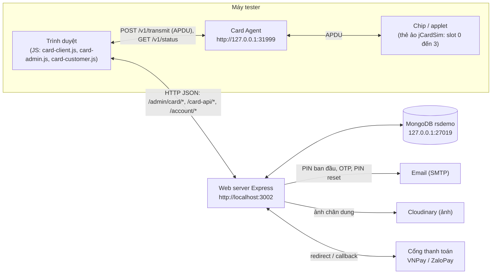
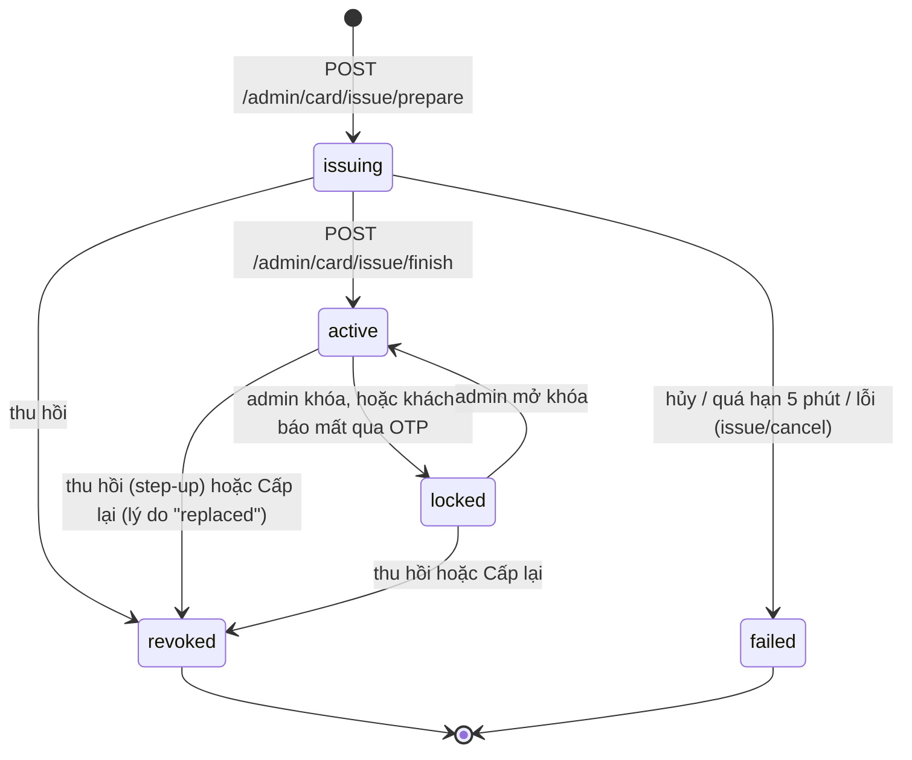
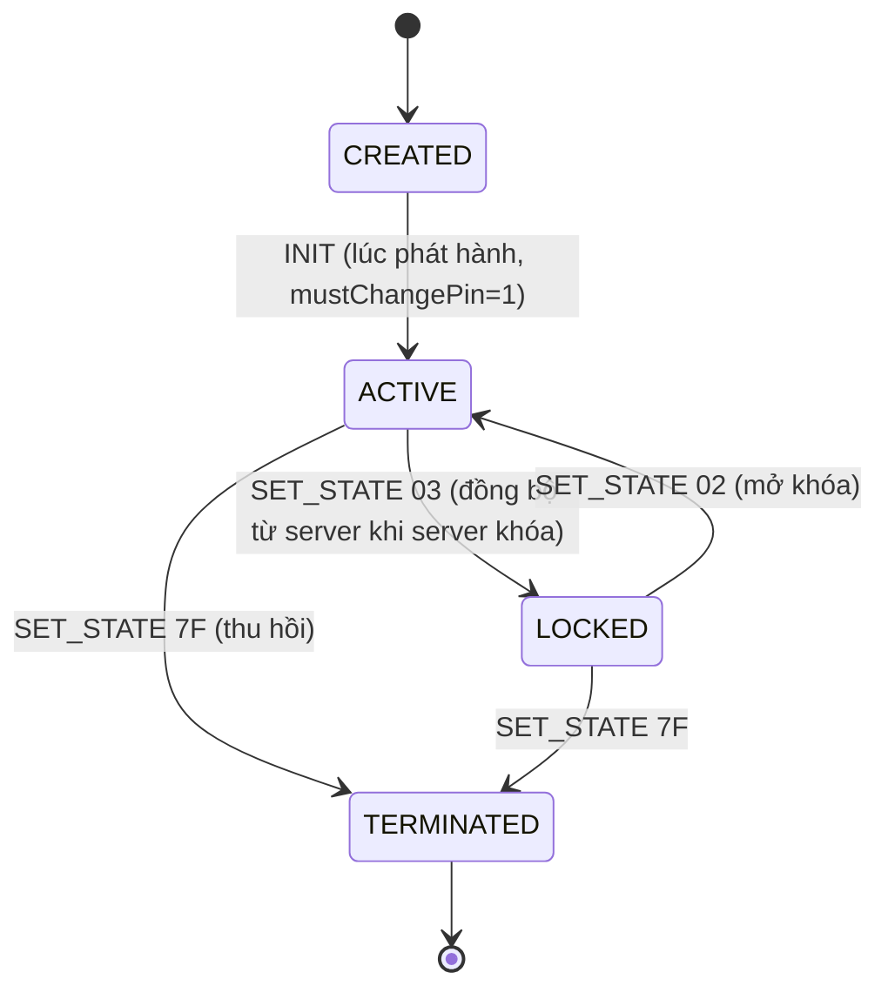
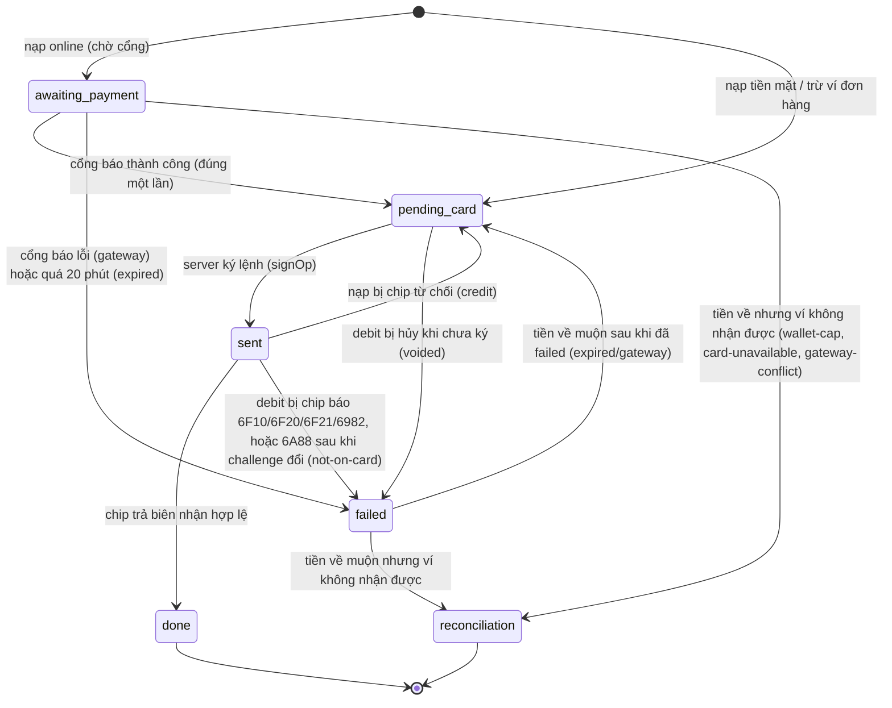
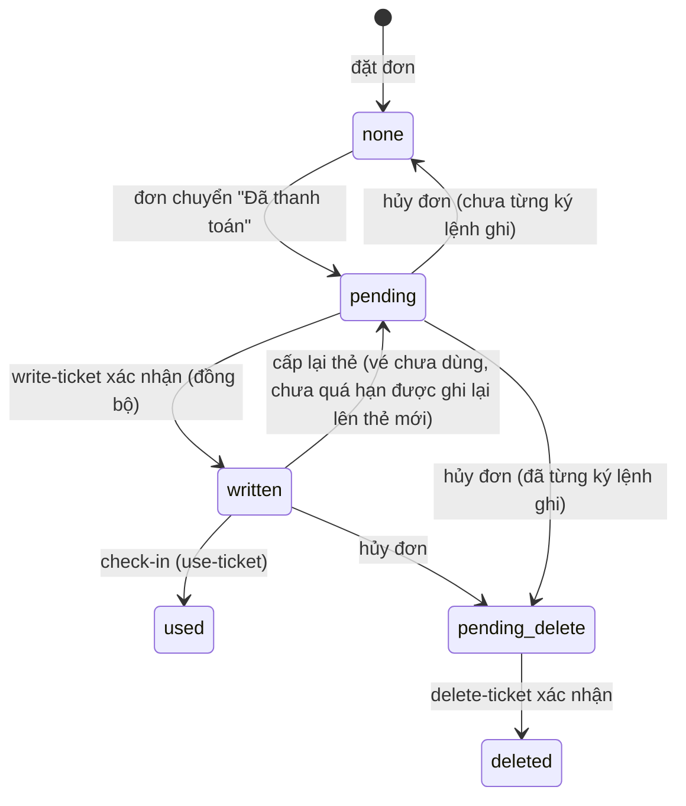

# 00. Tổng quan hệ thống thẻ thông minh và chuẩn bị môi trường

> Tài liệu này dành cho người **chưa hiểu thẻ hoạt động thế nào** và sẽ test tay bằng trình duyệt. Mọi chi tiết được rút ra từ mã nguồn của nhánh `feature/smartcard`. Chỗ nào chưa chắc chắn được ghi rõ là "chưa xác minh".
> Mục lục toàn bộ tài liệu: [README.md](README.md).

## 1. Thẻ thông minh là gì trong dự án này

Website du lịch (Express + Pug + MongoDB) được bổ sung **thẻ thành viên Java Card**. Một chiếc thẻ là một con chip chạy applet `TravelCardApplet` (AID `F054524156454C01`), lưu bên trong:

| Dữ liệu trên chip | Ghi chú |
|---|---|
| Mã thẻ (`cardId`, 16 byte = 32 ký tự hex) | Xóa trắng khi bị thu hồi (TERMINATE) |
| Loại thẻ: khách (1) hoặc nhân viên (2) | |
| PIN 6 chữ số, tối đa 5 lần thử sai | Sai quá 5 lần là PIN bị khóa |
| Cặp khóa RSA của thẻ | Dùng để chứng minh "đúng thẻ này" khi đăng nhập và để ký biên nhận |
| Hồ sơ (tối đa 448 byte) và ảnh JPEG chân dung (tối đa 10 080 byte) | Chỉ đọc được sau khi nhập đúng PIN |
| Ví tiền (chỉ thẻ khách): số dư tối đa **50.000.000 đ** + bộ đếm giao dịch | |
| Nhật ký giao dịch trên chip: 10 mục gần nhất | |
| Vé điện tử: tối đa **5 vé** cùng lúc | Trạng thái trên chip: 1 = chưa dùng (VALID), 2 = đã dùng (USED) |

Thẻ **không tự nói chuyện với website**. Trình duyệt đứng giữa: trình duyệt gọi **Card Agent** (một chương trình Java chạy trên máy bạn, ở cổng `31999`) để gửi lệnh APDU xuống thẻ, và gọi **Web server** để xin lệnh có chữ ký. Server giữ "sổ cái" tiền và vé; chip giữ số dư thật. Hai bên phải luôn khớp nhau, việc đưa chúng về khớp gọi là **đồng bộ (sync)**.

### 1.1 Các bên tham gia (actors)

| Actor | Làm gì |
|---|---|
| **Admin / nhân viên** (đăng nhập `/admin`) | Phát hành thẻ, khóa/thu hồi, nạp tiền mặt, check-in, xem nhật ký... Có thể bắt buộc dùng **thẻ nhân viên** để đăng nhập. |
| **Khách hàng** (đăng nhập `/account/login`) | Đăng nhập bằng **thẻ khách + PIN**, xem thẻ, nạp ví, đặt tour và trả bằng ví thẻ, báo mất thẻ. |
| **Card Agent** | Cầu HTTP giữa trình duyệt và chip. Chế độ giả lập `--sim` có 4 thẻ ảo (slot 0 đến 3). |
| **Chip (applet)** | Thực thi lệnh, kiểm tra PIN, kiểm tra chữ ký của server. |

### 1.2 Sơ đồ kiến trúc



Nguyên tắc an toàn quan trọng (giúp bạn hiểu các thông báo lỗi sau này):

1. **Server ký lệnh nhạy cảm** (nạp, trừ tiền, ghi/xóa vé, reset PIN, khóa/thu hồi, ghi hồ sơ). Chip chỉ chấp nhận lệnh có chữ ký server **và** đúng `challenge` vừa xin từ chip (`GET_CHALLENGE`). Challenge dùng một lần.
2. **Chip ký biên nhận** (receipt) cho mỗi lần nạp/trừ. Server chỉ ghi sổ khi biên nhận hợp lệ.
3. **PIN không bao giờ gửi lên server**; PIN chỉ đi từ trình duyệt xuống chip qua Agent.
4. Mỗi request thẻ phải cùng Origin với web (`http://localhost:3002`); Agent cũng kiểm Origin và Host.

## 2. Loại thẻ và trạng thái

### 2.1 Loại thẻ

| Loại | `cardType` server | Mã trên chip | Dùng để |
|---|---|---|---|
| Thẻ nhân viên | `staff` | 2 | Đăng nhập admin (khi tài khoản bị bắt buộc dùng thẻ), step-up. Không có ví, không có vé. |
| Thẻ khách hàng | `customer` | 1 | Đăng nhập khách, ví, vé, check-in. |

Mỗi chủ thẻ chỉ có **một thẻ hiện hành** (`isCurrent`) cho mỗi loại (chỉ mục duy nhất theo `ownerId` + `cardType`).

### 2.2 Trạng thái thẻ trên server (`Card.status`)

Giá trị thật: `issuing`, `active`, `locked`, `revoked`, `failed`. Nhãn hiển thị trong admin: "Đang phát hành", "Đang hoạt động", "Đã khóa", "Đã thu hồi", "Phát hành thất bại".



`isCurrent = true` khi trạng thái là `issuing`, `active` hoặc `locked`; `false` khi `revoked`/`failed`.

### 2.3 Trạng thái thẻ trên chip (`GET_PUBLIC_INFO`)

| Mã | Tên | Ý nghĩa |
|---|---|---|
| `0x00` | CREATED | Thẻ trắng, chưa phát hành. Chỉ nhận `GET_PUBLIC_INFO` và `INIT`. |
| `0x02` | ACTIVE | Hoạt động. Nếu `mustChangePin = 1` thì chỉ nhận một số lệnh (xem 3.1). |
| `0x03` | LOCKED | Bị khóa: chỉ nhận `GET_PUBLIC_INFO`, `GET_CHALLENGE`, `SET_STATE`. |
| `0x7F` | TERMINATED | Bị thu hồi vĩnh viễn: dữ liệu bị xóa, chỉ nhận `GET_PUBLIC_INFO`. |



**Server khóa/thu hồi không chạm chip ngay.** Trạng thái chip chỉ đổi khi thẻ được cắm và đồng bộ (`/card-api/sync/next` phát hiện `Card.status` khác trạng thái chip và tạo lệnh `set-state`). Đây là lý do nhiều bước test yêu cầu "cắm thẻ để đồng bộ".

## 3. Các khái niệm chính

### 3.1 PIN

| Quy tắc | Giá trị (theo mã) |
|---|---|
| Định dạng | Đúng 6 chữ số. Sai định dạng: "Mã PIN phải gồm đúng 6 chữ số." (trong modal) |
| Số lần thử | Tối đa 5. Sai thì chip trả `63Cx` (x = số lần còn lại): "Sai mã PIN, còn x lần thử". Hết lượt: `6983` "PIN đã bị khoá" |
| PIN yếu (bị từ chối) | 6 chữ số giống nhau (`111111`); dãy liên tiếp tăng hoặc giảm (`123456`, `234567`, `012345`, `654321`...); trùng `DDMMYY` ngày sinh (chỉ kiểm khi biết ngày sinh; cả khách và nhân viên đều kiểm, riêng thẻ mới có thể chặn đọc hồ sơ nên kiểm lại ngay sau khi đổi) |
| PIN ban đầu / PIN reset | Do server sinh ngẫu nhiên, không yếu, không trùng ngày sinh. Gửi email và hiển thị **một lần** |
| `mustChangePin` | Thẻ vừa phát hành hoặc vừa được admin reset PIN buộc phải đổi PIN trước khi dùng. Khi đó chip chỉ nhận `GET_PUBLIC_INFO`, `VERIFY_PIN`, `CHANGE_PIN`, `RESET_PIN`, `GET_CHALLENGE`, `GET_CARD_PUBKEY`, `BEGIN_WRITE`, `WRITE_CHUNK`, `COMMIT_WRITE`, `SET_STATE`; mọi lệnh khác trả `6985` |
| Thông báo PIN yếu | Khách: "PIN quá yếu (không dùng 6 số giống nhau, dãy số liên tiếp hoặc ngày sinh DDMMYY). Vui lòng nhập mã khác." Admin dùng cùng câu này (kể cả DDMMYY). Cả hai hiện **ngay trong modal PIN, modal không đóng**, bạn nhập lại luôn |
| Nhập lại không khớp | "PIN nhập lại không khớp. Vui lòng nhập lại." (cũng ở trong modal) |
| Mỗi lần trả tiền | `DEBIT` luôn xóa phiên PIN sau lệnh, nên **mỗi giao dịch trừ tiền đều hỏi PIN** |

### 3.2 Ví: số dư server và số dư chip

- Server có `Card.balance` (sổ cái), chip có số dư riêng. Chúng chỉ khớp sau khi mỗi giao dịch được **biên nhận** của chip xác nhận.
- **Credit chờ ghi (pending credit)**: tiền đã thu (tiền mặt tại quầy, cổng online) hoặc tiền hoàn do hủy đơn ví thẻ (`source refund`, xem [11](11-huy-don-xoa-ve.md)) nhưng chưa ghi xuống chip. Giao dịch ở trạng thái `pending-card`, được ghi xuống chip ở lần đồng bộ kế tiếp.
- Hạn mức ví: **50.000.000 đ**; nạp tối thiểu **10.000 đ**; tiền mặt tối đa **20.000.000 đ mỗi nhân viên mỗi ngày** (ngày theo giờ Việt Nam, UTC+7).
- Trang "Thẻ của tôi" có ô "Số dư hệ thống" (server) và "Số dư trên thẻ" (chỉ hiện sau khi bấm "Đọc thẻ"). Nếu lệch: banner "Số dư trên thẻ và hệ thống chưa khớp — đang đồng bộ".

Trạng thái giao dịch ví (`CardTransaction.status`): `awaiting-payment`, `pending-card`, `sent`, `done`, `failed`, `reconciliation`. Trường phụ: `source` (`cash`, `zalopay`, `vnpay`, `order`, `transfer`, `refund`), `failReason` (`expired`, `gateway`, `voided`, `moved`, `refunded`, `not-on-card`), `reconciliationReason` (`wallet-cap`, `card-unavailable`, `gateway-conflict`).



(`awaiting_payment` = `awaiting-payment`, `pending_card` = `pending-card` trong DB.)

### 3.3 Vé điện tử (ticket)

Mỗi mục (item) trong đơn hàng có `ticketStatus`:

| Giá trị | Nghĩa |
|---|---|
| `none` | Chưa có vé (đơn chưa thanh toán) |
| `pending` | Đơn đã thanh toán, vé chờ ghi lên thẻ |
| `written` | Đã ghi lên chip (chip: "Chưa dùng") |
| `used` | Đã check-in (chip: "Đã dùng") |
| `pending-delete` | Đơn bị hủy, vé chờ xóa khỏi chip |
| `deleted` | Đã xóa khỏi chip |



### 3.4 Step-up (xác thực lại nhân viên, 5 phút)

Thao tác nhạy cảm cần **chứng minh lại bằng thẻ nhân viên** trong vòng **5 phút** (`stepUpAt` trong JWT admin): **nạp tiền mặt, reset PIN, thu hồi thẻ, cấp lại thẻ**. Khi đăng nhập admin bằng thẻ, `stepUpAt` được đặt ngay lúc đó nên 5 phút đầu không cần step-up lại.

Chỉ có hiệu lực nếu phiên đăng nhập **có thẻ nhân viên** (JWT có `cardId`). Tài khoản chưa có thẻ nhân viên sẽ không thể step-up (xem 92).

Khi server trả `{"code":"step-up-required"}`, giao diện bắt bạn: cắm **thẻ nhân viên** của tài khoản đang đăng nhập, nhập PIN thẻ nhân viên, rồi tự gửi lại yêu cầu (hoặc bảo bạn bấm lại).

### 3.5 Nhật ký (CardLog) và hạng thành viên

- Mọi bước quan trọng (và cả lần bị từ chối) ghi vào nhật ký `card-logs` với `action`, `result` (`success`/`fail`), `detail`. PIN, OTP, mật khẩu, khóa bị che. Xem [18-nhat-ky-the.md](18-nhat-ky-the.md).
- **Hạng thành viên** theo `totalSpent` của khách (cộng dồn khi đơn được thanh toán): Standard (dưới 10.000.000) giảm 0%; Silver (từ 10.000.000) giảm 3%; Gold (từ 30.000.000) giảm 5%; Platinum (từ 80.000.000) giảm 8%. Giảm giá `= round(tạm tính x %)`, chỉ áp dụng cho khách đã đăng nhập bằng thẻ.

### 3.6 Sync và biên nhận (receipt)

Mỗi khi trình duyệt "mở phiên thẻ" (`openSession`), nó chạy tối đa **10 vòng** hỏi `POST /card-api/sync/next`. Server trả về bước kế tiếp theo thứ tự ưu tiên:

1. Có giao dịch đã ký/đã gửi chưa xong: bước `receipt` (đọc lại biên nhận từ chip bằng `GET_RECEIPT`).
2. Trạng thái chip khác server: lệnh `set-state`.
3. Credit chờ ghi (`credit`).
4. Vé chờ xóa (`delete-ticket`).
5. Vé chờ ghi (`write-ticket`).

Các bước cần **chủ thể được phép** (khách đã đăng nhập cùng thẻ, hoặc admin có quyền tương ứng): nếu chưa đăng nhập, server trả `requiresAuth: true` và dừng êm. Bộ chống dồn dập: 60 yêu cầu sync mỗi phút cho mỗi (thẻ, IP), vượt thì HTTP 429 `RATE_LIMITED` "Thao tác đồng bộ thẻ quá nhanh, vui lòng thử lại sau."

## 4. Quyền (permission) liên quan thẻ

Tạo/sửa nhóm quyền ở trang **Nhóm quyền** (`/admin/setting/role/...`). Quyền thẻ (`config/permission.js`):

| Quyền | Nhãn | Mở khóa |
|---|---|---|
| `card-view` | Xem thẻ thành viên | Menu "Quản lý thẻ", danh sách, chi tiết thẻ, thống kê thẻ trên dashboard, menu "Quản lý khách hàng" |
| `card-issue` | Phát hành thẻ | Trang và API phát hành; Quản lý khách hàng; cùng `card-revoke` thì được Cấp lại thẻ |
| `card-edit` | Sửa hồ sơ thẻ | Form "Sửa hồ sơ / ảnh trên thẻ"; ký lệnh ghi/xóa vé khi đồng bộ bởi admin |
| `card-lock` | Khóa và mở khóa thẻ | Nút Khóa/Mở khóa; nút "Đồng bộ ngay" |
| `card-revoke` | Thu hồi thẻ | Nút Thu hồi (cần step-up); Cấp lại thẻ |
| `card-reset-pin` | Đặt lại PIN thẻ | Nút Reset PIN (cần step-up) |
| `card-topup` | Nạp tiền mặt vào thẻ | Form "Nạp tiền mặt" (cần step-up) |
| `card-checkin` | Điểm danh bằng thẻ | Trang "Check-in tour"; cũng được ký lệnh ghi vé khi đồng bộ |
| `card-log-view` | Xem nhật ký thẻ | Menu và trang "Nhật ký thẻ" |

Thiếu quyền: trang GET hiển thị trang "no-permission" với nội dung **"Bạn không có quyền sử dụng tính năng này!"** (HTTP 403); API trả JSON lỗi `OP_FORBIDDEN`.

## 5. Chuẩn bị môi trường

### 5.1 Các thành phần đang chạy

| Thành phần | Địa chỉ / lệnh | Ghi chú |
|---|---|---|
| Web | `http://localhost:3002` | **Bắt buộc dùng `localhost`**, không dùng `127.0.0.1` (Agent từ chối Origin khác bằng HTTP 403). Chạy bằng nodemon: `yarn start` |
| MongoDB | replica set `rsdemo` tại `127.0.0.1:27019`, DB `vietnam-travel-smartcard-demo`, container Docker `vt-smartcard-demo-mongo` | Phải là replica set vì thanh toán ví/phát hành dùng transaction |
| Dữ liệu mẫu | 30 danh mục, 210 tour, 500 khách, 850 đơn | **Chưa có thẻ nào** |
| Card Agent (giả lập) | `cd smartcard && ./gradlew :agent:run --args="--sim"` tại `http://127.0.0.1:31999` | 4 thẻ ảo slot 0 đến 3, mặc định cắm slot 0 |
| Admin | `dangninh138@gmail.com` / `Admin@123` | Nhóm quyền "Demo Smartcard Full" (đủ quyền); `cardRequired = false` cho đến khi phát hành thẻ nhân viên cho chính tài khoản này |
| Email (SMTP) và Cloudinary | Thật theo `.env` | Ảnh khi phát hành được tải lên Cloudinary; PIN ban đầu, OTP báo mất, PIN reset gửi qua email |
| VNPay / ZaloPay | Khóa VNPay trống (`VNPAY_CODE`, `VNPAY_SECRET` đều rỗng trong `.env`); ZaloPay cần `DOMAIN_WEBSITE` công khai (ngrok) | Nạp online hầu như không test được trên local. Nạp tiền mặt thì được |

Kiểm tra Agent:

```bash
curl -H 'Origin: http://localhost:3002' http://127.0.0.1:31999/v1/status
# kỳ vọng: {"mode":"sim","reader":"jCardSim","cardPresent":true,"slot":0}
```

Đổi thẻ đang cắm (slot):

```bash
curl -X POST -H 'Origin: http://localhost:3002' -H 'Content-Type: application/json' \
  -d '{"slot":1}' http://127.0.0.1:31999/v1/sim/slot
# trả {"slot":1}. slot ngoài 0..3 hoặc body sai: HTTP 400
```

Reset một thẻ ảo về trắng (CREATED), **không đổi slot đang cắm**:

```bash
curl -X POST -H 'Origin: http://localhost:3002' -H 'Content-Type: application/json' \
  -d '{"slot":1}' http://127.0.0.1:31999/v1/sim/reset
```

Trang `/admin/card/issue` còn có nút **"Reset thẻ ảo"** (chỉ hiện khi Agent ở chế độ sim) gọi đúng endpoint này cho slot đang cắm (hỏi xác nhận "Reset thẻ ảo sẽ xóa dữ liệu trong slot hiện tại. Tiếp tục?").

> **Cảnh báo quan trọng:** thẻ ảo nằm **trong bộ nhớ** của Agent. Khởi động lại Agent, hoặc reset slot, xóa sạch chip; còn collection `cards` trong MongoDB vẫn nhớ thẻ đó là `active`. Hệ quả: web vẫn tưởng thẻ còn, chip lại là thẻ trắng. Cách khắc phục xem [92-han-che-va-xu-ly-su-co.md](92-han-che-va-xu-ly-su-co.md). Vì vậy **đừng tắt Agent giữa chừng** khi đang test.

### 5.2 Gợi ý dùng hai hồ sơ trình duyệt

Cookie `token` (admin) và `customerToken` (khách) cùng nằm trên host `localhost`. Khi đồng bộ, nếu có cả hai cookie thì server ưu tiên coi là **khách**. Để tránh lẫn, hãy mở **admin ở một hồ sơ Chrome (hoặc cửa sổ thường)** và **khách ở cửa sổ ẩn danh** (hoặc hồ sơ khác). Cả hai cùng dùng chung một Agent nên chỉ một thẻ ảo được cắm tại một thời điểm: đổi slot bằng `curl` mỗi khi đổi vai.

### 5.3 Kế hoạch slot đề xuất

| Slot | Vai trò | Ghi chú |
|---|---|---|
| 0 | Thẻ nhân viên của admin `dangninh138@gmail.com` | Dùng cho đăng nhập admin và step-up |
| 1 | Thẻ khách A | Khách chính (nạp, mua, check-in, báo mất) |
| 2 | Thẻ cấp lại (thay thẻ khách A) | Dùng ở bài Cấp lại thẻ |
| 3 | Khách B / dự phòng | Thử sai PIN, khóa PIN, reset PIN, thu hồi |

### 5.4 Chuẩn bị chung trước khi test

1. Đảm bảo Mongo, web, Agent đang chạy; `curl .../v1/status` trả `cardPresent: true`.
2. Chuẩn bị **2 địa chỉ email đọc được**: một cho khách A, một cho khách B (khách mới tạo lúc phát hành). Email của admin demo là `dangninh138@gmail.com`, nếu bạn không đọc được hộp thư đó thì PIN ban đầu thẻ nhân viên vẫn **hiện một lần trên màn hình** sau khi phát hành.
3. Chuẩn bị 2 ảnh chân dung (JPEG/PNG bất kỳ; trình duyệt tự cắt giữa 160x200 và nén xuống tối đa 10 080 byte).
4. Một tour dùng cho check-in: sửa `Ngày khởi hành` về **hôm nay** trước khi đặt đơn (xem [10-check-in-tour.md](10-check-in-tour.md)).

## 6. Quy ước dùng trong các file hướng dẫn

- "Cắm slot N" nghĩa là chạy lệnh `curl ... {"slot":N} ... /v1/sim/slot`.
- "Mở phiên thẻ" = trình duyệt chọn applet, đọc `GET_PUBLIC_INFO` rồi đồng bộ (không cần bạn làm gì).
- Tên nút và thông báo được trích nguyên văn từ giao diện và mã nguồn. Thông báo hệ thống có thể bị cắt bớt nếu rất dài.
- Sơ đồ tuần tự dùng các tham gia: Người dùng, Trình duyệt (JS), Web server, MongoDB, Card Agent, Chip.

## 7. Bảng thuật ngữ

| Thuật ngữ | Nghĩa |
|---|---|
| APDU | Lệnh nhị phân gửi xuống chip (INS: `GET_PUBLIC_INFO`, `VERIFY_PIN`, `GET_CHALLENGE`, `DEBIT`, `CREDIT`, `WRITE_TICKET`...) |
| Agent | Card Agent, cầu HTTP cổng 31999 giữa trình duyệt và chip |
| Slot | Khe cắm thẻ ảo 0 đến 3 của Agent `--sim` |
| Challenge | Số ngẫu nhiên chip phát (`GET_CHALLENGE`), server ký kèm lệnh; dùng một lần |
| Op (thao tác ký) | Bản ghi `CardOp`: `draft` -> `prepared` -> `done`/`failed`, hết hạn sau 5 phút |
| Receipt (biên nhận) | 166 byte do chip ký sau nạp/trừ; server chỉ ghi sổ khi hợp lệ |
| Sync (đồng bộ) | Đưa chip và server về khớp (`/card-api/sync/next`, tối đa 10 vòng mỗi lần mở phiên) |
| Pending credit | Tiền đã thu nhưng chưa ghi xuống chip (`pending-card`/`sent`) |
| Step-up | Xác thực lại bằng thẻ nhân viên, hiệu lực 5 phút |
| `cardRequired` | Cờ trên tài khoản admin: bắt buộc đăng nhập bằng thẻ nhân viên |
| `mustChangePin` | Thẻ mới/vừa reset PIN, phải đổi PIN trước khi dùng |
| Reconciliation | Giao dịch cần đối soát thủ công (tiền đã nhận nhưng ví không ghi được) |
| Check-in | Nhân viên xác nhận vé của khách trên thẻ (`USE_TICKET`) |
| Hạng thành viên | Standard/Silver/Gold/Platinum theo `totalSpent` |

## 8. Cách đọc bộ tài liệu

1. Làm theo thứ tự số: 01 (thẻ NV) -> 02 -> 03 (thẻ khách) -> 04 -> 05 -> 06/07 -> 08 -> 09 -> 10 -> 11; các bài 12 trở đi độc lập hơn.
2. Mỗi bài có: Mục đích, Ai thực hiện & quyền, Điều kiện trước, Sơ đồ, Các bước test, Kết quả mong đợi, Ngoại lệ & lỗi, Checklist, Liên quan.
3. Thông báo trong dấu ngoặc kép được trích nguyên văn từ mã nguồn; mục "(chưa xác minh)" là suy luận từ mã, chưa chạy thật.
4. Đừng khởi động lại Agent giữa chừng (xem cảnh báo ở 5.1).
