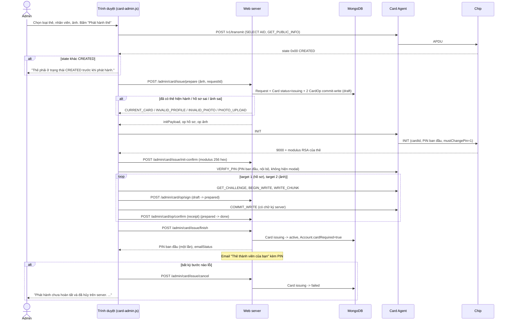
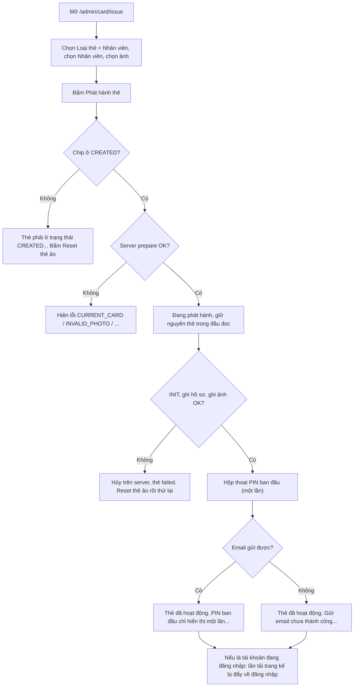

# 01. Phát hành thẻ nhân viên

Bài này hướng dẫn cấp một thẻ nhân viên (Java Card) cho một tài khoản admin tại trang `/admin/card/issue`. Sau khi xong, tài khoản đó bị bắt buộc đăng nhập bằng thẻ + PIN.

## Mục đích

- Cấp thẻ nhân viên cho một tài khoản admin: server tạo yêu cầu phát hành, trình duyệt ghi khóa/hồ sơ/ảnh xuống chip qua Card Agent, server kích hoạt thẻ.
- Sau khi phát hành, tài khoản có `cardRequired = true`: token đăng nhập cũ (không có `cardId`) bị từ chối, lần đăng nhập sau bắt buộc cắm thẻ + PIN (xem [02](02-dang-nhap-admin-bang-the.md)).
- PIN ban đầu do server sinh, **chỉ hiện một lần** trên màn hình và gửi qua email (tiêu đề "Thẻ thành viên của bạn").

## Ai thực hiện & quyền

| Mục | Giá trị |
|---|---|
| Vai trò | Admin (tài khoản demo `dangninh138@gmail.com` / `Admin@123`, nhóm quyền "Demo Smartcard Full") |
| Quyền | `card-issue` (trang và các API `/admin/card/issue/*`, `/admin/card/op/*` khi thẻ ở trạng thái `issuing`) |
| Step-up | Không cần. Cũng chưa cần thẻ nhân viên vì tài khoản chưa có thẻ |
| Thiếu quyền | Trang trả 403 "Bạn không có quyền sử dụng tính năng này!" |

## Điều kiện trước

- Đã làm xong [00](00-tong-quan.md): Mongo `rsdemo` (127.0.0.1:27019, container `vt-smartcard-demo-mongo`), web `http://localhost:3002`, Agent `cd smartcard && ./gradlew :agent:run --args="--sim"`.
- Cắm **slot 0** và slot 0 phải là thẻ trắng (CREATED). Agent mới khởi động thì đúng; nếu không chắc, bấm nút "Reset thẻ ảo" (hỏi xác nhận "Reset thẻ ảo sẽ xóa dữ liệu trong slot hiện tại. Tiếp tục?", xong báo "Đã reset thẻ ảo; có thể bắt đầu phát hành lại.").
- Kiểm tra: `curl -H 'Origin: http://localhost:3002' http://127.0.0.1:31999/v1/status` trả `"slot":0`, `"cardPresent":true`.
- Đăng nhập admin (chưa cần thẻ). Tài khoản cần có email (nếu không: `OWNER_STATE`).
- Một ảnh chân dung bất kỳ (JPEG/PNG; trình duyệt tự cắt giữa 160x200 và nén tối đa 10 080 byte).
- Biết trước: email của admin demo có thể bạn không đọc được; không sao, PIN vẫn hiện trên màn hình.

## Sơ đồ luồng hoạt động

### Sơ đồ tuần tự

### Sơ đồ quyết định (giao diện)

## Các bước test (happy path)

1. Cắm slot 0 (nếu cần: `curl -X POST -H 'Origin: http://localhost:3002' -H 'Content-Type: application/json' -d '{"slot":0}' http://127.0.0.1:31999/v1/sim/slot`).
2. Đăng nhập `http://localhost:3002/admin/account/login` bằng `dangninh138@gmail.com` / `Admin@123` (nhãn "Email", "Mật khẩu", nút "Đăng Nhập").
3. Vào sidebar "Quản lý thẻ" -> "Phát hành thẻ" (`/admin/card/issue`).
4. Ở "Loại thẻ" chọn **Nhân viên**. Ô "Nhân viên" hiện ra thay cho "Khách hàng hiện có".
5. Chọn chính tài khoản demo trong "Nhân viên".
6. Ở "Ảnh chân dung (cắt giữa 160 × 200)" chọn một ảnh (bắt buộc). Xem ảnh xem trước 160x200.
7. Bấm **"Phát hành thẻ"**. Dòng trạng thái: "Đang phát hành, giữ nguyên thẻ trong đầu đọc…". Không có modal PIN trong bước này (VERIFY_PIN chạy ngầm với PIN ban đầu).
8. Chờ xong. Hộp thoại **"PIN ban đầu — chỉ hiển thị một lần"** hiện PIN 6 số; ghi lại. Bấm **"Đã ghi nhận, đóng"**.
9. Đọc thông báo: "Thẻ đã hoạt động. PIN ban đầu chỉ hiển thị một lần; hãy đổi PIN khi đăng nhập." Vì đây là thẻ NV của **chính tài khoản đang đăng nhập** (phiên chỉ có mật khẩu, token chưa có `cardId`), server trả `reloginRequired` và giao diện thêm câu: "Thẻ nhân viên của chính bạn đã được kích hoạt: sau khi đóng hộp PIN, bạn sẽ được đăng xuất để đăng nhập lại bằng mật khẩu và thẻ."
10. Mở hộp thư của admin (nếu đọc được): email "Thẻ thành viên của bạn".
11. Mở "Quản lý thẻ" -> `/admin/card/list`: thẻ loại Nhân viên, trạng thái "Đang hoạt động".
12. Ngay sau khi đóng hộp PIN (bước 8), trang **tự đăng xuất** (`POST /admin/account/logout`) và chuyển tới `/admin/account/login?notice=card-required`; trang đăng nhập hiện "Tài khoản đã được yêu cầu đăng nhập bằng thẻ nhân viên. Vui lòng đăng nhập lại bằng mật khẩu và thẻ." (không cần tự tải lại). Nếu vẫn mở một tab admin cũ và tải lại: trang bị chuyển về đăng nhập với cùng thông báo, còn XHR/JSON nhận 403 `CARD_RELOGIN_REQUIRED` cùng câu đó. Nếu bạn phát hành cho **nhân viên khác**, phiên hiện tại không bị đăng xuất.
13. Tiếp tục ở [02](02-dang-nhap-admin-bang-the.md) bằng PIN vừa ghi.

## Kết quả mong đợi

**Trên giao diện**
- Hộp thoại PIN ban đầu một lần, thông báo thành công (hoặc cảnh báo email thất bại).
- `/admin/card/list` có thẻ mới "Nhân viên / Đang hoạt động".

**Trên chip** (mở lại phiên thẻ / "Đọc thẻ" ở 02)
- Trạng thái ACTIVE (0x02), `cardType` = 2, `mustChangePin` = 1.
- Hồ sơ và ảnh đã ghi (đọc được sau khi VERIFY_PIN).

**Trong dữ liệu**
- `cards`: bản ghi mới `status: issuing` rồi `active`, `cardType: staff`, `isCurrent: true`, lưu modulus RSA.
- Request phát hành: đóng khi `finish`. Hai `CardOp` commit-write: `draft` -> `prepared` -> `done`.
- `accounts`: `cardRequired = true` cho tài khoản được cấp.

**Trong Nhật ký thẻ** (`/admin/card/log`)
- `issue` (success), kèm các `card-op-sign` / `card-op-confirm`. Khi hủy: `issue-cancel`.

## Ngoại lệ & trường hợp lỗi

| # | Tình huống | Cách tái hiện | Kết quả / thông báo mong đợi |
|---|---|---|---|
| 1 | Thẻ không phải CREATED | Phát hành lần 2 vào cùng slot 0 | "Thẻ phải ở trạng thái CREATED trước khi phát hành." |
| 2 | Người này đã có thẻ hiện hành | Reset slot rồi phát hành lại cho cùng nhân viên | `CURRENT_CARD` "Người này đã có thẻ đang hoạt động" |
| 3 | Chọn file không phải ảnh (bằng "All files") | Chọn file `.txt` đổi đuôi | Client: "Ảnh không thể đọc; hãy chọn ảnh khác." |
| 4 | Ảnh vẫn quá lớn sau khi nén | Ảnh cực lớn/nhiễu | "Ảnh vẫn quá 10 080 byte; hãy chọn ảnh khác." |
| 5 | Server từ chối ảnh | Ảnh không phải JPEG hợp lệ/quá 10 080 byte tới server | `INVALID_PHOTO` "Ảnh phải là JPEG hợp lệ và không quá 10 080 byte." |
| 6 | Lưu ảnh Cloudinary lỗi | Ngắt mạng khi bấm Phát hành | `PHOTO_UPLOAD` "Không thể lưu ảnh; chưa phát hành thẻ." (nếu Cloudinary ném lỗi thô: 500 "Không thể xử lý yêu cầu thẻ.") |
| 7 | Yêu cầu quá 5 phút / đã đóng | Bỏ dở rồi gọi tiếp (F5 giữa chừng) | `ISSUE_EXPIRED`/`ISSUE_CLOSED` "Yêu cầu phát hành thẻ không hợp lệ hoặc đã kết thúc." |
| 8 | Đang chuẩn bị mà gửi lại | Double click "Phát hành thẻ" | `ISSUE_PREPARING` "Yêu cầu đang chuẩn bị; hãy hủy yêu cầu trước khi thử lại." |
| 9 | Hủy giữa chừng | Tắt Agent khi đang chạy | "Phát hành chưa hoàn tất và đã hủy trên server. Hãy cài lại applet trên thẻ thật hoặc reset thẻ ảo trước khi thử lại." (Agent tắt: "Không kết nối được Card Agent") |
| 10 | Email gửi lỗi | SMTP sai | "Thẻ đã hoạt động. Gửi email chưa thành công; PIN chỉ hiển thị một lần bên dưới." |
| 11 | Chủ thẻ không có email | Tài khoản không có email | `OWNER_STATE` "Yêu cầu phát hành thẻ không hợp lệ hoặc đã kết thúc." |
| 12 | Thiếu quyền | Đăng nhập tài khoản không có `card-issue` | 403 "Bạn không có quyền sử dụng tính năng này!" |
| 13 | Sai slot / Agent tắt | Agent dừng hoặc slot không đúng | "Không kết nối được Card Agent" (hoặc "Thẻ phải ở trạng thái CREATED...") |
| 14 | Mất mạng tới server | Ngắt mạng sau khi prepare | Admin hiển thị `REQUEST_TIMEOUT` bằng tiếng Việt: "Yêu cầu quá thời gian. Hãy kiểm tra kết nối rồi thử lại; nếu đang thu tiền, hãy đối chiếu giao dịch, không thu lần nữa." (không còn mã thô) |
| 15 | Phát hành thẻ NV cho chính mình | Bước 5 chọn tài khoản đang đăng nhập | Thành công, rồi tự đăng xuất và chuyển về `/admin/account/login?notice=card-required` (xem bước 9, 12). Mất thẻ/PIN sau đó: [15](15-sai-pin-khoa-pin-reset-pin.md) và script khôi phục trong [92](92-han-che-va-xu-ly-su-co.md) |

Sau mọi lỗi giữa chừng: bấm "Reset thẻ ảo" rồi thử lại.

## Checklist

- [ ] Happy path: PIN ban đầu hiện một lần, thẻ "Đang hoạt động", `cardRequired` bật
- [ ] Email "Thẻ thành viên của bạn" nhận được
- [ ] Sau khi đóng hộp PIN: tự đăng xuất, về trang đăng nhập có thông báo `card-required`
- [ ] Hàng 1 (không CREATED)
- [ ] Hàng 2 (đã có thẻ hiện hành)
- [ ] Hàng 3, 4, 5 (ảnh)
- [ ] Hàng 6 (Cloudinary)
- [ ] Hàng 7 (quá hạn/đã đóng)
- [ ] Hàng 8 (double submit)
- [ ] Hàng 9 (hủy giữa chừng, reset)
- [ ] Hàng 10 (email lỗi)
- [ ] Hàng 11, 12, 13, 14, 15

## Liên quan

[02 Đăng nhập admin bằng thẻ](02-dang-nhap-admin-bang-the.md) | [13 Khóa, thu hồi](13-khoa-mo-khoa-thu-hoi-the.md) | [91 Mã lỗi](91-bang-ma-loi.md) | [92 Sự cố](92-han-che-va-xu-ly-su-co.md)
