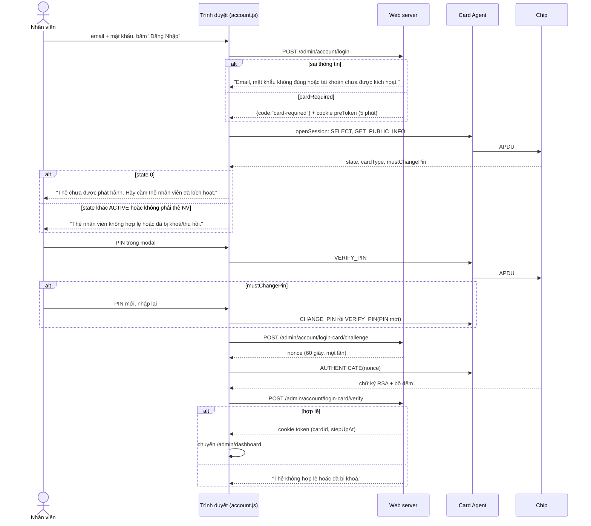
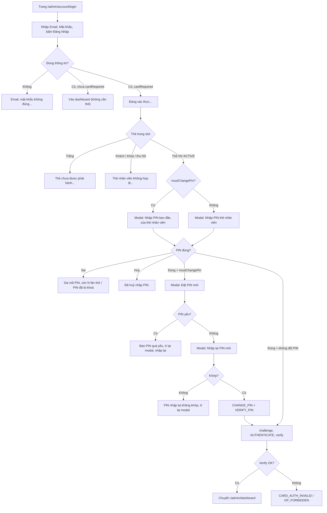

# 02. Đăng nhập admin bằng thẻ nhân viên (kèm đổi PIN lần đầu)

Khi tài khoản admin có `cardRequired = true`, mật khẩu đúng chưa đủ: phải cắm thẻ nhân viên, nhập PIN và chứng minh sở hữu khóa riêng của thẻ. Lần đầu thẻ còn `mustChangePin` nên bắt buộc đặt PIN mới.

## Mục đích

- Kiểm tra đăng nhập hai lớp: mật khẩu (server cấp `preToken` 5 phút) rồi thẻ (challenge-response, nonce 60 giây dùng một lần).
- Kiểm tra đổi PIN lần đầu: chọn PIN mới, PIN yếu và nhập lại không khớp bị chặn ngay trong modal.
- Sau khi thành công, JWT admin có `cardId` và `stepUpAt` (5 phút đầu không cần step-up).

## Ai thực hiện & quyền

| Mục | Giá trị |
|---|---|
| Vai trò | Nhân viên đã có thẻ nhân viên (tài khoản demo sau bài 01) |
| Quyền | Không cần permission thẻ để đăng nhập |
| Step-up | Đăng nhập thành công đặt `stepUpAt` = bây giờ, hiệu lực 300 000 ms |

## Điều kiện trước

- Đã xong [01](01-phat-hanh-the-nhan-vien.md); có PIN ban đầu (từ màn hình/email).
- Cắm **slot 0** (thẻ nhân viên). Agent `--sim` đang chạy.
- Đã đăng xuất admin (hoặc chờ bị đẩy ra ở bước 12 của 01). Có thể dùng cửa sổ ẩn danh.
- Với tài khoản `cardRequired`, mất PIN: xem [15](15-sai-pin-khoa-pin-reset-pin.md).

## Sơ đồ luồng hoạt động

### Sơ đồ tuần tự

### Sơ đồ quyết định (giao diện)

## Các bước test (happy path)

1. Cắm slot 0: `curl -X POST -H 'Origin: http://localhost:3002' -H 'Content-Type: application/json' -d '{"slot":0}' http://127.0.0.1:31999/v1/sim/slot`.
2. Mở `http://localhost:3002/admin/account/login`.
3. Nhập "Email" = `dangninh138@gmail.com`, "Mật khẩu" = `Admin@123`; bấm **"Đăng Nhập"**. Dòng trạng thái: "Đang xác thực…".
4. Modal PIN tiêu đề **"Nhập PIN ban đầu của thẻ nhân viên"** (lần đầu). Nhập PIN ban đầu 6 số (nhãn "Mã PIN (6 chữ số)"), bấm "Xác nhận".
5. Modal **"Đặt PIN mới (không dùng mã yếu hoặc ngày sinh)"**. Thử `111111`: modal không đóng, báo "PIN quá yếu (không dùng 6 số giống nhau, dãy số liên tiếp hoặc ngày sinh DDMMYY). Vui lòng nhập mã khác." Thử `123456`: tương tự. Thử PIN trùng **ngày sinh** của chủ thẻ theo dạng DDMMYY (ví dụ sinh 05/03/1990 thì `050390`): cũng bị chặn ngay trong modal với cùng câu. Trang đọc ngày sinh từ hồ sơ trên thẻ; nếu thẻ mới chặn đọc hồ sơ (6985) thì chưa biết ngày sinh, trang kiểm lại ngay sau khi đổi và hỏi "PIN vừa chọn trùng ngày sinh. Nhập PIN hiện tại để đổi lại". Nhập PIN tốt, ví dụ `482915`.
6. Modal **"Nhập lại PIN mới"**. Nhập `482916`: "PIN nhập lại không khớp. Vui lòng nhập lại." (ở lại modal). Nhập `482915`.
7. Hệ thống chạy `CHANGE_PIN`, `VERIFY_PIN`, challenge, AUTHENTICATE, verify, rồi chuyển về `/admin/dashboard`.
8. Đăng xuất, đăng nhập lại: modal chỉ còn **"Nhập PIN thẻ nhân viên"**, không còn bước đổi PIN.
9. Quên mật khẩu (`/admin/account/forgot-password`) với tài khoản `cardRequired`: sau khi đặt lại mật khẩu phải **đăng nhập lại** bằng thẻ, không vào thẳng dashboard.

## Kết quả mong đợi

**Trên giao diện**
- Chuyển tới `/admin/dashboard`; sidebar có "Quản lý thẻ" nếu có quyền.

**Trên chip**
- `mustChangePin` về 0, PIN mới có hiệu lực; số lần thử PIN về 5; bộ đếm tăng sau AUTHENTICATE.

**Trong dữ liệu**
- Cookie `token` chứa `cardId` và `stepUpAt`. Cookie `preToken` hết hạn/xóa.
- Mật khẩu/PIN không lưu ở đâu dạng rõ.

**Trong Nhật ký thẻ**
- `auth` (đăng nhập thẻ nhân viên), success. Lỗi cũng ghi `fail`.

## Ngoại lệ & trường hợp lỗi

| # | Tình huống | Cách tái hiện | Kết quả / thông báo mong đợi |
|---|---|---|---|
| 1 | Sai email/mật khẩu | Nhập sai mật khẩu | "Email, mật khẩu không đúng hoặc tài khoản chưa được kích hoạt." |
| 2 | Thẻ trắng (CREATED) | Cắm slot chưa phát hành (vd 3) | "Thẻ chưa được phát hành. Hãy cắm thẻ nhân viên đã kích hoạt." |
| 3 | Cắm thẻ khách / thẻ khóa / thu hồi | Cắm slot 1 (thẻ khách) | "Thẻ nhân viên không hợp lệ hoặc đã bị khoá/thu hồi." |
| 4 | Agent tắt | Dừng Agent | "Không kết nối được Card Agent" (có thể kèm dấu chấm) |
| 5 | Slot không có thẻ | Với sim, slot luôn có thẻ: "Card Agent chưa sẵn sàng hoặc khe đọc không có thẻ." gần như không xuất hiện (suy ra từ mã, chưa chạy thật) | Xem hàng 4 |
| 6 | Bấm Huỷ ở modal PIN | Bấm "Huỷ" | "Đã huỷ nhập PIN." |
| 7 | Sai PIN | Nhập PIN sai | "Sai mã PIN, còn x lần thử" |
| 8 | PIN bị khóa | Sai 5 lần | "PIN đã bị khoá" (6983); xem [15](15-sai-pin-khoa-pin-reset-pin.md) |
| 9 | PIN sai định dạng | Nhập 5 số | "Mã PIN phải gồm đúng 6 chữ số." (trong modal) |
| 10 | PIN mới yếu hoặc trùng ngày sinh | `111111`, `123456`, hoặc ngày sinh DDMMYY của chủ thẻ | "PIN quá yếu (không dùng 6 số giống nhau, dãy số liên tiếp hoặc ngày sinh DDMMYY). Vui lòng nhập mã khác." (ở lại modal và hỏi lại ngay trong modal; admin nay cũng kiểm DDMMYY) |
| 11 | Nhập lại không khớp | Hai PIN khác nhau | "PIN nhập lại không khớp. Vui lòng nhập lại." |
| 12 | Thẻ của người khác | Cắm thẻ NV của tài khoản khác | `OP_FORBIDDEN` "Thẻ không được phép đăng nhập tài khoản này." |
| 13 | Thẻ bị khóa/thu hồi trên server | Khóa thẻ ở bài 13 rồi đăng nhập | "Thẻ nhân viên đã bị khoá hoặc thu hồi. Liên hệ quản trị viên." |
| 14 | Quá 5 phút từ lúc nhập mật khẩu | Chờ > 5 phút ở modal | `AUTH_REQUIRED` "Phiên xác thực hết hạn. Hãy đăng nhập lại." (server: "Phiên xác thực thẻ đã hết hạn. Hãy đăng nhập lại.") |
| 15 | Nonce hết hạn 60 giây / ký sai | Chờ lâu giữa challenge và verify | `CARD_AUTH_INVALID` "Thẻ không hợp lệ hoặc yêu cầu xác thực đã hết hạn. Hãy thử lại." (server: "Thẻ không hợp lệ hoặc đã bị khoá.") |
| 16 | Double submit | Bấm "Đăng Nhập" hai lần | Nút bị khóa khi đang xử lý, chỉ một lượt chạy |
| 17 | Timeout mạng | Ngắt mạng khi gọi server | `REQUEST_TIMEOUT` "Yêu cầu quá thời gian. Hãy kiểm tra kết nối và Card Agent rồi thử lại." (đã có bản dịch tiếng Việt). Lỗi agent hiện "Không kết nối được Card Agent" |
| 19 | Vừa được bật yêu cầu thẻ khi đang đăng nhập bằng mật khẩu | Tài khoản `cardRequired` mà phiên chỉ có mật khẩu (ví dụ vừa tự phát hành thẻ NV cho chính mình ở [01](01-phat-hanh-the-nhan-vien.md)) rồi tải trang admin | Trang: bị đăng xuất, chuyển về `/admin/account/login?notice=card-required` và hiện "Tài khoản đã được yêu cầu đăng nhập bằng thẻ nhân viên. Vui lòng đăng nhập lại bằng mật khẩu và thẻ." Gọi API/XHR: JSON 403 `CARD_RELOGIN_REQUIRED` cùng câu đó |
| 18 | F5 giữa chừng | F5 khi modal PIN | Về form đăng nhập; `preToken` còn 5 phút nhưng phải nhập lại mật khẩu |

## Checklist

- [ ] Happy path lần đầu (đổi PIN) vào được dashboard
- [ ] Đăng nhập lần hai chỉ hỏi PIN
- [ ] Hàng 1 đến 3
- [ ] Hàng 4, 5 (Agent)
- [ ] Hàng 6 (Huỷ)
- [ ] Hàng 7, 8, 9 (PIN)
- [ ] Hàng 10, 11 (PIN mới trong modal)
- [ ] Hàng 12, 13 (thẻ khác/khóa)
- [ ] Hàng 14, 15 (hết hạn)
- [ ] Hàng 19 (đăng nhập lại sau khi bật yêu cầu thẻ)
- [ ] Hàng 16, 17, 18
- [ ] Quên mật khẩu bắt buộc đăng nhập lại

## Liên quan

[01](01-phat-hanh-the-nhan-vien.md) | [15 Sai PIN](15-sai-pin-khoa-pin-reset-pin.md) | [22 Đăng xuất](22-dang-xuat-phien-the.md) | [92 Sự cố](92-han-che-va-xu-ly-su-co.md)
