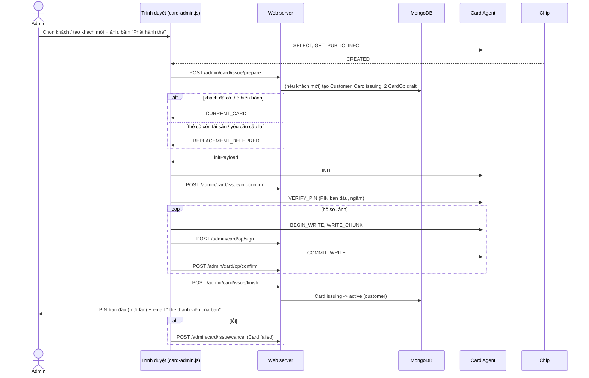
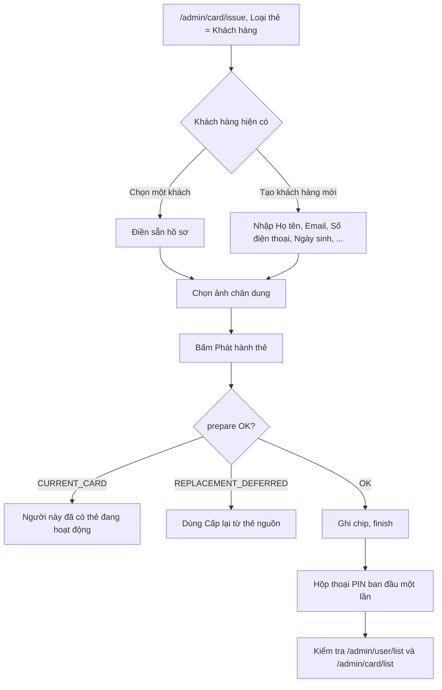

# 03. Phát hành thẻ khách hàng (khách có sẵn và khách mới)

Bài này phát hành thẻ khách hàng ở `/admin/card/issue` cho một khách đã có trong hệ thống hoặc tạo khách mới ngay lúc phát hành.

## Mục đích

- Cấp thẻ khách (ví, vé, check-in) cho khách có sẵn và cho khách mới.
- Kiểm tra hồ sơ ghi lên chip, PIN ban đầu (không trùng ngày sinh DDMMYY), email gửi khách, cột "Trạng thái thẻ hiện hành" ở Quản lý khách hàng.
- Khác 01: `cardRequired` của tài khoản admin **không** đổi.

## Ai thực hiện & quyền

| Mục | Giá trị |
|---|---|
| Vai trò | Admin đã đăng nhập (bằng thẻ nhân viên nếu đã làm 01/02) |
| Quyền | `card-issue` |
| Step-up | Không cần |
| Thiếu quyền | 403 "Bạn không có quyền sử dụng tính năng này!" |

## Điều kiện trước

- Làm [00](00-tong-quan.md); nên làm [01](01-phat-hanh-the-nhan-vien.md) và [02](02-dang-nhap-admin-bang-the.md).
- Slot 1 (khách A) và slot 3 (khách B tạo mới) đều là thẻ trắng (CREATED). Nếu không chắc: "Reset thẻ ảo" hoặc `curl -X POST -H 'Origin: http://localhost:3002' -H 'Content-Type: application/json' -d '{"slot":1}' http://127.0.0.1:31999/v1/sim/reset`.
- **Email đọc được**: khách seed có email giả `vt-demo-NNNN@example.com` và số điện thoại dạng `0000000001` (không đọc được thư, và số điện thoại không hợp lệ cho giỏ hàng). Vì vậy khuyến nghị tạo khách mới bằng email của bạn (khách A cũng nên là khách mới), hoặc dùng PIN hiện một lần trên màn hình. Danh sách "Khách hàng hiện có" lấy tối đa 500 khách đang hoạt động.
- Một ảnh chân dung cho mỗi thẻ.

## Sơ đồ luồng hoạt động

### Sơ đồ tuần tự

### Sơ đồ quyết định (giao diện)

## Các bước test (happy path)

**A. Khách có sẵn (slot 1)**
1. Cắm slot 1: `curl -X POST -H 'Origin: http://localhost:3002' -H 'Content-Type: application/json' -d '{"slot":1}' http://127.0.0.1:31999/v1/sim/slot`.
2. Đăng nhập admin, mở sidebar "Quản lý thẻ" -> "Phát hành thẻ" (`/admin/card/issue`).
3. "Loại thẻ" = **Khách hàng**.
4. Ở "Khách hàng hiện có" chọn một khách (tùy chọn đầu tiên là "Tạo khách hàng mới"). Chọn khách có email bạn đọc được (hoặc sửa email khách ở "Quản lý khách hàng" trước).
5. Chọn "Ảnh chân dung (cắt giữa 160 × 200)".
6. Bấm **"Phát hành thẻ"**, chờ "Đang phát hành, giữ nguyên thẻ trong đầu đọc…".
7. Hộp thoại "PIN ban đầu — chỉ hiển thị một lần": ghi PIN, bấm "Đã ghi nhận, đóng". Thông báo "Thẻ đã hoạt động. PIN ban đầu chỉ hiển thị một lần; hãy đổi PIN khi đăng nhập."
8. Mở "Quản lý khách hàng" (`/admin/user/list`): cột "Trạng thái thẻ hiện hành" của khách có thẻ; khách khác "Chưa có thẻ hiện hành".

**B. Khách mới (slot 3)**
1. Cắm slot 3 (`{"slot":3}`).
2. Ở "Khách hàng hiện có" chọn "Tạo khách hàng mới". Điền: "Họ tên", "Email" (đọc được), "Số điện thoại" (nên dùng số hợp lệ, vd `0912345678`), "Ngày sinh", "Số giấy tờ", "Người liên hệ khẩn cấp", "Số liên hệ khẩn cấp", "Nhóm máu", "Dị ứng", "Giới tính" (Chưa cung cấp / Nam / Nữ / Khác).
3. Chọn ảnh, bấm "Phát hành thẻ". Hệ thống tạo khách rồi cấp thẻ.
4. Kiểm tra hồ sơ trên thẻ ở [05](05-trang-the-cua-toi.md)/[04](04-khach-dang-nhap-bang-the.md); PIN ban đầu **không trùng DDMMYY** ngày sinh.

## Kết quả mong đợi

**Trên giao diện**
- Hộp thoại PIN một lần; thông báo thành công (hoặc cảnh báo email lỗi); `/admin/card/list` có thẻ "Khách hàng / Đang hoạt động".

**Trên chip**
- ACTIVE (0x02), `cardType` = 1, `mustChangePin` = 1, hồ sơ + ảnh đã ghi, số dư 0.

**Trong dữ liệu**
- `cards`: `status active`, `cardType customer`, `isCurrent true`. Khách mới: bản ghi trong `customers`.
- Hai `CardOp` commit-write `done`. Không đổi `Account.cardRequired`.

**Trong Nhật ký thẻ**
- `issue` (success), `card-op-sign`, `card-op-confirm`. Hủy: `issue-cancel`.

## Ngoại lệ & trường hợp lỗi

| # | Tình huống | Cách tái hiện | Kết quả / thông báo mong đợi |
|---|---|---|---|
| 1 | Khách đã có thẻ hiện hành | Phát hành lần 2 cho cùng khách (slot trắng khác) | `CURRENT_CARD` "Người này đã có thẻ đang hoạt động" |
| 2 | Thẻ cũ còn tài sản / yêu cầu cấp lại | Khách có thẻ đã thu hồi còn số dư | `REPLACEMENT_DEFERRED` "Thẻ cũ còn tài sản hoặc yêu cầu cấp lại; hãy dùng Cấp lại từ thẻ nguồn." |
| 3 | Hồ sơ sai | Họ tên trống/quá dài, ngày sinh sai | `INVALID_PROFILE` (thông báo mặc định "Yêu cầu phát hành thẻ không hợp lệ hoặc đã kết thúc."; nếu server không kèm câu, admin hiển thị "Hồ sơ thẻ không hợp lệ.") |
| 4 | Đang chuẩn bị mà gửi lại | Double click | `ISSUE_PREPARING` "Yêu cầu đang chuẩn bị; hãy hủy yêu cầu trước khi thử lại." |
| 5 | Quá 5 phút / đã đóng | Bỏ dở rồi gọi tiếp | `ISSUE_EXPIRED` / `ISSUE_CLOSED` "Yêu cầu phát hành thẻ không hợp lệ hoặc đã kết thúc." |
| 6 | Thẻ không phải CREATED | Phát hành vào slot đã phát hành | "Thẻ phải ở trạng thái CREATED trước khi phát hành." |
| 7 | Khách không có email | Khách không email | `OWNER_STATE` "Yêu cầu phát hành thẻ không hợp lệ hoặc đã kết thúc." |
| 8 | Ảnh sai / Cloudinary | Như [01](01-phat-hanh-the-nhan-vien.md) | "Ảnh không thể đọc; hãy chọn ảnh khác." / `INVALID_PHOTO` / `PHOTO_UPLOAD` |
| 9 | Thiếu quyền | Tài khoản không có `card-issue` | 403 "Bạn không có quyền sử dụng tính năng này!" |
| 10 | Agent tắt / sai slot | Dừng Agent | "Không kết nối được Card Agent" |
| 11 | Hủy giữa chừng | Tắt Agent giữa phát hành | "Phát hành chưa hoàn tất và đã hủy trên server. Hãy cài lại applet trên thẻ thật hoặc reset thẻ ảo trước khi thử lại." |
| 12 | Email lỗi | SMTP sai / email giả seed | "Thẻ đã hoạt động. Gửi email chưa thành công; PIN chỉ hiển thị một lần bên dưới." |
| 13 | Timeout mạng | Ngắt mạng | Admin: `REQUEST_TIMEOUT` "Yêu cầu quá thời gian. Hãy kiểm tra kết nối rồi thử lại; nếu đang thu tiền, hãy đối chiếu giao dịch, không thu lần nữa." |

Sau lỗi giữa chừng: "Reset thẻ ảo" rồi thử lại. Khi xong, khách đăng nhập lần đầu phải đổi PIN ([04](04-khach-dang-nhap-bang-the.md)).

## Checklist

- [ ] Happy path khách có sẵn (slot 1)
- [ ] Happy path khách mới (slot 3), email nhận PIN
- [ ] Cột "Trạng thái thẻ hiện hành" đúng
- [ ] Hàng 1 đến 3
- [ ] Hàng 4, 5, 6, 7
- [ ] Hàng 8, 9, 10
- [ ] Hàng 11, 12, 13

## Liên quan

[04](04-khach-dang-nhap-bang-the.md) | [17 Danh sách/chi tiết](17-danh-sach-chi-tiet-the.md) | [20 Quản lý khách](20-quan-ly-khach-hang.md)
