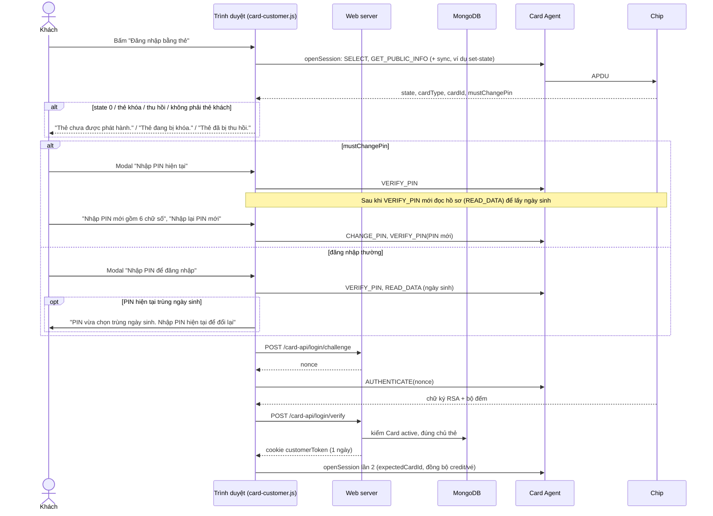
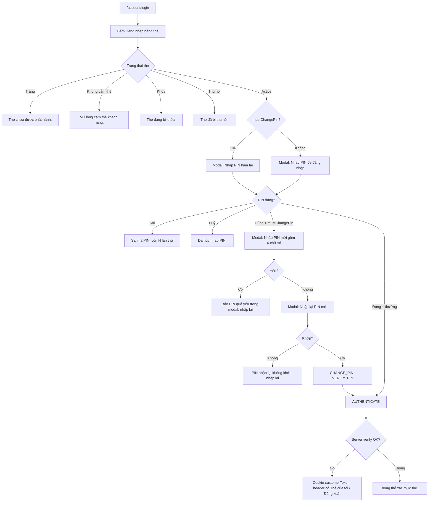

# 04. Khách đăng nhập bằng thẻ (đổi PIN lần đầu)

Khách hàng đăng nhập website bằng thẻ khách + PIN tại `/account/login`, không dùng mật khẩu. Lần đầu (thẻ còn `mustChangePin`) khách phải đặt PIN mới.

## Mục đích

- Kiểm tra đăng nhập thẻ khách: mở phiên thẻ (có đồng bộ), nhập PIN, chip ký challenge, server cấp cookie `customerToken` (1 ngày).
- Kiểm tra đổi PIN lần đầu với luật PIN yếu (gồm DDMMYY ngày sinh) và nhập lại, tất cả xử lý ngay trong modal PIN.
- Kiểm tra các nhánh lỗi: thẻ trắng, khóa, thu hồi, cắm nhầm thẻ, sai PIN, Agent tắt.

## Ai thực hiện & quyền

| Mục | Giá trị |
|---|---|
| Vai trò | Khách hàng (chủ thẻ) |
| Quyền | Không có permission admin; chỉ cần thẻ khách `active` |
| Step-up | Không áp dụng |
| Cookie | `customerToken` hiệu lực 1 ngày. Nếu có cả cookie admin `token`, server ưu tiên coi là khách khi đồng bộ, nên dùng cửa sổ ẩn danh |

## Điều kiện trước

- Đã xong [03](03-phat-hanh-the-khach-hang.md): thẻ khách A ở **slot 1**, trạng thái `active`, còn `mustChangePin`; có PIN ban đầu (hộp thoại phát hành hoặc email).
- Cắm slot 1: `curl -X POST -H 'Origin: http://localhost:3002' -H 'Content-Type: application/json' -d '{"slot":1}' http://127.0.0.1:31999/v1/sim/slot`.
- Mở web bằng `http://localhost:3002` (không dùng `127.0.0.1`) trong cửa sổ ẩn danh; Agent đang chạy.
- Biết ngày sinh của khách (để thử PIN DDMMYY).

## Sơ đồ luồng hoạt động

### Sơ đồ tuần tự

### Sơ đồ quyết định (giao diện)

## Các bước test (happy path)

1. Cắm slot 1 (lệnh ở phần Điều kiện trước).
2. Mở `http://localhost:3002/account/login` (cửa sổ ẩn danh). Trang có nút **"Đăng nhập bằng thẻ"** và liên kết "Mất thẻ? Khóa thẻ qua email".
3. Bấm "Đăng nhập bằng thẻ". Trình duyệt mở phiên thẻ (có đồng bộ, bạn không phải làm gì).
4. Modal PIN **"Nhập PIN hiện tại"** (đây là modal đầu tiên khi thẻ còn `mustChangePin`; không phải "nhập PIN ban đầu"). Nhập PIN ban đầu, bấm "Xác nhận".
5. Modal **"Nhập PIN mới gồm 6 chữ số"** (nhãn "Mã PIN (6 chữ số)"). Thử lần lượt:
   - `111111`, `123456`, `987654`, DDMMYY ngày sinh: modal **không đóng**, hiện "PIN quá yếu (không dùng 6 số giống nhau, dãy số liên tiếp hoặc ngày sinh DDMMYY). Vui lòng nhập mã khác."
   - `48291` (5 số): "Mã PIN phải gồm đúng 6 chữ số."
   - `482915`: chấp nhận.
6. Modal **"Nhập lại PIN mới"**: nhập `482916`: "PIN nhập lại không khớp. Vui lòng nhập lại." (ở lại modal). Nhập `482915`.
7. Hệ thống chạy `CHANGE_PIN`, `VERIFY_PIN`, challenge, `AUTHENTICATE`, verify rồi mở phiên thẻ lần hai.
8. Header đổi sang có "Thẻ của tôi" và "Đăng xuất"; vào được `/account/card`.
9. Bấm "Đăng xuất", đăng nhập lại: modal chỉ còn **"Nhập PIN để đăng nhập"**, không còn đổi PIN.
10. (Tùy chọn) Nếu bạn Reset PIN ở bài 15 hoặc PIN hiện tại trùng ngày sinh, lần đăng nhập kế sẽ hiện modal **"PIN vừa chọn trùng ngày sinh. Nhập PIN hiện tại để đổi lại"**.

## Kết quả mong đợi

**Trên giao diện**
- Chuyển trang sau đăng nhập; header có "Thẻ của tôi", "Đăng xuất".

**Trên chip**
- `mustChangePin` = 0; PIN mới hiệu lực; bộ đếm tăng sau `AUTHENTICATE`; số lần thử PIN hồi về 5.
- Trạng thái ACTIVE (0x02), `cardType` 1.

**Trong dữ liệu**
- Cookie `customerToken` (1 ngày). Không lưu PIN.
- Đồng bộ lần đăng nhập có thể đổi `CardTransaction` (credit `pending-card` -> `sent` -> `done`) và `items[].ticketStatus` (`pending` -> `written`), xem [09](09-ghi-ve-len-the-dong-bo.md).

**Trong Nhật ký thẻ**
- `customer-login-challenge`, `customer-login` (success); `auth`; lỗi ghi `fail`. Đăng xuất ghi `customer-logout`.

## Ngoại lệ & trường hợp lỗi

| # | Tình huống | Cách tái hiện | Kết quả / thông báo mong đợi |
|---|---|---|---|
| 1 | Thẻ trắng | Cắm slot chưa phát hành | "Thẻ chưa được phát hành." |
| 2 | Không có thẻ | Slot không có thẻ / thẻ không phải khách | "Vui lòng cắm thẻ khách hàng." |
| 3 | Thẻ bị khóa (chip hoặc server) | Admin khóa thẻ (bài 13) rồi đăng nhập | "Thẻ đang bị khóa." (`openSession` đồng bộ `set-state` trước khi đọc danh tính nên chip bị khóa ngay lúc này) |
| 4 | Thẻ bị thu hồi | Admin thu hồi thẻ | "Thẻ đã bị thu hồi." |
| 5 | Trạng thái lạ | Chip ở trạng thái ngoài 0/2/3/7F | "Trạng thái thẻ không hợp lệ." |
| 6 | Cắm thẻ khác với thẻ đang xem | Đổi sang slot 3 khi đã đăng nhập thẻ slot 1 | "Đang cắm thẻ khác. Vui lòng cắm đúng thẻ của bạn." |
| 7 | Hủy modal PIN | Bấm "Huỷ" | "Đã hủy nhập PIN." |
| 8 | PIN mới yếu (kiểm lại sau modal) | Chỉ xảy ra nếu bỏ qua kiểm modal | "PIN mới quá yếu." (trong modal là thông báo dài ở bước 5) |
| 9 | PIN sai định dạng | Nhập 5 hoặc 7 số, chữ cái | "Mã PIN phải gồm đúng 6 chữ số." (trong modal); mã `PIN_FORMAT` "PIN phải gồm đúng 6 chữ số." |
| 10 | Nhập lại không khớp | Hai PIN mới khác nhau | "PIN nhập lại không khớp. Vui lòng nhập lại." (ở lại modal) |
| 11 | Sai PIN | Nhập PIN sai | "Sai mã PIN, còn x lần thử" |
| 12 | PIN bị khóa | Sai 5 lần liên tiếp | `6983` "PIN đã bị khoá"; xem [15](15-sai-pin-khoa-pin-reset-pin.md) |
| 13 | Xác thực thất bại | Nonce hết hạn / chữ ký sai / thẻ không đúng chủ | `CARD_AUTH_INVALID` "Không thể xác thực thẻ. Vui lòng kiểm tra thẻ và thử lại." |
| 14 | Agent tắt | Dừng Agent rồi bấm đăng nhập | "Không kết nối được Card Agent" (mọi lỗi từ Agent đều bị gói thành câu này). "Không thể kết nối. Vui lòng kiểm tra Card Agent và thử lại." chỉ hiện với lỗi fetch (TypeError/AbortError) không đi qua Agent |
| 15 | Lỗi chung | Lỗi không nhận diện | "Không thể xử lý thẻ. Vui lòng kiểm tra Card Agent và thử lại." |
| 16 | Hết thời gian chờ server | Ngắt mạng khi gọi server | `REQUEST_TIMEOUT` "Yêu cầu quá thời gian. Vui lòng kiểm tra kết nối." |
| 17 | Phiên hết / chưa đăng nhập | Xóa cookie rồi thao tác | `AUTH_REQUIRED` "Vui lòng đăng nhập lại." |
| 18 | Đồng bộ dồn dập | Bấm đăng nhập liên tục (quá 60 lần/phút) | 429 `RATE_LIMITED` "Thao tác đồng bộ thẻ quá nhanh, vui lòng thử lại sau." |
| 19 | Double submit / F5 | Bấm hai lần hoặc F5 giữa chừng | Nút bị khóa khi đang chạy; sau F5 phải bấm lại, trạng thái chip vẫn giữ nên dùng PIN hiện hành |
| 20 | Phiên trang bị bỏ | Chuyển tab/đóng trang giữa chừng | `CLIENT_STALE` "Trang đã thay đổi. Vui lòng thử lại." / `CLIENT_SUSPENDED` "Trang đã tạm dừng." / `CLIENT_DISPOSED` "Trang đã đóng." |

## Checklist

- [ ] Happy path lần đầu: đổi PIN rồi đăng nhập được
- [ ] Đăng nhập lần hai chỉ hỏi "Nhập PIN để đăng nhập"
- [ ] PIN yếu (`111111`, `123456`, DDMMYY) bị chặn trong modal
- [ ] Nhập lại lệch bị chặn trong modal
- [ ] Hàng 1 đến 5 (trạng thái thẻ)
- [ ] Hàng 6 (cắm thẻ khác)
- [ ] Hàng 7, 8, 9, 10
- [ ] Hàng 11, 12 (sai/khóa PIN)
- [ ] Hàng 13
- [ ] Hàng 14, 15, 16 (Agent/mạng)
- [ ] Hàng 17, 18, 19, 20

## Liên quan

[05](05-trang-the-cua-toi.md) | [09 Đồng bộ vé](09-ghi-ve-len-the-dong-bo.md) | [15](15-sai-pin-khoa-pin-reset-pin.md) | [22 Đăng xuất](22-dang-xuat-phien-the.md)
