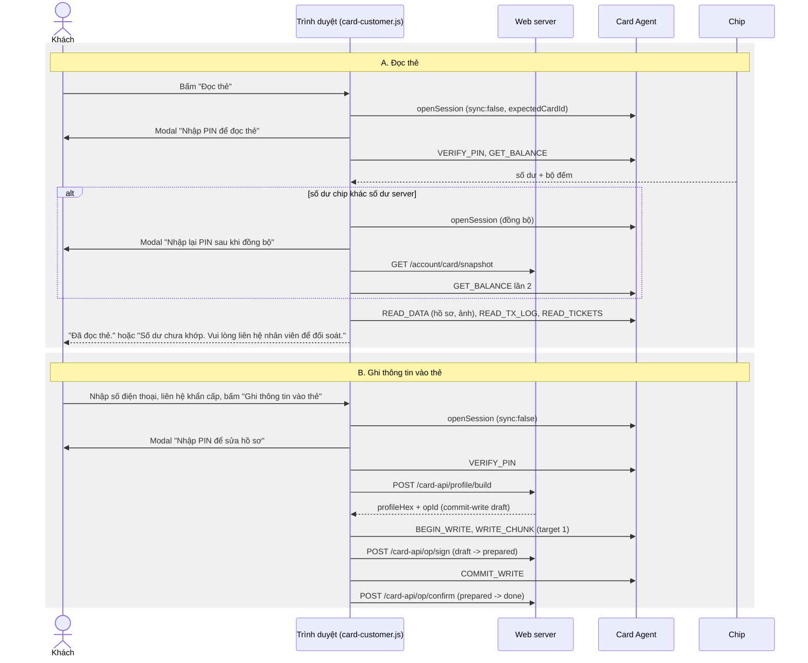
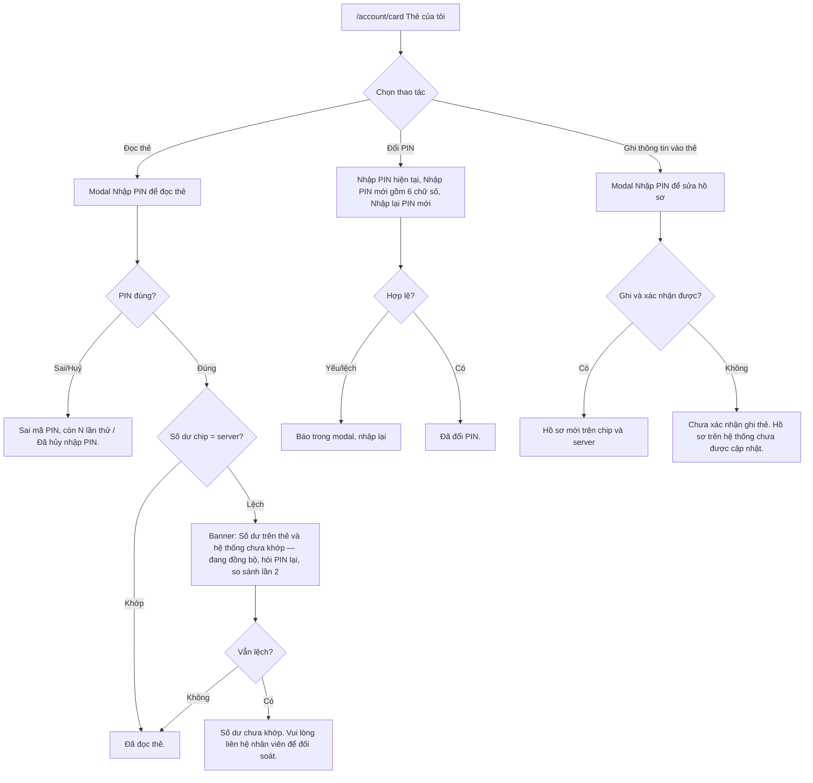

# 05. Trang "Thẻ của tôi": đọc thẻ, đổi PIN, ghi thông tin lên thẻ

Trang `/account/card` là bảng điều khiển của khách đã đăng nhập bằng thẻ: xem số dư, đọc nội dung chip, đổi PIN, sửa số điện thoại/liên hệ khẩn cấp ghi lên thẻ.

## Mục đích

- Kiểm tra hiển thị số dư hệ thống, credit chờ, tổng chi tiêu, hạng thành viên, lịch sử giao dịch.
- Kiểm tra "Đọc thẻ" (đọc chip, so với server, tự đồng bộ nếu lệch), "Đổi PIN" và "Ghi thông tin vào thẻ".

## Ai thực hiện & quyền

| Mục | Giá trị |
|---|---|
| Vai trò | Khách đã đăng nhập bằng thẻ |
| Quyền | Cookie `customerToken`; chưa đăng nhập bị chuyển về `/account/login` |
| Step-up | Không áp dụng; nhưng mỗi thao tác chip nhạy cảm hỏi lại PIN |

## Điều kiện trước

- Đã xong [04](04-khach-dang-nhap-bang-the.md), đang đăng nhập khách A; thẻ ở **slot 1**.
- Agent chạy. Để thấy dữ liệu phong phú: nạp tiền mặt ([06](06-nap-tien-mat-tai-quay.md)) và mua tour ([08](08-dat-tour-thanh-toan-vi-the.md)) rồi quay lại (không bắt buộc).
- Nếu thẻ khác slot: `curl -X POST -H 'Origin: http://localhost:3002' -H 'Content-Type: application/json' -d '{"slot":1}' http://127.0.0.1:31999/v1/sim/slot`.

## Sơ đồ luồng hoạt động

### Sơ đồ tuần tự

### Sơ đồ quyết định (giao diện)

## Các bước test (happy path)

**Chuẩn bị giao diện.** Mở `http://localhost:3002/account/card`. Kiểm tra: tiêu đề "Thẻ của tôi"; ô "Số dư hệ thống", "Số dư trên thẻ" (ban đầu "Chưa đọc thẻ"), "Credit đang chờ ghi thẻ" (chỉ tính giao dịch `pending-card` + `sent`), "Tổng chi tiêu"; huy hiệu "Hạng X" và "Giảm N%" (Standard 0%, Silver 3% từ 10 triệu, Gold 5% từ 30 triệu, Platinum 8% từ 80 triệu); form nạp tiền ("Số tiền (đ)", "Cổng thanh toán" VNPay/ZaloPay, nút "Nạp tiền"); bảng giao dịch với nhãn "Chờ thanh toán", "Chờ ghi thẻ", "Đang đối soát", "Hoàn tất", "Chưa hoàn tất", "Đã nhận tiền — chờ đối soát"; liên kết "Báo mất và khóa thẻ".

**A. Đọc thẻ**
1. Bấm **"Đọc thẻ"**. Modal **"Nhập PIN để đọc thẻ"**; nhập PIN.
2. Nếu số dư chip khớp server: hiện "Đã đọc thẻ." (chỉ hỏi PIN một lần; nút này mở phiên với `sync:false`, không ghi vé/credit).
3. Kiểm tra: "Số dư thẻ: N đ · Bộ đếm: M"; hồ sơ (Họ tên, Ngày sinh, Giới tính, Số điện thoại, Giấy tờ, Liên hệ khẩn cấp, Điện thoại khẩn cấp, Nhóm máu, Dị ứng); ảnh; nhật ký chip (mỗi dòng "Nạp/Trừ N đ · Số dư ... · Bộ đếm ... · mã"), hoặc "Chưa có giao dịch trên thẻ."; vé ("<orderCode> · Tour <id> · <YYYYMMDD> · N khách · Chưa dùng/Đã dùng") hoặc "Chưa có vé trên thẻ.".
4. Tái hiện lệch số dư: ở một khách đã nạp tiền mặt nhưng chưa đồng bộ (credit `pending-card`) hãy bấm "Đọc thẻ": banner 'Số dư trên thẻ và hệ thống chưa khớp — đang đồng bộ', hệ thống đồng bộ (ghi credit), hỏi **"Nhập lại PIN sau khi đồng bộ"**, đọc lại; sau đó hiện "Đã đọc thẻ." nếu đã khớp, nếu vẫn lệch: "Số dư chưa khớp. Vui lòng liên hệ nhân viên để đối soát.".

**B. Đổi PIN**
1. Bấm **"Đổi PIN"** (mở phiên `sync:false`).
2. Modal "Nhập PIN hiện tại": nhập PIN đang dùng.
3. Modal "Nhập PIN mới gồm 6 chữ số": thử `111111`, `123456`, DDMMYY ngày sinh: modal không đóng, hiện "PIN quá yếu (không dùng 6 số giống nhau, dãy số liên tiếp hoặc ngày sinh DDMMYY). Vui lòng nhập mã khác." Nhập PIN tốt.
4. Modal "Nhập lại PIN mới": nhập lệch -> "PIN nhập lại không khớp. Vui lòng nhập lại."; nhập khớp.
5. Hiện "Đã đổi PIN." Đăng xuất và đăng nhập lại bằng PIN mới để chắc chắn.

**C. Ghi thông tin vào thẻ**
1. Ở form hồ sơ nhập "Số điện thoại" (ví dụ `0912345678`), "Người liên hệ khẩn cấp", "Điện thoại khẩn cấp".
2. Bấm **"Ghi thông tin vào thẻ"**; modal **"Nhập PIN để sửa hồ sơ"**; nhập PIN.
3. Chờ xong (server dựng hồ sơ, ký, chip ghi, biên nhận). Kiểm tra bằng "Đọc thẻ" lại, hoặc admin mở chi tiết thẻ (`/admin/card/detail/:cardId`, xem [17](17-danh-sach-chi-tiet-the.md)).

## Kết quả mong đợi

**Trên giao diện**
- "Đã đọc thẻ." / "Số dư chưa khớp. Vui lòng liên hệ nhân viên để đối soát." / "Đã đổi PIN." ; ô "Số dư trên thẻ" hiện số sau khi đọc.

**Trên chip** (chính là nội dung "Đọc thẻ")
- Số dư + bộ đếm, tối đa 10 mục nhật ký, tối đa 5 vé, hồ sơ <= 448 byte, ảnh <= 10 080 byte. Sau "Ghi thông tin": hồ sơ có số điện thoại/liên hệ mới.

**Trong dữ liệu**
- `customers`: hồ sơ cập nhật sau khi chip xác nhận. `cardops`: commit-write target 1 `draft` -> `prepared` -> `done`.
- Đổi PIN chỉ đổi trên chip; không có gì ở server.

**Trong Nhật ký thẻ**
- `customer-profile-build` (hoặc `profile-build`), `card-op-sign`, `card-op-confirm` cho ghi hồ sơ. Đổi PIN/đọc thẻ: không có mục riêng (chỉ ghi khi gọi server, chưa xác minh).

## Ngoại lệ & trường hợp lỗi

| # | Tình huống | Cách tái hiện | Kết quả / thông báo mong đợi |
|---|---|---|---|
| 1 | Chưa đăng nhập | Mở `/account/card` ở cửa sổ ẩn danh mới | Chuyển về `/account/login` |
| 2 | Hết phiên | Xóa cookie `customerToken`, bấm "Đọc thẻ" | `AUTH_REQUIRED` "Vui lòng đăng nhập lại." / "Phiên đăng nhập đã hết hạn. Vui lòng đăng nhập lại bằng thẻ." |
| 3 | Cắm thẻ khác | Đổi slot 3 rồi bấm "Đọc thẻ" | "Đang cắm thẻ khác. Vui lòng cắm đúng thẻ của bạn." |
| 4 | Agent tắt | Dừng Agent | "Không kết nối được Card Agent" |
| 5 | Hủy modal PIN | Bấm "Huỷ" | "Đã hủy nhập PIN." |
| 6 | Sai PIN | Nhập sai | "Sai mã PIN, còn x lần thử"; 5 lần: "PIN đã bị khoá" |
| 7 | PIN sai định dạng | Nhập 5 số | "Mã PIN phải gồm đúng 6 chữ số." (trong modal) |
| 8 | PIN mới yếu / lệch (đổi PIN) | Như bước B3, B4 | Hỏi lại ngay trong modal PIN (`askPin` có `validate`): "PIN quá yếu (không dùng 6 số giống nhau, dãy số liên tiếp hoặc ngày sinh DDMMYY). Vui lòng nhập mã khác." / "PIN nhập lại không khớp. Vui lòng nhập lại."; modal không đóng; lỗi dự phòng "PIN mới quá yếu." |
| 9 | Số dư lệch sau đồng bộ | Chip và server khác nhau (ví dụ restart Agent) | "Số dư chưa khớp. Vui lòng liên hệ nhân viên để đối soát." |
| 10 | Hồ sơ vượt 448 byte | Nhập chuỗi rất dài vào các ô hồ sơ | `INVALID_PROFILE` "Hồ sơ vượt giới hạn 448 byte hoặc chứa trường không hợp lệ." |
| 11 | Ghi hồ sơ thất bại giữa chừng | Tắt Agent sau khi nhập PIN | "Chưa xác nhận ghi thẻ. Hồ sơ trên hệ thống chưa được cập nhật." |
| 12 | Op hết hạn/đổi | Chờ > 5 phút giữa build và ký | `OP_STATE` "Thao tác đã hết hạn hoặc thay đổi. Vui lòng thử lại." |
| 13 | Thẻ khóa/thu hồi | Admin khóa thẻ rồi bấm "Đọc thẻ" | "Thẻ đang bị khóa." / "Thẻ đã bị thu hồi." / `CARD_STATE` "Thẻ hiện không cho phép thao tác." |
| 14 | Đồng bộ dồn dập | Bấm liên tục > 60 lần/phút | 429 `RATE_LIMITED` "Thao tác đồng bộ thẻ quá nhanh, vui lòng thử lại sau." |
| 15 | Timeout mạng | Ngắt mạng | `REQUEST_TIMEOUT` "Yêu cầu quá thời gian. Vui lòng kiểm tra kết nối." |
| 16 | Double submit / F5 | Bấm "Ghi thông tin vào thẻ" hai lần, hoặc F5 giữa chừng | Nút bị khóa khi chạy; F5 hủy luồng, op cũ hết hạn sau 5 phút; hồ sơ chỉ đổi khi chip xác nhận |

## Checklist

- [ ] Giao diện đủ ô số dư, hạng, nút
- [ ] Đọc thẻ khớp: "Đã đọc thẻ."
- [ ] Đọc thẻ lệch: hỏi PIN lần hai, đồng bộ
- [ ] Đổi PIN thành công "Đã đổi PIN."
- [ ] Ghi thông tin vào thẻ rồi Đọc thẻ thấy dữ liệu mới
- [ ] Hàng 1, 2, 3
- [ ] Hàng 4, 5, 6, 7, 8
- [ ] Hàng 9, 10, 11, 12
- [ ] Hàng 13, 14, 15, 16

## Liên quan

[04](04-khach-dang-nhap-bang-the.md) | [08 Điền từ thẻ](08-dat-tour-thanh-toan-vi-the.md) | [21 Sửa hồ sơ (admin)](21-sua-ho-so-anh-tren-the.md)
