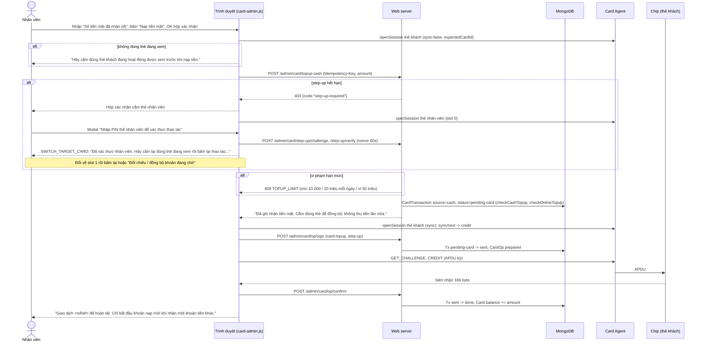
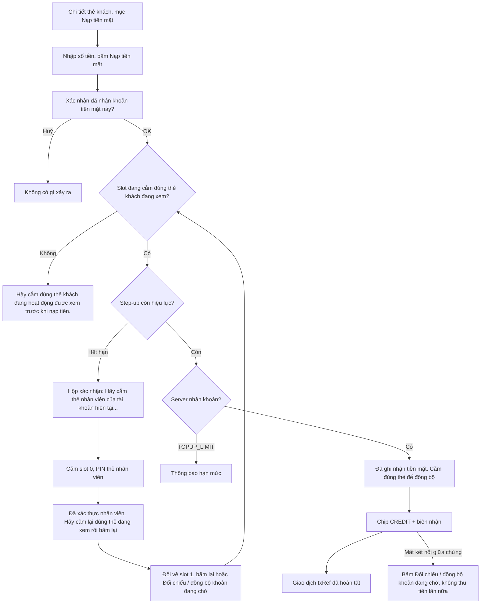

# 06. Nạp tiền mặt tại quầy

Nhân viên nhận tiền mặt của khách rồi nạp vào ví thẻ khách từ trang chi tiết thẻ. Luồng này cần step-up (thẻ nhân viên) và đồng thời phải cắm đúng thẻ khách để chip ghi số dư.

## Mục đích

- Kiểm tra nạp tiền mặt: server ghi nhận khoản thu (`pending-card`), ký lệnh `CREDIT`, chip cộng tiền và trả biên nhận, server ghi sổ (`done`).
- Kiểm tra hạn mức (tối thiểu 10.000 đ, tối đa 20.000.000 đ mỗi lần nạp, 20.000.000 đ/nhân viên/ngày VN, ví tối đa 50.000.000 đ), idempotency, step-up và hai thẻ phải đổi qua lại (nhân viên rồi khách).

## Ai thực hiện & quyền

| Mục | Giá trị |
|---|---|
| Vai trò | Nhân viên đăng nhập admin **bằng thẻ nhân viên** |
| Quyền | `card-topup` (form "Nạp tiền mặt" chỉ hiện khi có quyền, thẻ `active` và là thẻ khách). Ký lệnh credit cũng cần `card-topup` |
| Step-up | Bắt buộc, `stepUpAt` còn trong 5 phút. Quá hạn: 403 `step-up-required` "Hãy xác thực lại thẻ nhân viên trước khi thực hiện thao tác." |
| Header | `Idempotency-Key` 32 ký tự hex (trình duyệt tự tạo, giữ khi mất phản hồi) |

## Điều kiện trước

- Đã làm [02](02-dang-nhap-admin-bang-the.md) (đăng nhập admin bằng thẻ, slot 0) và [03](03-phat-hanh-the-khach-hang.md) (thẻ khách A active ở slot 1, đã đăng nhập/đổi PIN ở [04](04-khach-dang-nhap-bang-the.md) là tốt nhất).
- Phải có thẻ nhân viên đang hoạt động và đăng nhập bằng thẻ thì step-up mới chạy (JWT có `cardId`); nếu không, step-up trả `STAFF_CARD_REQUIRED` / `STAFF_CARD_CHANGED` / `STAFF_CARD_MISMATCH` (xem hàng 11 đến 11d và [91](91-bang-ma-loi.md)).
- Slot 1 = thẻ khách A, slot 0 = thẻ nhân viên. Lệnh đổi slot: `curl -X POST -H 'Origin: http://localhost:3002' -H 'Content-Type: application/json' -d '{"slot":N}' http://127.0.0.1:31999/v1/sim/slot`.
- Mở chi tiết thẻ khách A: `/admin/card/list` -> chọn thẻ -> `/admin/card/detail/<cardId>`.
- Số tiền thử: 100000; để test hạn mức cần thêm vài lần nạp (xem bảng lỗi).

## Sơ đồ luồng hoạt động

### Sơ đồ tuần tự

### Sơ đồ quyết định (giao diện)

## Các bước test (happy path)

1. Cắm slot 0, đăng nhập admin bằng thẻ ([02](02-dang-nhap-admin-bang-the.md)) trong vòng 5 phút trước (để step-up còn hiệu lực) hoặc chuẩn bị đổi slot nếu hết hạn.
2. Cắm **slot 1** (thẻ khách A). Mở `/admin/card/detail/<cardId của khách A>`. Kiểm tra: "Trạng thái server" = "Đang hoạt động", mục "Ví thẻ" hiện "Số dư server (đ)".
3. Cuộn đến form **"Nạp tiền mặt"**. Ô "Số tiền mặt đã nhận (đ)" (min 10000, max 20000000): nhập `100000`.
4. Bấm **"Nạp tiền mặt"**. Hộp xác nhận: "Xác nhận đã nhận khoản tiền mặt này? Nếu đang đối soát khoản cũ, hãy đồng bộ thay vì tạo khoản mới." Bấm OK.
5. Nếu step-up đã hết hạn (quá 5 phút): hộp xác nhận "Hãy cắm thẻ nhân viên của tài khoản hiện tại, sau đó bấm OK để xác thực. Chưa thu tiền hoặc tạo khoản nạp mới." (khi đó **chưa** tạo khoản nạp). Cắm slot 0, bấm OK, modal **"Nhập PIN thẻ nhân viên để xác thực thao tác"**, nhập PIN. Giao diện báo "Đã xác thực nhân viên. Hãy cắm lại đúng thẻ đang xem rồi bấm lại thao tác; giữ nguyên yêu cầu tiền mặt cũ nếu có." Đổi về **slot 1** rồi bấm lại "Nạp tiền mặt" (hoặc "Đối chiếu / đồng bộ khoản đang chờ" nếu nút xuất hiện).
6. Khi thành công, thông báo ghi nhận: "Đã ghi nhận tiền mặt. Cắm đúng thẻ để đồng bộ; không thu tiền lần nữa." rồi sau khi chip xác nhận: "Giao dịch <txRef> đã hoàn tất. Chỉ bắt đầu khoản nạp mới khi nhận một khoản tiền khác."
7. Tải lại trang chi tiết: "Số dư server" tăng 100.000; bảng "Giao dịch" có dòng `credit / cash`, 100.000, trạng thái `done` (huy hiệu xám); mục "Credit đang chờ" ghi "Không có credit đang chờ."
8. Chuyển sang cửa sổ khách (slot 1), vào "Thẻ của tôi" bấm "Đọc thẻ": "Số dư thẻ" tăng 100.000 đ.
9. Mở "Nhật ký thẻ" (`/admin/card/log`): `topup-cash`, `card-sync-op`/`card-op-sign`/`card-op-confirm`.
10. Kiểm tra hạn mức ngày: lặp bước 3 đến 7 nạp `20000000` (hoặc nhiều lần cộng đủ 20 triệu), rồi nạp thêm `10000` (xem hàng 3).

## Kết quả mong đợi

**Trên giao diện**
- Thông báo ghi nhận và thông báo hoàn tất như bước 6; "Số dư server" tăng đúng số tiền.

**Trên chip**
- Số dư chip tăng đúng số tiền; bộ đếm giao dịch +1; nhật ký chip có dòng "Nạp N đ · Số dư ... · mã giao dịch" ("Đọc thẻ" ở [05](05-trang-the-cua-toi.md)).

**Trong dữ liệu**
- `cardtransactions`: `type credit`, `source cash`, `status` `pending-card` -> `sent` -> `done`, `createdBy` = tài khoản nhân viên. Lưu Idempotency-Key (cùng key + cùng số tiền không thu lần hai).
- `cards`: `balance` tăng. `cardops`: `credit` `draft/prepared` -> `done`.

**Trong Nhật ký thẻ**
- `topup-cash`, `card-sync-op`, `card-op-sign`, `card-op-confirm`. Bị từ chối: `topup-cash` với `result fail`.

## Ngoại lệ & trường hợp lỗi

| # | Tình huống | Cách tái hiện | Kết quả / thông báo mong đợi |
|---|---|---|---|
| 1 | Dưới 10.000 đ | Nhập `9000` | Form chặn (min); server: `TOPUP_LIMIT` 409 "Số tiền nạp tối thiểu là 10.000 VNĐ." hoặc "Số tiền hoặc mã yêu cầu nạp không hợp lệ." |
| 2 | Trên 20.000.000 một lần | Nhập `20000001` (hoặc gửi API trực tiếp) | Form chặn (max 20000000). Server từ chối mỗi lần tối đa 20.000.000 đ: 400 "Số tiền nạp tiền mặt phải là số nguyên từ 10.000 đến 20.000.000 VNĐ mỗi lần." (câu này cũng hiện cho số tiền không nguyên/sai kiểu; không còn thông báo chung chung) |
| 3 | Tổng ngày quá hạn mức | Nạp 20.000.000 rồi nạp thêm 10.000 | `TOPUP_LIMIT` 409 "Vượt hạn mức tiền mặt 20.000.000 VNĐ mỗi nhân viên mỗi ngày." (ngày theo UTC+7) |
| 4 | Vượt trần ví 50 triệu | Số dư + tiền chờ + số nạp > 50.000.000 (nạp liên tiếp qua nhiều ngày/nhân viên) | Server từ chối `TOPUP_LIMIT` 409 "Số dư và tiền chờ nạp vượt hạn mức 50.000.000 VNĐ." Nếu lọt tới chip: `6F11` "Vượt hạn mức số dư", credit bị giữ (log `card-sync-credit-held`) và có thể thành `reconciliation` (`wallet-cap`) |
| 5 | Thẻ không phải thẻ khách active | Mở chi tiết thẻ nhân viên/khóa | Form không hiện; API: "Chỉ nạp tiền cho thẻ khách đang hoạt động." |
| 6 | Cắm sai thẻ | Đang ở slot 3 khi bấm | "Hãy cắm đúng thẻ khách đang hoạt động được xem trước khi nạp tiền." |
| 7 | Step-up hết hạn | Chờ quá 5 phút sau khi đăng nhập thẻ | 403 `step-up-required` "Hãy xác thực lại thẻ nhân viên trước khi thực hiện thao tác." Giao diện: "Hãy cắm thẻ nhân viên đang hoạt động của tài khoản hiện tại để xác thực lại." và phải bấm lại sau khi đổi về thẻ khách |
| 8 | Huỷ PIN nhân viên khi step-up | Bấm "Huỷ" ở modal | "Đã hủy xác thực; trạng thái chưa được gửi lại." (với nút trạng thái) / "Đã huỷ nhập PIN." / không thu tiền |
| 9 | Sai PIN nhân viên | Nhập sai | "Sai mã PIN, còn x lần thử" |
| 10 | Không xác thực được thẻ nhân viên | Thẻ NV không đúng tài khoản | "Không thể xác thực thẻ nhân viên." |
| 11 | Tài khoản không có thẻ NV đang hoạt động | Đăng nhập admin khi chưa phát hành thẻ NV (`cardRequired=false`) rồi bấm nạp | 403 `STAFF_CARD_REQUIRED` "Tài khoản của bạn chưa có thẻ nhân viên đang hoạt động. Hãy phát hành thẻ nhân viên cho tài khoản này (Phát hành thẻ → Nhân viên) rồi đăng nhập lại bằng thẻ." |
| 11b | Phiên gắn với thẻ NV cũ | Đã cấp lại thẻ NV, phiên đăng nhập bằng thẻ cũ | 403 `STAFF_CARD_CHANGED` "Phiên đăng nhập gắn với thẻ nhân viên cũ, không phải thẻ nhân viên đang hoạt động (có thể thẻ đã được thay). Hãy đăng xuất và đăng nhập lại bằng thẻ nhân viên mới." |
| 11c | Cắm sai thẻ NV khi step-up | Đang cắm thẻ NV khác (hoặc thẻ khác) lúc xác thực | 403 `STAFF_CARD_MISMATCH` "Thẻ đang cắm không phải thẻ nhân viên của phiên đăng nhập này. Hãy cắm đúng thẻ đã dùng để đăng nhập, hoặc đăng nhập lại bằng thẻ này." |
| 11d | Phiên chỉ có mật khẩu nhưng tài khoản đã bật `cardRequired` | Tự phát hành thẻ NV rồi chưa đăng nhập lại | Trang: về đăng nhập với thông báo; API: 403 `CARD_RELOGIN_REQUIRED` "Tài khoản đã được yêu cầu đăng nhập bằng thẻ nhân viên. Vui lòng đăng nhập lại bằng mật khẩu và thẻ." |
| 12 | Dùng lại mã yêu cầu cho khoản khác | Cùng Idempotency-Key, số tiền khác (gửi API trực tiếp) | "Mã yêu cầu đã được dùng cho một khoản thu khác." |
| 13 | Double submit / F5 giữa chừng | Bấm hai lần hoặc F5 sau khi server ghi nhận | Cùng key nên không thu hai lần; trả "Giao dịch đã hoàn tất." nếu đã xong; dùng "Đối chiếu / đồng bộ khoản đang chờ" |
| 14 | Mất kết nối khi chip chưa xác nhận | Tắt Agent sau khi "Đã ghi nhận tiền mặt" | Khoản giữ `pending-card`/`sent`; cắm lại đúng thẻ rồi "Đối chiếu / đồng bộ khoản đang chờ" ([16](16-dong-bo-doi-soat-bien-nhan.md)); không thu tiền lần nữa |
| 15 | Bấm "Bắt đầu khoản tiền mặt khác" | Sau khi hoàn tất hoặc muốn bỏ khoản nhớ | Quên khoản đang nhớ để nhập khoản mới; chỉ dùng khi nhận một khoản tiền khác |
| 16 | Thiếu quyền `card-topup` | Nhóm quyền không có | Form không hiện; API `OP_FORBIDDEN` "Bạn không có quyền sử dụng tính năng này!"; trang: "Bạn không có quyền sử dụng tính năng này!" |
| 17 | Agent tắt | Dừng Agent | "Không kết nối được Card Agent" |
| 18 | Timeout mạng | Ngắt mạng | Admin: `REQUEST_TIMEOUT` "Yêu cầu quá thời gian. Hãy kiểm tra kết nối rồi thử lại; nếu đang thu tiền, hãy đối chiếu giao dịch, không thu lần nữa." |

## Checklist

- [ ] Happy path: nạp 100.000, `done`, số dư server và chip cùng tăng
- [ ] Nhật ký có `topup-cash` và `card-op-*`
- [ ] Hàng 1, 2 (min/max)
- [ ] Hàng 3 (hạn mức ngày)
- [ ] Hàng 4 (trần ví)
- [ ] Hàng 5, 6 (thẻ/slot)
- [ ] Hàng 7, 8, 9, 10, 11 (step-up và PIN NV)
- [ ] Hàng 12, 13, 14, 15 (idempotent/đối soát)
- [ ] Hàng 16, 17, 18

## Liên quan

[07 Nạp online](07-nap-online-vnpay-zalopay.md) | [16 Đối soát](16-dong-bo-doi-soat-bien-nhan.md) | [18 Nhật ký](18-nhat-ky-the.md) | [92 Sự cố](92-han-che-va-xu-ly-su-co.md)
