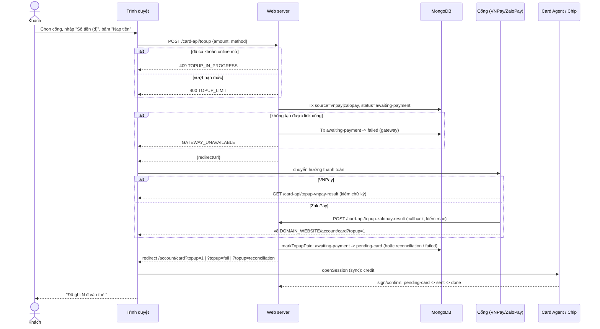
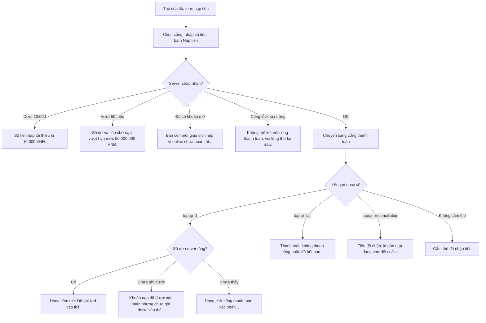

# 07. Nạp ví online (VNPay / ZaloPay)

Khách tự nạp ví thẻ qua cổng VNPay hoặc ZaloPay từ trang "Thẻ của tôi". Tiền về cổng, server chuyển giao dịch sang `pending-card`, chip ghi ở lần đồng bộ kế tiếp.

## Mục đích

- Kiểm tra luồng nạp online end-to-end: tạo yêu cầu, chuyển cổng, callback/return, ghi thẻ ở lần cắm thẻ tiếp theo.
- Kiểm tra các nhánh chặn trước cổng (hạn mức, đã có khoản mở, cổng không sẵn sàng) và các thông báo trang thẻ theo `?topup=`.

**Lưu ý môi trường:** khóa VNPay **trống** (đã xác nhận trong `.env`: `VNPAY_CODE` và `VNPAY_SECRET` đều là chuỗi rỗng); ZaloPay cần `DOMAIN_WEBSITE` công khai (ngrok). Vì vậy bài này **phần lớn không test được local** (chưa chạy thử với cổng thật). Phần "Kiểm tra được ngay cả khi không có cổng" vẫn chạy được.

## Ai thực hiện & quyền

| Mục | Giá trị |
|---|---|
| Vai trò | Khách đã đăng nhập bằng thẻ |
| Quyền | Cookie `customerToken`, thẻ `active` và `isCurrent` |
| Step-up | Không áp dụng |
| Endpoint | `POST /card-api/topup`; VNPay return `GET /card-api/topup-vnpay-result`; ZaloPay callback `POST /card-api/topup-zalopay-result` |

## Điều kiện trước

- Đã xong [04](04-khach-dang-nhap-bang-the.md) và [05](05-trang-the-cua-toi.md); slot 1 (thẻ khách A) đang cắm và đã đăng nhập.
- Để test thật: khóa VNPay (`VNPAY_CODE`, ...) hoặc ZaloPay và `DOMAIN_WEBSITE` công khai trỏ về web (callback server-to-server cần truy cập được).
- Quy tắc: tối thiểu 10.000 đ; số dư + tiền chờ + số nạp không quá 50.000.000 đ; mỗi thẻ chỉ một khoản online đang mở; cổng hết hạn sau 15 phút, coi là treo sau 20 phút.

## Sơ đồ luồng hoạt động

### Sơ đồ tuần tự

### Sơ đồ quyết định (giao diện)

## Các bước test (happy path, khi có khóa cổng)

1. Đăng nhập khách A ([04](04-khach-dang-nhap-bang-the.md)); mở `/account/card`. Ghi lại "Số dư hệ thống".
2. Ở form nạp: "Số tiền (đ)" = `100000`; "Cổng thanh toán" = VNPay (hoặc ZaloPay); bấm **"Nạp tiền"** (`POST /card-api/topup`). Server tạo giao dịch `awaiting-payment` và trả `redirectUrl`.
3. Trình duyệt chuyển sang cổng; hoàn tất thanh toán bằng tài khoản thử của cổng.
4. VNPay quay về `GET /card-api/topup-vnpay-result`; ZaloPay gọi `POST /card-api/topup-zalopay-result` (server-to-server) rồi cổng đưa khách về `/account/card?topup=1`.
5. Trang chuyển tới `/account/card?topup=1` (thành công), `?topup=fail` (lỗi) hoặc `?topup=reconciliation` (tiền đã nhận nhưng ví không nhận được).
6. Giữ **slot 1** cắm. Với `topup=1` trang tự mở phiên thẻ, đồng bộ credit `pending-card`: hiện "Đã ghi 100.000 đ vào thẻ." và số dư hệ thống tăng. Nếu không cắm thẻ: "Cắm thẻ để nhận tiền"; cắm xong, đăng nhập lại hoặc tải lại để đồng bộ ([09](09-ghi-ve-len-the-dong-bo.md)).
7. Bấm "Đọc thẻ" ([05](05-trang-the-cua-toi.md)) để thấy số dư chip tăng; bảng giao dịch có dòng nạp `Hoàn tất`.

## Kết quả mong đợi

**Trên giao diện**
- Thông báo theo `topup=`; số dư hệ thống tăng; giao dịch hiện nhãn "Chờ thanh toán" -> "Chờ ghi thẻ" -> "Hoàn tất".

**Trên chip**
- Sau đồng bộ: số dư +100.000, bộ đếm +1, nhật ký có dòng "Nạp".

**Trong dữ liệu**
- `cardtransactions`: `awaiting-payment` -> `pending-card` -> `sent` -> `done` (`source vnpay|zalopay`). Trường hợp lỗi: `failed` (`failReason gateway` hoặc `expired`); tiền về nhưng ví không nhận: `reconciliation` (`wallet-cap`, `card-unavailable`, `gateway-conflict`).
- Callback lặp chỉ được xác nhận khi đã ở trạng thái đã thanh toán.

**Trong Nhật ký thẻ**
- `card-topup-prepare`, `card-topup-paid`, `card-topup-reconciliation`, `card-topup-callback` (kèm lý do khi từ chối: chữ ký/mac sai, không tìm thấy khoản, "cần đối soát thủ công").

## Ngoại lệ & trường hợp lỗi

| # | Tình huống | Cách tái hiện | Kết quả / thông báo mong đợi |
|---|---|---|---|
| 1 | Dưới 10.000 đ | Nhập `5000`, bấm "Nạp tiền" | "Số tiền nạp tối thiểu là 10.000 VNĐ." |
| 2 | Vượt 50.000.000 đ | Số dư + số nạp > 50 triệu | "Số dư và tiền chờ nạp vượt hạn mức 50.000.000 VNĐ." (400 `TOPUP_LIMIT`) |
| 3 | Đã có khoản mở | Bấm "Nạp tiền" khi còn khoản `awaiting-payment` (dưới 20 phút) hoặc `pending-card`/`sent` | 409 `TOPUP_IN_PROGRESS` "Bạn còn một giao dịch nạp ví online chưa hoàn tất. Vui lòng hoàn tất hoặc chờ giao dịch hết hạn (khoảng 20 phút) rồi thử lại." |
| 4 | Không gọi được cổng (khóa trống) | Chọn VNPay trên môi trường local | `GATEWAY_UNAVAILABLE` "Không thể kết nối cổng thanh toán, vui lòng thử lại sau."; giao dịch thành `failed` (`gateway`) |
| 5 | Thanh toán thất bại / hủy | Hủy ở trang cổng | `?topup=fail`: "Thanh toán không thành công hoặc đã hết hạn nên chưa nạp tiền vào ví. Bạn có thể thử nạp lại." |
| 6 | Đang chờ cổng xác nhận | Về trang khi callback chưa tới | "Đang chờ cổng thanh toán xác nhận. Vui lòng đợi ít phút rồi tải lại trang và cắm thẻ để nhận tiền." (F5 trên trang trả về có thể vẫn hiện câu này dù tiền đã về: hạn chế đã biết) |
| 7 | Đã xác nhận nhưng chưa ghi thẻ | Về trang khi thẻ đang bận/đã chọn nhưng credit còn chờ | "Khoản nạp đã được xác nhận nhưng chưa ghi được vào thẻ. Vui lòng giữ thẻ trong đầu đọc và thử lại." |
| 8 | Tiền về nhưng ví không nhận | Ví đầy, thẻ bị thu hồi/khóa, hoặc khoản đã hết hạn | `?topup=reconciliation`: "Tiền đã nhận, khoản nạp đang chờ đối soát. Vui lòng liên hệ nhân viên và cung cấp mã giao dịch; không thanh toán lại." (Tx `reconciliation`, xem [16](16-dong-bo-doi-soat-bien-nhan.md)) |
| 9 | Không cắm thẻ khi quay về | Rút/đổi slot rồi mở `?topup=1` | "Cắm thẻ để nhận tiền" |
| 10 | Cắm thẻ khác khi quay về | Đổi sang slot 3 | "Đang cắm thẻ khác. Vui lòng cắm đúng thẻ của bạn." |
| 11 | Phiên đăng nhập hết | Xóa cookie rồi mở `?topup=1` | "Phiên đăng nhập đã hết hạn. Vui lòng đăng nhập lại bằng thẻ." |
| 12 | Chữ ký/dữ liệu callback sai | Gọi callback giả (không có chữ ký) | ZaloPay trả `{return_code:-1, return_message:"mac not equal"}`; không cộng tiền; log `card-topup-callback` fail |
| 13 | Callback muộn sau khi hết hạn | Callback tới sau > 20 phút | Tx `failed` (`expired`) -> xử lý lại thành `pending-card` hoặc `reconciliation`; log "cần đối soát thủ công" nếu ví không nhận |
| 14 | Double submit / F5 | Bấm "Nạp tiền" hai lần | Lần hai gặp hàng 3 (`TOPUP_IN_PROGRESS`) |
| 15 | Timeout mạng | Ngắt mạng khi gọi `/card-api/topup` | "Yêu cầu quá thời gian. Vui lòng kiểm tra kết nối." |
| 16 | Chưa đăng nhập | Xóa cookie rồi bấm "Nạp tiền" | `AUTH_REQUIRED` "Vui lòng đăng nhập lại." |

## Checklist

- [ ] (Nếu có cổng) Happy path: nạp 100.000 rồi "Đã ghi 100.000 đ vào thẻ."
- [ ] Hàng 1, 2 (hạn mức)
- [ ] Hàng 3 (khoản đang mở)
- [ ] Hàng 4 (cổng không sẵn sàng)
- [ ] Hàng 5, 6, 7, 8 (thông báo `topup=`)
- [ ] Hàng 9, 10, 11
- [ ] Hàng 12, 13 (callback)
- [ ] Hàng 14, 15, 16

## Liên quan

[06 Tiền mặt](06-nap-tien-mat-tai-quay.md) | [16 Đối soát](16-dong-bo-doi-soat-bien-nhan.md) | [92](92-han-che-va-xu-ly-su-co.md)
