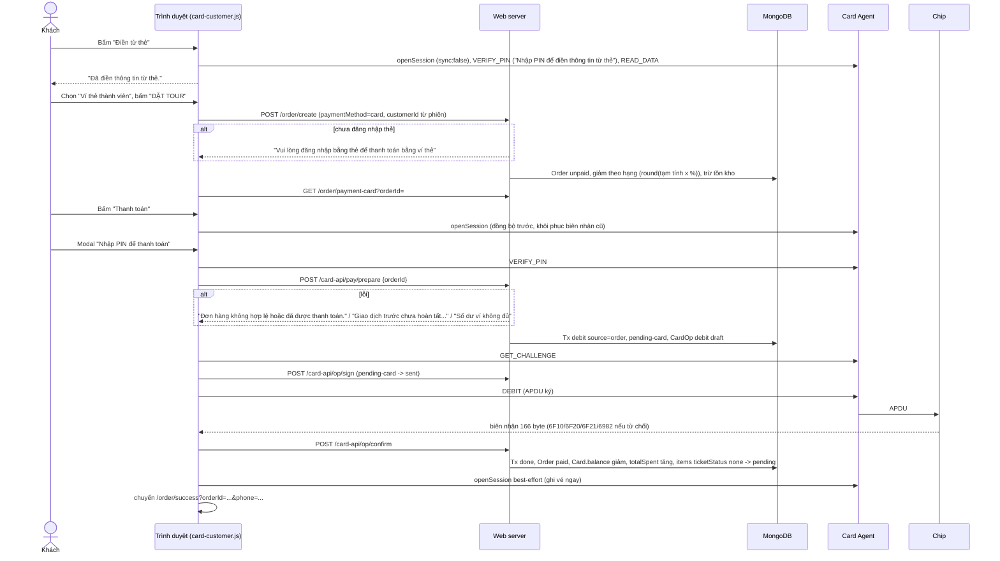
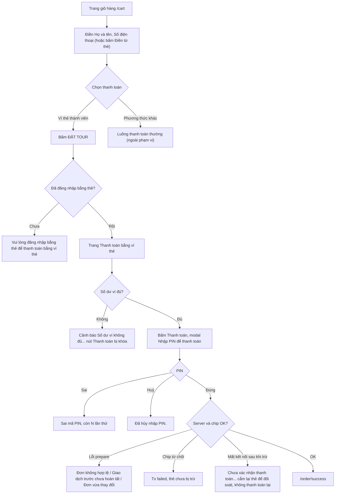

# 08. Đặt tour và thanh toán bằng ví thẻ (giảm theo hạng, "Điền từ thẻ")

Khách đăng nhập bằng thẻ đặt tour ở trang giỏ hàng, chọn "Ví thẻ thành viên" rồi trả tiền tại trang `/order/payment-card`. Server trừ ví qua lệnh `DEBIT` ký, chip trả biên nhận, đơn chuyển "đã thanh toán".

## Mục đích

- Kiểm tra "Điền từ thẻ" (đọc họ tên + số điện thoại từ chip bằng PIN, không gửi lên server).
- Kiểm tra giảm giá theo hạng thành viên, tạo đơn `card`, thanh toán trừ ví (PIN mỗi giao dịch), cập nhật `totalSpent` và `ticketStatus` `none` -> `pending`.
- Kiểm tra các nhánh lỗi: thiếu số dư, đơn đã trả, còn giao dịch cũ chưa xong, mất kết nối sau khi chip trừ tiền.

## Ai thực hiện & quyền

| Mục | Giá trị |
|---|---|
| Vai trò | Khách đã đăng nhập bằng thẻ (`customerToken`) |
| Quyền | Chỉ chủ thẻ; đơn phải thuộc khách này (`customerId`), `paymentMethod: card`, chưa thanh toán, chưa hủy |
| Step-up | Không áp dụng; mỗi lần trả tiền hỏi PIN (`DEBIT` luôn xóa phiên PIN sau lệnh) |

## Điều kiện trước

- Đã xong [04](04-khach-dang-nhap-bang-the.md) và [06](06-nap-tien-mat-tai-quay.md): khách A đăng nhập, ví đủ tiền cho đơn. Cắm **slot 1**.
- Nếu muốn test [10](10-check-in-tour.md): vào admin `/admin/tour/list` sửa tour, trường **"Ngày khởi hành"** về **hôm nay** TRƯỚC KHI đặt (đơn sao chép ngày lúc tạo; chưa xác minh offset ngày của tour seed).
- Số điện thoại hợp lệ cho giỏ hàng: regex `(84|0[3|5|7|8|9])+([0-9]{8})\b`; họ tên 5 đến 50 ký tự. **Khách seed có số `0000000001` (không hợp lệ)**, nên "Điền từ thẻ" cho khách seed sẽ điền số sai: hãy gõ lại số hợp lệ (vd `0912345678`) hoặc dùng khách tạo mới ở [03](03-phat-hanh-the-khach-hang.md) với số hợp lệ.
- Biết hạng của khách: xem huy hiệu "Hạng X" ở [05](05-trang-the-cua-toi.md). Khách mới là Standard (0%).

## Sơ đồ luồng hoạt động

### Sơ đồ tuần tự

### Sơ đồ quyết định (giao diện)

## Các bước test (happy path)

1. Cắm slot 1, đăng nhập khách A ([04](04-khach-dang-nhap-bang-the.md)). Chuẩn bị ví >= giá tour (nạp ở [06](06-nap-tien-mat-tai-quay.md)).
2. Mở trang tour, thêm vào giỏ (số khách >= 1), mở `http://localhost:3002/cart`.
3. Nếu đã có hạng Silver trở lên: dòng tổng có chú thích "(Hạng X giảm N%)" và dòng giảm giá; Standard không có giảm.
4. Bấm **"Điền từ thẻ"**: modal **"Nhập PIN để điền thông tin từ thẻ"**, nhập PIN. Thông báo "Đã điền thông tin từ thẻ." và điền "Họ và tên" + "Số điện thoại" từ chip. Nếu số điện thoại điền vào không hợp lệ (khách seed), sửa lại thủ công.
5. Ở phương thức thanh toán chọn radio **"Ví thẻ thành viên"** (chỉ hiện khi đã đăng nhập bằng thẻ).
6. Bấm **"ĐẶT TOUR"**: tạo đơn, chuyển `/order/payment-card?orderId=<id>`.
7. Trang "Thanh toán bằng ví thẻ" hiện: "Mã đơn hàng", "Tạm tính", "Giảm theo hạng thành viên", "Tổng thanh toán", "Số dư ví hiện tại". Kiểm tra Tổng = Tạm tính - Giảm; Giảm = round(Tạm tính x %).
8. Bấm **"Thanh toán"**: hệ thống đồng bộ thẻ trước (khôi phục biên nhận cũ nếu có), modal **"Nhập PIN để thanh toán"**: nhập PIN.
9. Chờ hoàn tất; trang chuyển tới `/order/success?orderId=<id>&phone=<sđt>`.
10. Kiểm tra số dư: "Thẻ của tôi" -> "Số dư hệ thống" giảm đúng "Tổng thanh toán"; "Đọc thẻ" thấy số dư chip bằng nhau và nhật ký chip có dòng "Trừ N đ · ...".
11. Admin mở `/admin/order/list` / `/admin/order/edit/<id>`: "Trạng thái thanh toán" = Đã thanh toán, phương thức thẻ. Mục đơn có `ticketStatus = pending` (hoặc `written` nếu bước ghi vé best-effort đã chạy). Tiếp tục ở [09](09-ghi-ve-len-the-dong-bo.md).
12. Bảng hạng: Standard dưới 10.000.000 (0%), Silver từ 10.000.000 (3%), Gold từ 30.000.000 (5%), Platinum từ 80.000.000 (8%). Khách seed có thể đã có `totalSpent` sẵn nên hạng khác Standard (chưa xác minh với dữ liệu seed cụ thể).
13. **Hoàn tiền khi hủy đơn:** nếu admin hủy đơn đã trả bằng ví ([11](11-huy-don-xoa-ve.md)), `totalSpent` bị trừ đúng `order.total` (không xuống dưới 0) và hạng được tính lại từ `totalSpent`, nên khách có thể **tụt hạng** (ví dụ Silver về Standard khi tổng chi tiêu xuống dưới 10.000.000). Giảm giá theo hạng cho các đơn sau áp theo hạng mới.

## Kết quả mong đợi

**Trên giao diện**
- Trang success; số dư hệ thống giảm; "Tổng chi tiêu" tăng; có thể lên hạng.

**Trên chip**
- Số dư giảm đúng Tổng thanh toán, bộ đếm +1, nhật ký chip có "Trừ N đ"; sau ghi vé: vé mới "Chưa dùng".

**Trong dữ liệu**
- `orders`: `paymentStatus paid`, `paymentMethod card`, `customerId`, `cardTxRef`; mỗi `items[].ticketStatus`: `none` -> `pending` (đơn khách có thẻ).
- `cardtransactions`: `type debit`, `source order`, `pending-card` -> `sent` -> `done`.
- `cards.balance` giảm; `customers.totalSpent` tăng. (Khi đơn bị hủy và hoàn tiền: `totalSpent` giảm lại, `cards.balance` chỉ tăng sau khi khoản hoàn `pending-card` được ghi lên chip; xem [11](11-huy-don-xoa-ve.md).)

**Trong Nhật ký thẻ**
- `card-pay-prepare`, `card-op-sign`, `card-op-confirm`. Nếu tự phục hồi biên nhận: `card-receipt-recovery`.

## Ngoại lệ & trường hợp lỗi

| # | Tình huống | Cách tái hiện | Kết quả / thông báo mong đợi |
|---|---|---|---|
| 1 | Chưa đăng nhập mà chọn ví thẻ | Đăng xuất rồi gửi `POST /order/create` với `paymentMethod=card` | "Vui lòng đăng nhập bằng thẻ để thanh toán bằng ví thẻ" (radio "Ví thẻ thành viên" cũng không hiện) |
| 2 | Số dư thiếu | Đặt đơn lớn hơn số dư | Trang: "Số dư ví không đủ. Vui lòng nạp thêm trước khi thanh toán." (nút "Thanh toán" bị khóa); API `INSUFFICIENT_BALANCE` "Số dư ví không đủ" |
| 3 | Đơn đã trả / không hợp lệ | Mở lại `/order/payment-card?orderId=` của đơn đã trả rồi bấm "Thanh toán" | "Đơn hàng không hợp lệ hoặc đã được thanh toán." |
| 4 | Còn giao dịch trước chưa xong | Giao dịch debit/credit trước đang `pending-card`/`sent` | "Giao dịch trước chưa hoàn tất, vui lòng cắm thẻ để đồng bộ" |
| 5 | Đơn đổi giữa chừng | Admin sửa đơn khi khách đang ở trang thanh toán | "Đơn hàng vừa thay đổi, vui lòng thử lại." |
| 6 | Chip từ chối | `6F10`/`6F20`/`6F21`/`6982` | Tx `failed`, thẻ chưa bị trừ; thông báo theo bảng mã chip |
| 7 | Sai PIN | Nhập sai ở modal | "Sai mã PIN, còn x lần thử" |
| 8 | Hủy modal PIN | Bấm "Huỷ" | "Đã hủy nhập PIN." |
| 9 | PIN bị khóa | Sai 5 lần | "PIN đã bị khoá" (6983) |
| 10 | Mất kết nối sau khi trừ | Tắt Agent sau khi chip đã `DEBIT` | "Chưa xác nhận thanh toán. Vui lòng cắm lại thẻ để hệ thống đối soát, không thanh toán lại." Cắm lại đúng thẻ và đăng nhập: bước `receipt` tự xử lý ([16](16-dong-bo-doi-soat-bien-nhan.md)) |
| 11 | Cắm thẻ khác | Đổi slot khi ở trang thanh toán | "Đang cắm thẻ khác. Vui lòng cắm đúng thẻ của bạn." |
| 12 | Thẻ khóa/thu hồi | Admin khóa thẻ trước khi bấm | "Thẻ đang bị khóa." / "Thẻ đã bị thu hồi." |
| 13 | Hết phiên | Xóa cookie rồi bấm | `AUTH_REQUIRED` "Vui lòng đăng nhập lại." |
| 14 | Op hết hạn | Chờ > 5 phút giữa prepare và ký | `OP_STATE` "Thao tác đã hết hạn hoặc thay đổi. Vui lòng thử lại." |
| 15 | Hủy "Điền từ thẻ" | Bấm "Huỷ" ở modal | "Đã hủy nhập PIN." (form giữ nguyên) |
| 16 | Số điện thoại/Họ tên sai | Số `0000000001` (số của khách seed), tên < 5 ký tự | Giỏ hàng từ chối (số phải khớp regex ở phần Điều kiện trước, họ tên 5 đến 50 ký tự). Muốn đặt đơn: tạo khách mới có số điện thoại thật (xem [92](92-han-che-va-xu-ly-su-co.md)) |
| 17 | Double submit / F5 | Bấm "Thanh toán" hai lần, F5 ở giữa | Nút khóa khi chạy; lần hai gặp hàng 3 hoặc hàng 4; sau F5 cắm thẻ để đồng bộ, không thanh toán lại |
| 18 | Agent tắt | Dừng Agent | "Không kết nối được Card Agent" |
| 19 | Timeout mạng | Ngắt mạng | "Yêu cầu quá thời gian. Vui lòng kiểm tra kết nối." |

## Checklist

- [ ] "Điền từ thẻ" điền đúng họ tên và số điện thoại
- [ ] Happy path: đơn paid, số dư giảm đúng, chuyển `/order/success`
- [ ] Giảm giá đúng hạng (Standard 0%)
- [ ] Vé chuyển `pending` (hoặc `written`)
- [ ] Hàng 1 (chưa đăng nhập)
- [ ] Hàng 2 (thiếu số dư)
- [ ] Hàng 3, 4, 5 (lỗi prepare)
- [ ] Hàng 6, 7, 8, 9 (chip/PIN)
- [ ] Hàng 10 (mất kết nối sau khi trừ rồi đối soát)
- [ ] Hàng 11, 12, 13, 14, 15, 16, 17, 18, 19

## Liên quan

[09](09-ghi-ve-len-the-dong-bo.md) | [11 Hủy đơn](11-huy-don-xoa-ve.md) | [16](16-dong-bo-doi-soat-bien-nhan.md)
