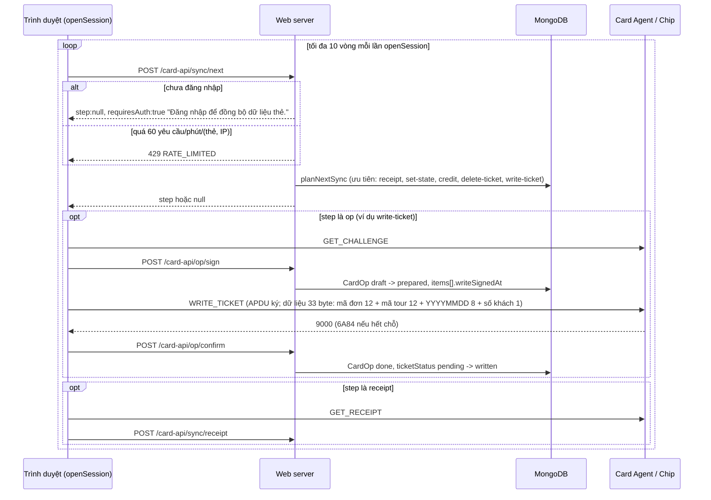
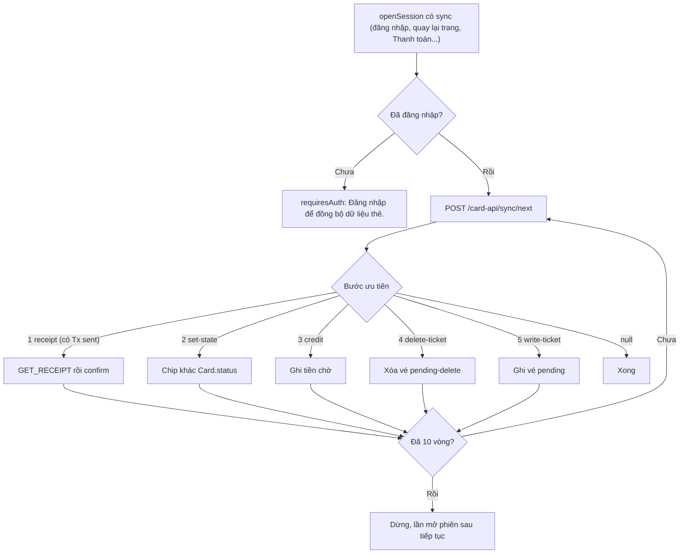

# 09. Ghi vé lên thẻ và cơ chế đồng bộ (sync)

Sau khi đơn của khách có thẻ được thanh toán, vé điện tử chờ ghi (`pending`). Mỗi lần mở phiên thẻ có đồng bộ, trình duyệt hỏi server "bước tiếp theo là gì" và thực hiện tuần tự các bước (receipt, set-state, credit, delete-ticket, write-ticket) cho đến khi hết việc.

## Mục đích

- Kiểm tra vé `pending` được ghi lên chip qua lệnh `write-ticket` và chuyển `written`.
- Hiểu và kiểm tra thứ tự ưu tiên của sync, giới hạn 10 vòng, giới hạn 5 vé trên chip, chống dồn dập 60 yêu cầu/phút, nhánh chưa đăng nhập.

## Ai thực hiện & quyền

| Mục | Giá trị |
|---|---|
| Vai trò | Khách chủ thẻ (đăng nhập bằng thẻ) hoặc admin khi cắm thẻ khách |
| Quyền | Khách: chủ thẻ. Admin: `card-edit` hoặc `card-checkin` để ký `write-ticket`; `card-edit` để ký `delete-ticket`; `card-topup` cho credit (credit tiền mặt cần step-up còn hạn); `card-lock` (`card-revoke` cho trạng thái 127) cho `set-state` |
| Step-up | Chỉ cần với credit tiền mặt do admin ký |
| Cookie | Nếu có cả `token` (admin) và `customerToken`, server ưu tiên coi là khách |

## Điều kiện trước

- Đã xong [08](08-dat-tour-thanh-toan-vi-the.md): có đơn đã thanh toán của khách A với `ticketStatus = pending`. (Nếu bước ghi vé best-effort sau thanh toán đã chạy thì vé đã `written`; để thấy `pending`, hãy tắt Agent ngay sau khi chip trừ tiền hoặc đặt đơn mới khi Agent lỗi, hoặc dùng đơn admin đánh dấu "Đã thanh toán" của khách có thẻ ở [11](11-huy-don-xoa-ve.md)).
- Cắm slot 1: `curl -X POST -H 'Origin: http://localhost:3002' -H 'Content-Type: application/json' -d '{"slot":1}' http://127.0.0.1:31999/v1/sim/slot`.
- Chip còn chỗ: tối đa 5 vé cùng lúc.

## Sơ đồ luồng hoạt động

### Sơ đồ tuần tự

### Sơ đồ quyết định (giao diện và hành vi đồng bộ)

## Các bước test (happy path)

1. Đảm bảo đơn khách A đã thanh toán và mục đơn có `ticketStatus = pending` (xem điều kiện trước; admin xem ở `/admin/order/edit/<id>` hoặc chi tiết thẻ, mục "Các vé của chủ thẻ" hiện `pending`).
2. Cắm slot 1 và **đăng xuất rồi đăng nhập lại bằng thẻ** ([04](04-khach-dang-nhap-bang-the.md)): `openSession` có sync nên chạy `write-ticket`. Bạn không phải làm gì thêm (chỉ nhập PIN đăng nhập).
3. Vào "Thẻ của tôi" -> "Đọc thẻ" (nhập PIN): phần vé hiện dòng `<orderCode> · Tour <id> · <YYYYMMDD> · N khách · Chưa dùng`.
4. Kiểm tra chi tiết thẻ ở admin (`/admin/card/detail/<cardId>`, mục "Các vé của chủ thẻ"): vé chuyển `pending` -> `written`.
5. Nút "Đọc thẻ" mở phiên với `sync:false`, **không** ghi vé; chỉ các luồng có sync (đăng nhập, thanh toán, quay lại từ cổng) mới ghi.
6. Giới hạn 5 vé: tạo và thanh toán thêm đơn cho đến khi chip có 5 vé chưa dùng; vé kế tiếp bị chip từ chối `6A84` "Hết chỗ lưu trữ"; vé vẫn `pending` (hiển thị cụ thể chưa xác minh). Chip ưu tiên dùng slot trống rồi slot vé đã dùng.
7. Chưa đăng nhập: xóa cookie `customerToken` rồi gọi lại sync: `step: null`, `requiresAuth: true`, "Đăng nhập để đồng bộ dữ liệu thẻ."
8. Chống dồn dập: gọi `sync/next` hơn 60 lần mỗi phút cho cùng (thẻ, IP): 429 `RATE_LIMITED` "Thao tác đồng bộ thẻ quá nhanh, vui lòng thử lại sau."
9. Thứ tự ưu tiên: tạo cùng lúc một credit tiền mặt chờ ghi ([06](06-nap-tien-mat-tai-quay.md)) và một vé pending; đăng nhập: credit được ghi trước vé.

## Kết quả mong đợi

**Trên giao diện**
- "Đọc thẻ" hiển thị vé "Chưa dùng"; admin thấy `written`.

**Trên chip**
- Vé nằm trong slot (VALID = 1 "Chưa dùng"), tối đa 5; ghi lại cùng khóa 24 byte (mã đơn + mã tour) là thành công, không nhân đôi.

**Trong dữ liệu**
- `orders.items[].ticketStatus`: `pending` -> `written`; `writeSignedAt` đặt khi ký lệnh. `cardops`: `write-ticket` `draft` -> `prepared` -> `done`.

**Trong Nhật ký thẻ**
- `card-sync-op`, `card-op-sign`, `card-op-confirm`. Nếu bị chặn credit: `card-sync-credit-held`.

## Ngoại lệ & trường hợp lỗi

| # | Tình huống | Cách tái hiện | Kết quả / thông báo mong đợi |
|---|---|---|---|
| 1 | Chưa đăng nhập | Xóa cookie `customerToken` rồi sync | `step: null`, `requiresAuth: true`, "Đăng nhập để đồng bộ dữ liệu thẻ." (không dừng bằng lỗi) |
| 2 | Chip đầy 5 vé | Ghi vé thứ 6 | Chip trả `6A84` "Hết chỗ lưu trữ"; vé còn `pending` |
| 3 | Dồn dập | > 60 yêu cầu sync/phút | 429 `RATE_LIMITED` "Thao tác đồng bộ thẻ quá nhanh, vui lòng thử lại sau." |
| 4 | Cắm thẻ khác | Đổi slot khi sync | "Đang cắm thẻ khác. Hãy cắm đúng thẻ đang xem trước khi đồng bộ." (hoặc "Đang cắm thẻ khác. Vui lòng cắm đúng thẻ của bạn.") |
| 5 | Thẻ khóa/thu hồi | Admin khóa thẻ rồi sync | Bước `set-state` chạy trước; sau đó "Thẻ đang bị khóa." / "Thẻ đã bị thu hồi." |
| 6 | Agent tắt giữa chừng | Tắt Agent khi đang ghi | "Không kết nối được Card Agent"; vé giữ `pending` (hoặc đã ký `writeSignedAt`); lần sau tiếp tục; có thể cần bước `receipt` |
| 7 | Op hết hạn | Chờ > 5 phút giữa sign và confirm | `OP_STATE` "Thao tác đã hết hạn hoặc thay đổi. Vui lòng thử lại." |
| 8 | Mười vòng chưa xong | Quá nhiều việc chờ | Dừng sau 10 vòng; mở phiên lần sau tiếp tục |
| 9 | Admin ký thiếu quyền | Admin không có `card-edit`/`card-checkin` | `OP_FORBIDDEN` "Bạn không có quyền thực hiện thao tác này." |
| 10 | Credit tiền mặt thiếu step-up | Admin sync khi step-up hết hạn | 403 `step-up-required` "Hãy xác thực lại thẻ nhân viên trước khi thực hiện thao tác." |
| 11 | Double submit / F5 | Đăng nhập hai lần liên tiếp | Ghi lại cùng khóa vé là thành công (idempotent), không nhân đôi |
| 12 | Timeout mạng | Ngắt mạng | "Yêu cầu quá thời gian. Vui lòng kiểm tra kết nối." |
| 13 | Đơn khách vãng lai | Đơn không gắn khách | Không có vé (`ticketStatus none`), không có gì để ghi |

## Checklist

- [ ] Happy path: vé `pending` -> `written`, "Đọc thẻ" thấy "Chưa dùng"
- [ ] "Đọc thẻ" không ghi vé (`sync:false`)
- [ ] Hàng 1 (chưa đăng nhập, `requiresAuth`)
- [ ] Hàng 2 (đầy 5 vé)
- [ ] Hàng 3 (429)
- [ ] Hàng 4, 5 (thẻ khác/khóa)
- [ ] Hàng 6, 7, 8
- [ ] Hàng 9, 10 (quyền, step-up)
- [ ] Hàng 11, 12, 13
- [ ] Thứ tự ưu tiên credit trước vé

## Liên quan

[10 Check-in](10-check-in-tour.md) | [11](11-huy-don-xoa-ve.md) | [16](16-dong-bo-doi-soat-bien-nhan.md)
