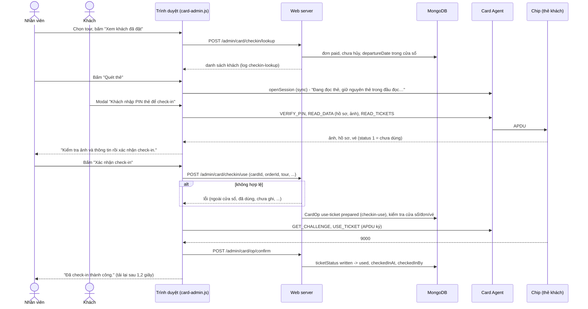
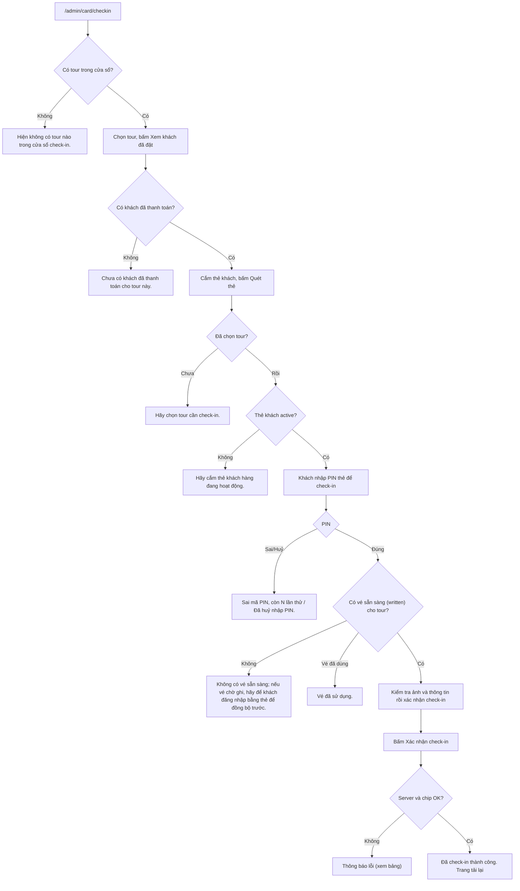

# 10. Check-in tour bằng thẻ

Nhân viên mở trang "Check-in tour", chọn tour, quét thẻ khách (khách nhập PIN), kiểm tra ảnh/vé rồi xác nhận. Vé trên chip chuyển sang "Đã dùng" và vé trong đơn chuyển `used`.

## Mục đích

- Kiểm tra danh sách tour trong cửa sổ check-in và danh sách khách đã thanh toán.
- Kiểm tra quét thẻ (đọc ảnh, hồ sơ, vé), xác nhận check-in bằng lệnh ký `use-ticket`, ghi `checkedInAt/By`.
- Kiểm tra mọi nhánh từ chối: ngoài cửa sổ ngày, vé chưa ghi, vé đã dùng, đơn chưa trả/hủy, thẻ không phù hợp.

## Ai thực hiện & quyền

| Mục | Giá trị |
|---|---|
| Vai trò | Nhân viên đứng quầy; khách nhập PIN tại chỗ |
| Quyền | `card-checkin` (trang `/admin/card/checkin`, API `/admin/card/checkin/lookup` và `/use`; ký lệnh `use-ticket` cần `card-checkin`) |
| Step-up | Không cần |
| Thiếu quyền | 403 "Bạn không có quyền sử dụng tính năng này!" |

## Điều kiện trước

- Đã xong [08](08-dat-tour-thanh-toan-vi-the.md) và [09](09-ghi-ve-len-the-dong-bo.md): đơn đã thanh toán, vé của khách A `written` trên chip (slot 1).
- **Ngày khởi hành**: cửa sổ check-in theo giờ VN là từ 00:00 ngày (khởi hành - 1) đến 23:59:59.999 ngày khởi hành. Trang chỉ liệt kê đơn đã thanh toán, chưa hủy, có `item.departureDate` trong [hôm nay - 3 ngày, hôm nay + 4 ngày] và nằm trong cửa sổ. Ngày khởi hành được **sao chép lúc tạo đơn**, nên hãy vào `/admin/tour/list` -> sửa tour (ô "Ngày khởi hành") về **hôm nay hoặc ngày mai** rồi **mới đặt đơn** ở bài 08 (seed tour: chưa xác minh offset).
- Admin đã đăng nhập (bằng thẻ nhân viên nếu có). Slot cắm: **1** (thẻ khách) tại quầy; Agent chạy.
- Lệnh đổi slot: `curl -X POST -H 'Origin: http://localhost:3002' -H 'Content-Type: application/json' -d '{"slot":1}' http://127.0.0.1:31999/v1/sim/slot`.

## Sơ đồ luồng hoạt động

### Sơ đồ tuần tự

### Sơ đồ quyết định (giao diện)

## Các bước test (happy path)

1. Cắm slot 1 (thẻ khách A đã có vé `written`).
2. Admin mở sidebar **"Quản lý thẻ"** -> **"Check-in tour"** (`/admin/card/checkin`).
3. Chọn tour (danh sách chỉ gồm tour trong cửa sổ check-in). Bấm **"Xem khách đã đặt"**: bảng liệt kê khách đã thanh toán của tour (log `checkin-lookup`).
4. Bấm **"Quét thẻ"**. Trạng thái: "Đang đọc thẻ, giữ nguyên thẻ trong đầu đọc…". Modal **"Khách nhập PIN thẻ để check-in"**: khách nhập PIN (nhãn "Mã PIN (6 chữ số)", nút "Xác nhận").
5. Hiện ảnh, họ tên và vé của tour: "Kiểm tra ảnh và thông tin rồi xác nhận check-in."
6. Bấm **"Xác nhận check-in"**. Thông báo "Đã check-in thành công." rồi trang tải lại sau khoảng 1,2 giây (log `checkin-use`).
7. Kiểm tra: ở `/admin/order/edit/<id>` hoặc chi tiết thẻ mục "Các vé của chủ thẻ": vé `used`, có `checkedInAt`/`checkedInBy`.
8. Quét lại cùng thẻ + tour: "Vé đã sử dụng." (chip: `6985` "Sai trạng thái, chưa đổi PIN hoặc vé đã dùng").
9. Khách vào "Thẻ của tôi" -> "Đọc thẻ": vé hiện "Đã dùng".
10. Thử đổi "Ngày khởi hành" của tour sang quá khứ xa hoặc tương lai xa (sau khi đã có đơn cũ) và quét: ngoài cửa sổ (xem hàng 3 của bảng lỗi).

## Kết quả mong đợi

**Trên giao diện**
- "Đã check-in thành công."; trang tải lại; khách có thể thấy thống kê ở [19](19-thong-ke-dashboard.md).

**Trên chip**
- Vé chuyển USED (status 2) và hiện "Đã dùng" ở "Đọc thẻ"; bộ đếm/nhật ký không đổi số dư.

**Trong dữ liệu**
- `orders.items[].ticketStatus`: `written` -> `used`, `checkedInAt`, `checkedInBy`. `cardops`: `use-ticket` `prepared` -> `done`.

**Trong Nhật ký thẻ**
- `checkin-lookup`, `checkin-use`, `card-op-sign`, `card-op-confirm`.

## Ngoại lệ & trường hợp lỗi

| # | Tình huống | Cách tái hiện | Kết quả / thông báo mong đợi |
|---|---|---|---|
| 1 | Không có tour trong cửa sổ | Không có đơn nào thuộc cửa sổ | "Hiện không có tour nào trong cửa sổ check-in." |
| 2 | Chưa có khách đã thanh toán | Tour chưa có đơn paid | "Chưa có khách đã thanh toán cho tour này." |
| 3 | Ngoài cửa sổ ngày | Gọi check-in khi ngày khởi hành đã qua/chưa tới | "Chưa tới hoặc đã qua ngày check-in" |
| 4 | Chưa chọn tour | Bấm "Quét thẻ" khi chưa chọn | "Hãy chọn tour cần check-in." |
| 5 | Không có thẻ khách hoạt động | Cắm thẻ nhân viên/khóa/thu hồi/trắng | "Hãy cắm thẻ khách hàng đang hoạt động." (client); server: "Thẻ không hoạt động hoặc không phải thẻ khách hàng." |
| 6 | Dữ liệu sai | Gửi API với dữ liệu hỏng | "Dữ liệu check-in không hợp lệ." |
| 7 | Vé đã dùng | Check-in lần hai | "Vé đã sử dụng." (client) / "Vé đã sử dụng" (server) |
| 8 | Vé chưa ghi lên thẻ | Vé còn `pending` | "Vé chưa được ghi lên thẻ, hãy đồng bộ trước"; client: "Không có vé sẵn sàng; nếu vé chờ ghi, hãy để khách đăng nhập bằng thẻ để đồng bộ trước." |
| 9 | Vé không còn hiệu lực trên thẻ | Vé `deleted`/`pending-delete` | "Vé không còn hiệu lực trên thẻ." |
| 10 | Đơn chưa trả / đã hủy / không của chủ thẻ | Dùng thẻ khách B cho vé của A | "Đơn hàng chưa thanh toán, đã huỷ hoặc không thuộc chủ thẻ." |
| 11 | Không có vé trong đơn | Tour không khớp đơn | "Không tìm thấy vé trong đơn hàng." |
| 12 | Lỗi khác | Lỗi không nhận diện | "Không thể xử lý check-in." |
| 13 | Sai PIN | Khách nhập sai | "Sai mã PIN, còn x lần thử"; 5 lần: "PIN đã bị khoá" |
| 14 | Hủy modal PIN | Bấm "Huỷ" | "Đã huỷ nhập PIN." |
| 15 | Thiếu quyền `card-checkin` | Nhóm quyền không có | Trang: "Bạn không có quyền sử dụng tính năng này!"; API `OP_FORBIDDEN` |
| 16 | Agent tắt | Dừng Agent | "Không kết nối được Card Agent" |
| 17 | Double submit / F5 | Bấm "Xác nhận check-in" hai lần | Lần hai báo vé đã sử dụng; F5 giữa chừng: op hết hạn sau 5 phút, vé chỉ `used` khi chip/biên nhận xác nhận |
| 18 | Timeout mạng | Ngắt mạng | Admin: `REQUEST_TIMEOUT` "Yêu cầu quá thời gian. Hãy kiểm tra kết nối rồi thử lại; nếu đang thu tiền, hãy đối chiếu giao dịch, không thu lần nữa." |

## Checklist

- [ ] Happy path: "Đã check-in thành công.", vé `used`, chip "Đã dùng"
- [ ] Quét lại báo "Vé đã sử dụng."
- [ ] Hàng 1, 2 (danh sách)
- [ ] Hàng 3 (cửa sổ ngày)
- [ ] Hàng 4, 5, 6
- [ ] Hàng 7, 8, 9
- [ ] Hàng 10, 11, 12
- [ ] Hàng 13, 14 (PIN)
- [ ] Hàng 15, 16, 17, 18

## Liên quan

[09](09-ghi-ve-len-the-dong-bo.md) | [19 Thống kê check-in](19-thong-ke-dashboard.md) | [92](92-han-che-va-xu-ly-su-co.md)
