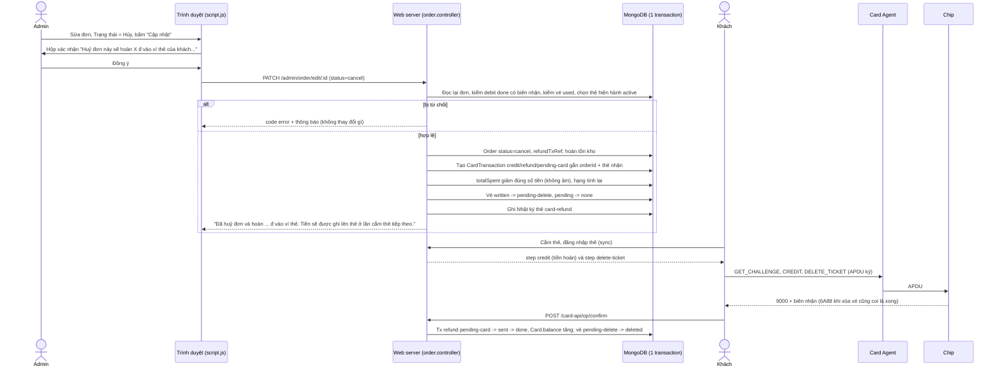
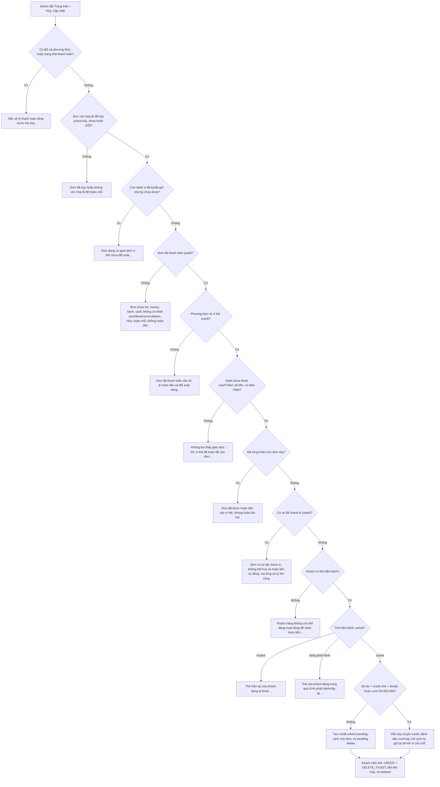

# 11. Hủy đơn, hoàn tiền vào ví thẻ và xóa vé trên thẻ

Admin hủy một đơn khách đã trả bằng **ví thẻ**: hệ thống tự tạo khoản hoàn tiền (`credit`, nguồn `refund`, trạng thái `pending-card`), hoàn tồn kho, giảm `totalSpent` của khách và chuyển vé trên đơn sang `pending-delete`. Ở lần cắm thẻ kế tiếp, vòng đồng bộ ghi tiền hoàn lên chip (lệnh CREDIT) và xóa vé khỏi chip (lệnh DELETE_TICKET). Đơn trả bằng tiền mặt/chuyển khoản chưa thanh toán vẫn hủy được như trước (mục "Biến thể" bên dưới).

## Mục đích

- Kiểm tra hủy đơn ví thẻ: đơn `cancel`, tồn kho hoàn, khoản hoàn `pending-card` đúng số tiền đúng một lần, `totalSpent` giảm.
- Kiểm tra vòng đời vé khi hủy: `written` -> `pending-delete` -> `deleted`; `pending` -> `none` (hoặc `pending-delete` nếu đã ký lệnh ghi).
- Kiểm tra các trường hợp bị từ chối: khoản trừ ví chưa có biên nhận, vé đã check-in, không có thẻ hiện hành đang hoạt động, thẻ khóa/đang phát hành, hoàn lần hai.
- Kiểm tra xóa (ẩn) đơn `deletePatch`: chỉ đơn vãng lai đã hủy, chưa trả, không vé/giao dịch thẻ.

## Ai thực hiện & quyền

| Mục | Giá trị |
|---|---|
| Vai trò | Admin hủy đơn; khách cắm thẻ để đồng bộ (nhận tiền hoàn và xóa vé) |
| Quyền | `order-edit` cho `PATCH /admin/order/edit/:id` (hủy/sửa đơn). Xóa đơn `PATCH /admin/order/delete/:id` có kiểm quyền riêng (thông báo "Bạn không có quyền xóa đơn hàng."). Đồng bộ phía khách không cần quyền admin |
| Step-up | Không cần |
| Thiếu quyền | Hủy: JSON 403 "Bạn không có quyền sửa đơn hàng." (trang: "Bạn không có quyền sử dụng tính năng này!") |

## Điều kiện trước

- Đã xong [08](08-dat-tour-thanh-toan-vi-the.md) và [09](09-ghi-ve-len-the-dong-bo.md): có **một đơn đã thanh toán bằng ví thẻ** (`paymentMethod card`, `paymentStatus paid`), khoản trừ `debit` ở trạng thái `done` (đã có biên nhận chip), vé đã `written` trên chip (hoặc `pending`).
- Khách A có **thẻ hiện hành đang `active`** (slot 1) để nhận tiền hoàn. Admin đăng nhập `/admin/account/login`, có quyền `order-edit`.
- Đơn **chưa check-in**: không mục nào có vé `used` (xem hàng 3 bảng lỗi).
- Muốn đặt đơn mới: khách seed có số điện thoại `0000000001` bị giỏ hàng từ chối. Hãy tạo khách mới có số điện thoại thật rồi phát hành thẻ ([03](03-phat-hanh-the-khach-hang.md)) và nạp tiền ([06](06-nap-tien-mat-tai-quay.md)); xem [92](92-han-che-va-xu-ly-su-co.md).
- Ghi lại trước khi hủy: số dư ví, `totalSpent`/hạng của khách, tồn kho tour, `ticketStatus` của đơn.

## Sơ đồ luồng hoạt động

### Sơ đồ tuần tự

### Sơ đồ quyết định (nhánh khi bấm hủy)

Ghi chú: thứ tự kiểm tra trong mã còn có bước đọc lại đơn trong transaction và (khi bị lệch dữ liệu) các thông báo chung ở bảng lỗi; sơ đồ trên chỉ thể hiện các nhánh chính. Quy tắc vé đã check-in là một nhánh từ chối: không có gì thay đổi (đơn, tồn kho, ví, `totalSpent`, vé đều giữ nguyên).

## Các bước test (happy path)

1. Ghi lại: số dư ví khách A (ví dụ 5.000.000 đ), `totalSpent`, tồn kho tour, đơn trả ví 1.500.000 đ với vé `written` (đã đồng bộ ở [09](09-ghi-ve-len-the-dong-bo.md)).
2. Admin vào `/admin/order/list`, mở **Sửa đơn** `/admin/order/edit/<id>`. Trên trang có dòng ghi chú: "Đơn đã thanh toán bằng ví thẻ: nếu huỷ đơn, hệ thống sẽ tự hoàn 1.500.000đ vào ví thẻ của khách (ghi lên thẻ ở lần cắm thẻ tiếp theo)."
3. Đặt "Trạng thái" = **Hủy** (không đổi gì khác), bấm **"Cập nhật"**. Hộp xác nhận: "Huỷ đơn này sẽ hoàn 1.500.000 đ vào ví thẻ của khách. Tiền sẽ được ghi lên thẻ ở lần cắm thẻ tiếp theo. Tiếp tục huỷ đơn?". Chọn đồng ý.
4. Thông báo thành công: "Đã huỷ đơn và hoàn 1.500.000 đ vào ví thẻ. Tiền sẽ được ghi lên thẻ ở lần cắm thẻ tiếp theo." Trang tải lại; đơn hiển thị "Hủy" và dòng "Đã hoàn 1.500.000đ vào ví thẻ (mã giao dịch ...): Chờ ghi lên thẻ ở lần cắm thẻ tiếp theo."
5. Kiểm tra DB/admin ngay (chưa cắm thẻ): đơn `status cancel`, `paymentStatus paid` (giữ nguyên), `refundTxRef` có giá trị; tồn kho/số chỗ tour tăng lại; Tx `credit`/`refund` `pending-card` đúng 1.500.000; `totalSpent` khách giảm 1.500.000 (hạng tính lại); vé `written` -> `pending-delete`. Số dư trên chip **chưa đổi**.
6. Nhật ký thẻ (`/admin/card/log`, lọc `card-refund`): một dòng success, chi tiết có mã đơn, `txRef`, số tiền, `totalSpentBefore/After`.
7. Khách A cắm slot 1, đăng nhập bằng thẻ ([04](04-khach-dang-nhap-bang-the.md)): vòng đồng bộ chạy `credit` (tiền hoàn) và `delete-ticket`. Số dư ví tăng 1.500.000 (5.000.000 -> 6.500.000). Tx refund `pending-card` -> `done`; vé `pending-delete` -> `deleted`.
8. `/account/card`: lịch sử có dòng nhãn **"Hoàn tiền"** (không phải "Nạp"). "Đọc thẻ": số dư mới, vé đó biến mất ("Chưa có vé trên thẻ." nếu là vé duy nhất).
9. Thử hủy lại cùng đơn (F5/bấm lại): bị từ chối, không hoàn lần hai (hàng 12 bảng lỗi).
10. (Tùy chọn) Xóa đơn: chỉ đơn vãng lai đã hủy, chưa trả, không vé/giao dịch mới ẩn được qua `PATCH /admin/order/delete/:id`; đơn của khách có thẻ bị chặn (hàng 18).

## Biến thể: đơn chưa thanh toán (không phải ví)

- Đơn tiền mặt/chuyển khoản/ví **chưa trả** hủy được: thông báo "Đã hủy đơn và hoàn tồn kho." (flash "Đã hủy đơn và hoàn số chỗ."), không có khoản hoàn tiền. Vé `pending` chưa ký -> `none`; vé đã ký ghi -> `pending-delete`.
- Đơn tiền mặt/chuyển khoản **đã trả**, hoặc zalopay/vnpay/momo đã trả: bị từ chối "Đơn đã thanh toán cần xử lý hoàn tiền và đối soát riêng." (không tự hoàn).

## Kết quả mong đợi

**Trên giao diện**
- Trang sửa đơn trước khi hủy hiện ghi chú hoàn tiền; sau khi hủy hiện dòng "Đã hoàn Xđ vào ví thẻ (mã giao dịch ...): <trạng thái>". Nhãn trạng thái: "Chờ ghi lên thẻ ở lần cắm thẻ tiếp theo", "Đang ghi lên thẻ, chờ biên nhận", "Đã ghi lên thẻ", "Chờ đối soát", "Đã hoàn tiền mặt khi thu hồi thẻ".
- Khách thấy "Hoàn tiền" trong lịch sử ví sau khi đồng bộ.

**Trên chip**
- Trước khi cắm đồng bộ: không đổi. Sau đồng bộ: số dư tăng đúng số tiền hoàn (biên nhận chip ký), vé đã giải phóng slot. Nếu chip không còn vé đó (6A88) vẫn coi là xóa xong.

**Trong dữ liệu**
- `orders`: `status cancel`, `refundTxRef`, `stockRestoredAt`; `items[].ticketStatus` `written` -> `pending-delete` -> `deleted`.
- `card-transactions`: một `credit` `source refund` gắn `orderId`; `pending-card` -> `sent` -> `done`. Chỉ một khoản hoàn cho mỗi đơn (chỉ mục duy nhất).
- `customers.totalSpent` giảm đúng số tiền (tối thiểu 0), hạng tính lại.
- Thẻ nhận hoàn là **thẻ hiện hành đang active** của khách (có thể khác thẻ đã dùng để trả nếu đã cấp lại).

**Trong Nhật ký thẻ**
- `card-refund` (success) khi hủy; `ticket-order-cancel` cho vé; `card-debit-void` nếu có debit chưa ký bị đóng; khi sync: `card-sync-op`, `card-op-sign`, `card-op-confirm`. Khoản hoàn vượt trần: `card-sync-credit-held` (một lần).

## Ngoại lệ & trường hợp lỗi

Thông báo hiển thị nguyên văn ở hộp cảnh báo của trang sửa đơn.

| # | Tình huống | Cách tái hiện | Kết quả / thông báo mong đợi |
|---|---|---|---|
| 1 | Hủy cùng lúc với đổi thanh toán | Đổi phương thức/trạng thái thanh toán và Trạng thái = Hủy trong một lần | 409 "Hãy xử lý thanh toán riêng trước khi hủy." |
| 2 | Khoản trừ ví chưa có biên nhận | Đơn có debit `sent`/đã ký chưa `done` (ví dụ mất mạng sau khi chip trừ tiền) | "Đơn đang có giao dịch ví thẻ chưa đối soát; hãy để khách cắm thẻ đồng bộ trước". Không đổi gì. Khách đồng bộ rồi hủy lại |
| 3 | Có vé đã check-in (`used`) | Check-in một mục của đơn ([10](10-check-in-tour.md)) rồi hủy đơn ví | "Đơn có vé đã check-in, không thể huỷ và hoàn tiền tự động. Vui lòng xử lý thủ công." Không có gì thay đổi (đơn, ví, vé, tồn kho) |
| 4 | Không tìm thấy debit hoàn tất | Đơn `paid` bằng ví nhưng không có Tx debit `done` khớp (dữ liệu lệch) | "Không tìm thấy giao dịch trừ ví thẻ đã hoàn tất của đơn; cần đối soát thủ công trước khi huỷ." |
| 5 | Khách không còn thẻ hiện hành | Thẻ bị thu hồi mà chưa cấp lại | "Khách hàng không còn thẻ đang hoạt động để nhận hoàn tiền. Hãy cấp lại thẻ cho khách rồi huỷ đơn, hoặc xử lý hoàn tiền thủ công." |
| 6 | Thẻ hiện hành đang khóa | Khóa thẻ ở [13](13-khoa-mo-khoa-thu-hoi-the.md) rồi hủy đơn | "Thẻ hiện tại của khách đang bị khoá. Hãy mở khoá hoặc cấp lại thẻ trước khi huỷ đơn để hoàn tiền vào ví thẻ." |
| 7 | Thẻ đang phát hành/cấp lại | Thẻ hiện hành chưa `active` | "Thẻ của khách đang trong quá trình phát hành/cấp lại. Hãy hoàn tất phát hành thẻ trước khi huỷ đơn để hoàn tiền vào ví thẻ." |
| 8 | Trạng thái thẻ đổi giữa chừng | Thẻ vừa bị khóa/thu hồi trong lúc hủy | "Trạng thái thẻ của khách vừa thay đổi. Hãy tải lại trang." |
| 9 | Thẻ thanh toán đã thu hồi/cấp lại | Đã làm [14](14-cap-lai-the.md) sau khi trả đơn | Không lỗi: hoàn vào **thẻ hiện hành**; thông báo thêm "Khoản hoàn được ghi vào thẻ hiện tại của khách (thẻ đã dùng thanh toán không còn hoạt động)." |
| 10 | Vượt trần ví 50.000.000 | Số dư + credit chờ + tiền hoàn > 50.000.000 | Không từ chối: hủy thành công, thông báo thêm "Lưu ý: số dư ví cộng khoản hoàn vượt hạn mức 50.000.000 đ nên khi đồng bộ khoản này sẽ được giữ lại cho tới khi ví còn đủ hạn mức hoặc được đối soát thủ công." Log `card-refund` có `overCap`; sync ghi `card-sync-credit-held`, chưa ký credit |
| 11 | Đơn đã trả bằng phương thức khác | Đơn tiền mặt/chuyển khoản/cổng đã `paid` | "Đơn đã thanh toán cần xử lý hoàn tiền và đối soát riêng." |
| 12 | Hoàn lần hai / double submit | Bấm "Cập nhật" hai lần, hoặc 2 tab | Lượt thứ hai không tạo khoản hoàn mới: "Đơn đã được hoàn tiền vào ví thẻ, không hoàn lần hai." hoặc "Đơn đã hủy hoặc không còn hợp lệ để hoàn chỗ." / "Đơn hàng đã huỷ, không thể đổi sang trạng thái khác!". Chỉ một `credit refund` |
| 13 | Đơn đã hủy, đổi trạng thái khác | Sửa đơn Hủy sang Khởi tạo/Hoàn thành | "Đơn hàng đã huỷ, không thể đổi sang trạng thái khác!" |
| 14 | Đơn ví đã trả, chuyển về chưa thanh toán | Sửa "Trạng thái thanh toán" = Chưa thanh toán | "Đơn đã được thanh toán bằng ví thẻ, không thể chuyển về chưa thanh toán!" |
| 15 | Đánh dấu trả ví thủ công | Đổi đơn `card` sang đã thanh toán bằng tay | "Thanh toán ví thẻ chỉ được xác nhận bằng biên nhận trừ tiền hợp lệ!" / "Không thể ghi nhận thanh toán cho đơn hàng này!" |
| 16 | Đơn chưa trả, phương thức lạ | Đơn zalopay/vnpay chưa trả | "Phương thức thanh toán này cần đối soát trước khi hủy." |
| 17 | Đơn chưa trả nhưng đã có debit | Dữ liệu lệch | "Giao dịch ví thẻ cần đối soát trước khi hủy." |
| 18 | Xóa đơn không đủ điều kiện | `PATCH /admin/order/delete/:id` với đơn khách có thẻ/đã trả/có vé/Tx | "Chỉ có thể ẩn đơn khách vãng lai đã hủy và chưa thanh toán." / "Đơn còn dữ liệu vé cần đối soát." / "Đơn có lịch sử giao dịch thẻ, không thể ẩn." |
| 19 | Hủy khi vé `pending` chưa ký ghi | Hủy trước khi khách đồng bộ ghi vé | `ticketStatus` `pending` -> `none` (không cần xóa chip) |
| 20 | Hủy khi vé `pending` đã ký ghi | Chip đã ghi nhưng chưa xác nhận (`writeSignedAt`) | `pending` -> `pending-delete`; sync `delete-ticket` (6A88 vẫn coi thành công) |
| 21 | Khách chưa đồng bộ sau khi hủy | Không cắm thẻ | Tiền hoàn vẫn `pending-card`, vé vẫn `pending-delete`, chip còn vé; check-in báo "Vé không còn hiệu lực trên thẻ." (xem [10](10-check-in-tour.md)) |
| 22 | Thiếu quyền `order-edit` | Nhóm quyền không có | 403 "Bạn không có quyền sửa đơn hàng." / "Bạn không có quyền sử dụng tính năng này!" |
| 23 | Sync khi Agent tắt / cắm sai thẻ | Tắt Agent / đổi slot | "Không kết nối được Card Agent" / "Đang cắm thẻ khác. Vui lòng cắm đúng thẻ của bạn." |
| 24 | Timeout mạng khi sync | Ngắt mạng khi đồng bộ | "Yêu cầu quá thời gian. Vui lòng kiểm tra kết nối." |

## Checklist

- [ ] Happy path: hủy đơn ví, thông báo hoàn tiền, hộp xác nhận hiện đúng số tiền
- [ ] Trước sync: Tx refund `pending-card` đúng số tiền, `totalSpent` giảm, vé `pending-delete`, tồn kho hoàn, chip chưa đổi
- [ ] Sau sync: số dư chip tăng, Tx `done`, vé `deleted`, lịch sử khách ghi "Hoàn tiền"
- [ ] Nhật ký `card-refund` đúng một dòng
- [ ] Hàng 1, 2, 3 (đổi thanh toán, debit chưa đối soát, vé đã check-in: không đổi gì)
- [ ] Hàng 4 đến 8 (không debit hợp lệ, không thẻ, thẻ khóa/phát hành/đổi trạng thái)
- [ ] Hàng 9, 10 (thẻ đã cấp lại, vượt trần)
- [ ] Hàng 11, 12, 13 (khác phương thức, hoàn lần hai, đơn đã hủy)
- [ ] Hàng 14 đến 17 (trạng thái thanh toán)
- [ ] Hàng 18 (xóa đơn), 19 đến 21 (trạng thái vé), 22 đến 24

## Liên quan

[08](08-dat-tour-thanh-toan-vi-the.md) | [09](09-ghi-ve-len-the-dong-bo.md) | [10](10-check-in-tour.md) | [14](14-cap-lai-the.md) | [92](92-han-che-va-xu-ly-su-co.md)
