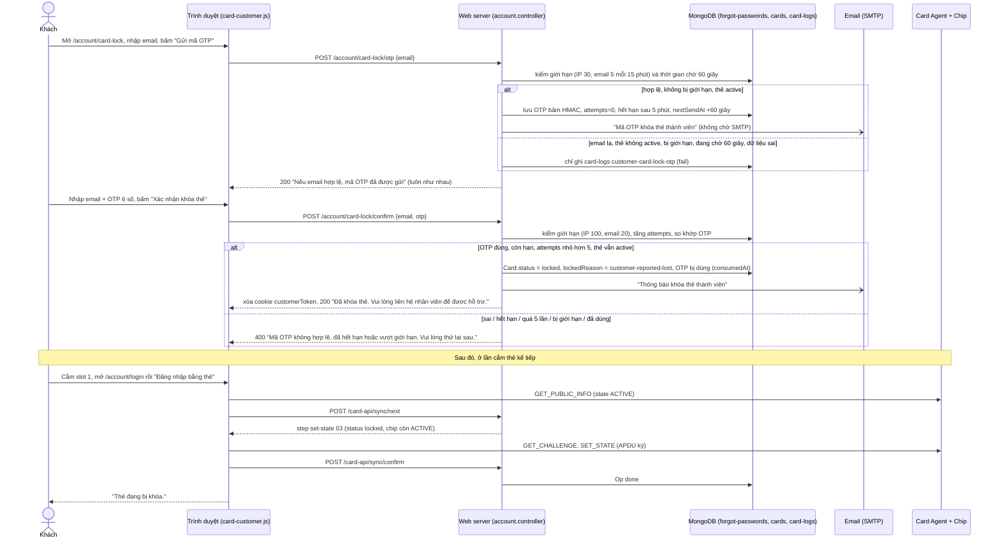
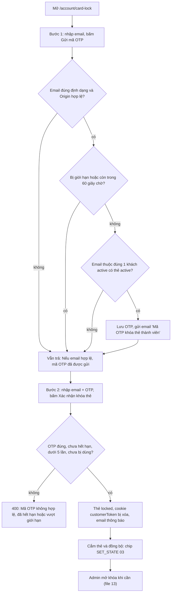

# 12. Khách báo mất thẻ và khóa thẻ qua OTP email

Khách làm mất thẻ có thể tự khóa thẻ mà **không cần thẻ và không cần đăng nhập**: nhập email chủ thẻ, nhận mã OTP 6 số qua email, nhập lại OTP để khóa. Chip chưa bị khóa ngay: chỉ trạng thái trên server đổi, chip bị khóa ở lần cắm thẻ kế tiếp (đồng bộ).

## Mục đích

- Kiểm tra khách tự khóa được thẻ đang hoạt động bằng email + OTP (hiệu lực 5 phút, tối đa 5 lần nhập).
- Kiểm tra các lớp chống lạm dụng: câu trả lời chung (không lộ email có tồn tại hay không), thời gian chờ gửi lại 60 giây, giới hạn theo email và theo IP.
- Kiểm tra hậu quả: thẻ ở trạng thái `locked` (lý do `customer-reported-lost`), phiên đăng nhập của khách bị vô hiệu, chip bị khóa (`SET_STATE 03`) khi cắm lại.

## Ai thực hiện & quyền

| Vai trò | Quyền / điều kiện |
|---|---|
| Khách hàng (chưa hoặc đã đăng nhập) | Không cần quyền, không cần thẻ, không cần phiên. Chỉ cần **email của khách đọc được** và khách có **thẻ khách đang `active`, `isCurrent`**. |
| Admin (bước mở khóa sau đó) | `card-lock` ([13](13-khoa-mo-khoa-thu-hoi-the.md)); không cần step-up cho mở khóa. |

Không có step-up. Không có PIN trong luồng này.

## Điều kiện trước

- Đã làm [03](03-phat-hanh-the-khach-hang.md): thẻ khách A (slot 1) ở trạng thái `active`, chủ thẻ có email thật đọc được (SMTP phải chạy; nếu mail lỗi thì không có OTP để thử).
- Thẻ **đang `active`**. Nếu thẻ đã `locked` hoặc `revoked`, hệ thống vẫn trả câu trả lời chung nhưng không gửi OTP.
- Không cần Card Agent cho bước báo mất; cần Agent + slot 1 cho bước kiểm tra chip bị khóa (bước 8).
- Khuyến nghị dùng thẻ **khách A** ở bước cuối của kịch bản [90](90-kich-ban-end-to-end.md) sau khi đã test nạp/mua/check-in, hoặc dùng khách B (slot 3) nếu không muốn ảnh hưởng khách A.

## Sơ đồ luồng hoạt động

## Các bước test (happy path)

1. Mở `http://localhost:3002/account/login`, bấm liên kết **"Mất thẻ? Khóa thẻ qua email"** (hoặc vào thẳng `http://localhost:3002/account/card-lock`; từ trang "Thẻ của tôi" có liên kết **"Báo mất và khóa thẻ"**). Tiêu đề trang: "Khóa thẻ bị mất".
2. **Bước 1.** Ô "Email chủ thẻ": nhập email của khách A (không phân biệt hoa thường). Bấm **"Gửi mã OTP"**. Dòng trạng thái hiện (từ trên xuống): "Đang xử lý…" rồi "Nếu email hợp lệ, mã OTP đã được gửi". Ô email của Bước 2 được tự điền lại cùng giá trị.
3. Mở hộp thư: email tiêu đề **"Mã OTP khóa thẻ thành viên"**, nội dung "Mã OTP khóa thẻ: <b>NNNNNN</b>. Mã có hiệu lực 5 phút. Không cung cấp mã cho người khác."
4. **Bước 2.** Ô "Mã OTP gồm 6 chữ số": nhập 6 số (ô dạng mật khẩu). Bấm **"Xác nhận khóa thẻ"** trong 5 phút. Thông báo: "Đã khóa thẻ. Vui lòng liên hệ nhân viên để được hỗ trợ." Nút "Đăng xuất" trên header bị ẩn, ô OTP bị xóa.
5. Hộp thư: email tiêu đề **"Thông báo khóa thẻ thành viên"** ("Thẻ thành viên đã được khóa theo yêu cầu báo mất. Vui lòng liên hệ nhân viên để được hỗ trợ.").
6. Admin (hồ sơ trình duyệt khác, đã đăng nhập bằng thẻ slot 0): `/admin/card/list`, tìm thẻ khách A, mở chi tiết. Trạng thái server: **"Đã khóa"**, mục "Lý do khóa / thu hồi": `customer-reported-lost`.
7. Thử đăng nhập lại ở trình duyệt khách bằng cookie cũ: vào `/account/card` sẽ bị chuyển về `/account/login` (cookie đã bị xóa, thẻ không còn `active`).
8. Đổi sang thẻ khách: `curl -X POST -H 'Origin: http://localhost:3002' -H 'Content-Type: application/json' -d '{"slot":1}' http://127.0.0.1:31999/v1/sim/slot`. Ở `/account/login` bấm **"Đăng nhập bằng thẻ"**: trình duyệt đọc thẻ, đồng bộ nhận lệnh `set-state 03` (chip chuyển LOCKED) rồi báo **"Thẻ đang bị khóa."** (không hiện hộp PIN).
9. Mở khóa lại để test tiếp: xem [13](13-khoa-mo-khoa-thu-hoi-the.md) mục A.

Thử giới hạn (tùy chọn):
10. Gửi OTP, rồi bấm "Gửi mã OTP" lần nữa trong vòng 60 giây: vẫn báo thông báo chung nhưng **không có email thứ hai** (và OTP cũ vẫn dùng được).
11. Gửi OTP mới, nhập sai OTP 5 lần liên tiếp rồi nhập OTP **đúng**: vẫn báo lỗi (đã hết 5 lần). Phải chờ 60 giây rồi gửi OTP mới (OTP mới đặt lại số lần thử về 0).

## Kết quả mong đợi

- **Trên giao diện:** các thông báo ở các bước trên; sau khi khóa, khách bị đăng xuất ngầm (cookie `customerToken` bị xóa; middleware cũng coi token vô hiệu vì thẻ không còn `active`). Đăng nhập thẻ báo "Thẻ đang bị khóa.".
- **Trên chip:** ngay sau khi báo mất chip **vẫn ACTIVE**. Sau lần cắm + đồng bộ (bước 8) chip ở trạng thái LOCKED (`0x03`): chỉ nhận `GET_PUBLIC_INFO`, `GET_CHALLENGE`, `SET_STATE`.
- **Trong dữ liệu:**
  - `cards`: `status = locked`, `lockedReason = customer-reported-lost`, `isCurrent = true` (số dư và credit chờ giữ nguyên).
  - `forgot-passwords` (khóa theo HMAC, `purpose = customer-card-lock`): `otpHash`, `salt`, `attempts`, `expireAt` (+5 phút), `nextSendAt` (+60 giây), `emailStatus` (`pending`/`sent`/`failed`/`busy`/`not-applicable`); sau khi khóa: `consumedAt` có giá trị, `otpHash`/`salt` bị xóa. Các bản ghi giới hạn `purpose = customer-card-lock-limit` (cửa sổ 15 phút).
  - `card-operations`: sau bước 8 có op `set-state` (`state: 3`) trạng thái `done`.
- **Trong Nhật ký thẻ** (`/admin/card/log`, lọc "Thao tác" đúng chuỗi): `customer-card-lock-otp` (success `accepted` hoặc fail `limited`/`INVALID_INPUT`/`UNAVAILABLE`), `customer-card-lock-mail` (kết quả gửi email OTP: `sent`/`failed`/`busy`), `customer-card-lock` (success `reason: customer-reported-lost`, hoặc fail `OTP_INVALID`/`INVALID_INPUT`/`UNAVAILABLE`), `customer-card-lock-notice` (email thông báo), rồi `card-sync-op` (set-state).

## Ngoại lệ & trường hợp lỗi

| # | Tình huống | Cách tái hiện | Kết quả / thông báo mong đợi (exact text) |
|---|---|---|---|
| 1 | Email không có trong hệ thống / không có thẻ | Bước 1 với email lạ | 200 "Nếu email hợp lệ, mã OTP đã được gửi" (giống hệt trường hợp đúng; không gửi email; chống dò email). Server còn chờ tối thiểu ~120 ms để thời gian phản hồi không lộ thông tin. |
| 2 | Email đúng nhưng thẻ đã `locked`/`revoked`/`issuing` | Báo mất lần hai, hoặc thẻ đã bị admin khóa | Cùng câu trả lời chung, không có email OTP; ở Bước 2 mọi OTP đều bị từ chối. |
| 3 | Gửi lại trong 60 giây | Bấm "Gửi mã OTP" hai lần liên tiếp | Cùng thông báo chung, không gửi email mới, OTP cũ không bị thay. |
| 4 | Vượt giới hạn gửi | Gửi hơn 5 lần/email hoặc 30 lần/IP trong 15 phút (cần chờ 60 giây giữa các lần để vượt cooldown) | Thông báo chung như cũ nhưng không gửi email; nhật ký `customer-card-lock-otp` fail `limited`. |
| 5 | OTP sai | Bước 2 nhập 6 số bất kỳ | 400 "Mã OTP không hợp lệ, đã hết hạn hoặc vượt giới hạn. Vui lòng thử lại sau." (mỗi lần thử tăng `attempts`). |
| 6 | OTP hết hạn | Chờ hơn 5 phút rồi nhập OTP đúng | 400, cùng thông báo như dòng 5. |
| 7 | Quá 5 lần nhập | Nhập sai 5 lần, lần 6 nhập đúng | 400, cùng thông báo; phải gửi OTP mới (sau 60 giây). |
| 8 | OTP đã dùng | Dùng lại OTP đúng sau khi khóa thành công | 400, cùng thông báo (`consumedAt` đã có; thẻ cũng không còn `active`). |
| 9 | Vượt giới hạn xác nhận | Hơn 20 lần/email hoặc 100 lần/IP trong 15 phút | 400, cùng thông báo. |
| 10 | Định dạng sai | Gỡ ràng buộc HTML rồi gửi OTP không phải 6 chữ số, hoặc email sai định dạng | Bước 1: vẫn thông báo chung (nhật ký fail `INVALID_INPUT`); Bước 2: 400 như dòng 5. |
| 11 | Origin khác | Gọi API từ trang `http://127.0.0.1:3002` (header Origin lệch Host) | Bước 1: thông báo chung (không xử lý); Bước 2: 400 như dòng 5. |
| 12 | Hai khách trùng email (không phân biệt hoa thường) | Dữ liệu có 2 khách `active` cùng email | Không tìm được khách duy nhất: coi như email lạ (thông báo chung, không OTP). |
| 13 | SMTP lỗi hoặc đang bận (đã có 4 email chờ gửi) | SMTP hỏng/treo | Vẫn thông báo chung; không có email; `emailStatus` = `failed`/`busy` và nhật ký `customer-card-lock-mail` fail. Server không chờ SMTP. |
| 14 | F5 / bấm đúp "Xác nhận khóa thẻ" | Gửi hai lần liên tiếp | Lần đầu thành công; lần hai bị từ chối (OTP đã dùng) hiển thị lỗi 400 chung. Nút bị vô hiệu trong lúc xử lý ("Đang xử lý…"). |
| 15 | Khóa khi đang có phiên | Khách đang đăng nhập ở tab khác | Tab kia: lần tải `/account/card` kế tiếp bị chuyển về `/account/login`; API `GET /account/card/snapshot` trả 401 "Vui lòng đăng nhập bằng thẻ.". |
| 16 | Cắm sai thẻ / chưa cắm (bước 8) | Slot khác hoặc `curl` slot lỗi | Agent 503 `no-card` hoặc thẻ khác: "Không thể kết nối. Vui lòng kiểm tra Card Agent và thử lại." / "Đang cắm thẻ khác. Vui lòng cắm đúng thẻ của bạn." |
| 17 | Mở khóa rồi OTP cũ | Khóa, admin mở khóa, dùng lại OTP | 400 như dòng 8 (OTP đã bị dùng). |

## Checklist

- [ ] Trang `/account/card-lock` mở được khi chưa đăng nhập; có liên kết từ trang đăng nhập và từ "Thẻ của tôi".
- [ ] Gửi OTP với email thật: thông báo chung + nhận email "Mã OTP khóa thẻ thành viên".
- [ ] Gửi OTP với email lạ: cùng thông báo, không có email.
- [ ] Gửi lại trong 60 giây: không có email mới.
- [ ] OTP sai: 400 đúng thông báo; sai 5 lần rồi nhập đúng vẫn bị từ chối.
- [ ] OTP hết hạn (sau 5 phút): bị từ chối.
- [ ] OTP đúng: "Đã khóa thẻ. Vui lòng liên hệ nhân viên để được hỗ trợ." + email "Thông báo khóa thẻ thành viên".
- [ ] Admin thấy thẻ "Đã khóa", lý do `customer-reported-lost`.
- [ ] Cookie `customerToken` bị xóa, `/account/card` chuyển về `/account/login`.
- [ ] Cắm slot 1 + đăng nhập: đồng bộ `set-state 03`, báo "Thẻ đang bị khóa.".
- [ ] Nhật ký có `customer-card-lock-otp`, `customer-card-lock`, `customer-card-lock-notice`.
- [ ] OTP đã dùng không dùng lại được.

## Liên quan

[13 Khóa, mở khóa, thu hồi](13-khoa-mo-khoa-thu-hoi-the.md) | [04 Đăng nhập khách](04-khach-dang-nhap-bang-the.md) | [18 Nhật ký](18-nhat-ky-the.md) | [91 Bảng mã lỗi](91-bang-ma-loi.md) | [92 Hạn chế](92-han-che-va-xu-ly-su-co.md)
