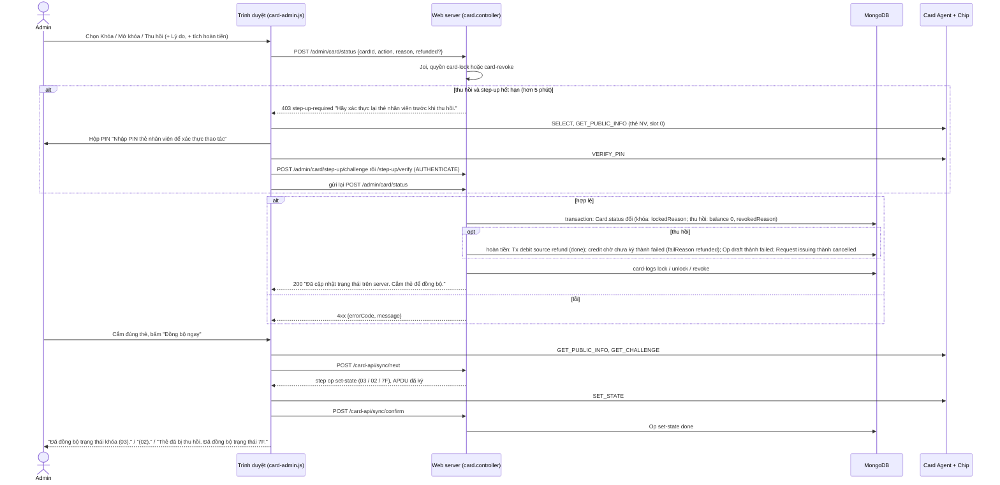
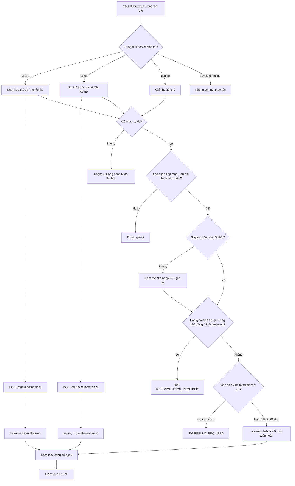

# 13. Khóa, mở khóa và thu hồi thẻ (admin)

Admin đổi trạng thái thẻ trên trang chi tiết thẻ: **Khóa** (tạm dừng), **Mở khóa** (dùng lại), **Thu hồi** (vĩnh viễn, có hoàn tiền). Mọi thay đổi **chỉ đổi trên server trước**; chip đổi trạng thái khi thẻ được cắm và đồng bộ (nút "Đồng bộ ngay" hoặc khi khách/nhân viên mở phiên thẻ).

## Mục đích

- Kiểm tra máy trạng thái `active -> locked -> active` và `active/locked/issuing -> revoked`.
- Kiểm tra thu hồi: bắt lý do, bắt xác nhận hoàn tiền khi còn tiền, tạo bút toán hoàn, step-up 5 phút, chặn khi còn giao dịch/lệnh chưa đối soát.
- Kiểm tra chip nhận `SET_STATE` (03, 02, 7F) đúng khi đồng bộ; thu hồi xóa dữ liệu trên chip.

## Ai thực hiện & quyền

| Thao tác | Quyền (`config/permission.js`) | Step-up (thẻ NV, 5 phút) |
|---|---|---|
| Khóa / Mở khóa / "Đồng bộ ngay" | `card-lock` ("Khóa và mở khóa thẻ") | Không |
| Thu hồi | `card-revoke` ("Thu hồi thẻ") | **Có** (thiếu thì "Hãy xác thực lại thẻ nhân viên trước khi thu hồi.") |
| Xem trang chi tiết | `card-view` | Không |

Nút nào chỉ hiện khi tài khoản có quyền tương ứng; ô "Lý do" và dấu tích hoàn tiền chỉ hiện khi có `card-lock`/`card-revoke`. Thiếu quyền mà gọi API: JSON `OP_FORBIDDEN` với thông báo "Bạn không có quyền sử dụng tính năng này!".

## Điều kiện trước

- Đã làm [02](02-dang-nhap-admin-bang-the.md): admin đăng nhập **bằng thẻ nhân viên (slot 0)** để có phiên có `cardId`. Không có phiên này thì step-up không dùng được (xem [92](92-han-che-va-xu-ly-su-co.md)).
- Đã làm [03](03-phat-hanh-the-khach-hang.md): có khách B (slot 3) `active` để thử **thu hồi**, khách A (slot 1) để thử **khóa/mở khóa**. Để thử hoàn tiền, nạp tiền mặt cho thẻ trước ([06](06-nap-tien-mat-tai-quay.md)) và để lại một ít số dư.
- Trang: `http://localhost:3002/admin/card/detail/<cardId>` (mở từ `/admin/card/list`), mục "Thao tác thẻ" > "Trạng thái thẻ".

## Sơ đồ luồng hoạt động

Quy tắc chuyển trạng thái (`helpers/card-op.helper.js`, `cardStatus.nextStatus`): Khóa chỉ từ `active`; Mở khóa chỉ từ `locked`; Thu hồi từ `active`, `locked` hoặc `issuing`.

## Các bước test (happy path)

### A. Khóa và mở khóa (khách A, slot 1)

1. Đăng nhập admin bằng thẻ (slot 0): `http://localhost:3002/admin/account/login` ([02](02-dang-nhap-admin-bang-the.md)). Vào menu **"Quản lý thẻ"** (`/admin/card/list`), bấm mã thẻ khách A.
2. Mục "Trạng thái thẻ": ô **"Lý do (bắt buộc khi thu hồi)"** nhập `test khóa` (tùy chọn với khóa). Bấm **"Khóa thẻ"**. Thông báo: "Đã cập nhật trạng thái trên server. Cắm thẻ để đồng bộ. Nếu vừa xác thực lại, hãy cắm thẻ đang xem trước khi bấm Đồng bộ ngay." Nhãn trạng thái đổi thành "Đã khóa" (không cần tải lại); nút "Khóa thẻ" ẩn, "Mở khóa thẻ" hiện.
3. Đổi sang thẻ khách A: `curl -X POST -H 'Origin: http://localhost:3002' -H 'Content-Type: application/json' -d '{"slot":1}' http://127.0.0.1:31999/v1/sim/slot`.
4. Bấm **"Đồng bộ ngay"**. Thông báo "Đang đồng bộ; giữ nguyên thẻ đang xem trong đầu đọc…" rồi **"Đã đồng bộ trạng thái khóa (03)."** (không hỏi PIN).
5. (Phía khách, cửa sổ ẩn danh) `/account/login` > "Đăng nhập bằng thẻ": báo **"Thẻ đang bị khóa."**. Cookie khách cũ: `/account/card` chuyển về `/account/login`.
6. Quay lại admin, bấm **"Mở khóa thẻ"**: nhãn "Đang hoạt động", cùng thông báo "Đã cập nhật trạng thái trên server. Cắm thẻ để đồng bộ...". Slot vẫn là 1, bấm **"Đồng bộ ngay"**: **"Đã đồng bộ trạng thái hoạt động (02)."** Khách đăng nhập lại bình thường.

### B. Thu hồi (khách B, slot 3)

1. Nạp trước ít tiền mặt cho khách B ([06](06-nap-tien-mat-tai-quay.md)) và đồng bộ để có số dư (hoặc bỏ qua để thử thu hồi không dư).
2. Admin mở chi tiết thẻ khách B. Để trống "Lý do" rồi bấm **"Thu hồi thẻ"**: "Vui lòng nhập lý do thu hồi." (chặn ở trình duyệt, chưa gọi server).
3. Nhập lý do `test thu hồi`. Nếu thẻ còn số dư hoặc credit chờ: chưa tích **"Tôi xác nhận đã hoàn tiền mặt cho chủ thẻ"** rồi bấm "Thu hồi thẻ", đồng ý hộp thoại: server trả `REFUND_REQUIRED` hiển thị "Thẻ còn số dư, hãy xác nhận đã hoàn tiền hoặc dùng Cấp lại thẻ".
4. Tích dấu hoàn tiền, bấm **"Thu hồi thẻ"**, hộp thoại xác nhận "Thu hồi thẻ là vĩnh viễn. Nếu chọn hoàn tiền, hãy bảo đảm đã hoàn tiền mặt cho chủ thẻ. Tiếp tục?" bấm OK.
5. Nếu quá 5 phút từ lúc đăng nhập/xác thực lại: dòng trạng thái "Hãy cắm thẻ nhân viên của tài khoản hiện tại, sau đó nhập PIN trong hộp thoại để xác thực lại." Chạy lệnh đổi slot sang **0** (`{"slot":0}`), hộp PIN **"Nhập PIN thẻ nhân viên để xác thực thao tác"** hiện, nhập PIN nhân viên. Trình duyệt tự gửi lại yêu cầu thu hồi.
6. Thành công: nhãn "Đã thu hồi" (đỏ), các nút ẩn hết. Thông báo "Đã cập nhật trạng thái trên server. Cắm thẻ để đồng bộ. Nếu vừa xác thực lại, hãy cắm thẻ đang xem trước khi bấm Đồng bộ ngay."
7. Chuyển slot sang **3** (`{"slot":3}`) rồi bấm **"Đồng bộ ngay"**: thẻ chuyển TERMINATED, thông báo **"Thẻ đã bị thu hồi. Đã đồng bộ trạng thái 7F."**
8. Cắm lại thẻ vào trang khách: `GET_PUBLIC_INFO` báo state `0x7F`; khách không đăng nhập được ("Thẻ đã bị thu hồi.").

## Kết quả mong đợi

- **Trên giao diện:** các thông báo đã nêu; nhãn trạng thái "Đang hoạt động"/"Đã khóa"/"Đã thu hồi"; mục "Lý do khóa / thu hồi" hiện lý do; `/admin/card/list` lọc theo trạng thái mới; dashboard ([19](19-thong-ke-dashboard.md)) tăng "Thẻ bị khoá / thu hồi".
- **Trên chip:** khóa: ACTIVE `0x02` -> LOCKED `0x03` (chỉ nhận `GET_PUBLIC_INFO`, `GET_CHALLENGE`, `SET_STATE`); mở khóa: `0x03` -> `0x02`; thu hồi: -> TERMINATED `0x7F`, `cardId` và dữ liệu bị xóa, chỉ nhận `GET_PUBLIC_INFO`.
- **Trong dữ liệu:**
  - `cards`: khóa `status=locked`, `lockedReason=<lý do>`, `isCurrent=true`; mở khóa `status=active`, `lockedReason=''`; thu hồi `status=revoked`, `isCurrent=false`, `balance=0`, `revokedBy`, `revokedAt`, `revokedReason`, `issuance` bị xóa.
  - `card-transactions` (thu hồi có tiền): một dòng `type=debit, source=refund, status=done` cho số dư (`balanceAfter=0`); mỗi credit chờ chưa ký thành `status=failed, failReason=refunded` kèm một dòng `debit/refund` (có `movedFrom`).
  - `card-operations`: lệnh nháp (`draft`) của thẻ thành `failed`; sau đồng bộ có op `set-state` (`state` 3, 2 hoặc 127) `done`.
  - `card-issuance-requests`: yêu cầu `preparing`/`ready` của thẻ (nếu là thẻ `issuing`) thành `cancelled`.
- **Trong Nhật ký thẻ:** `lock` / `unlock` / `revoke` (success, `detail.from`, `detail.to`, `detail.reason`, `detail.refunded`); từ chối (fail) ghi cùng tên thao tác với `errorCode` (`STEP_UP_REQUIRED`, `CARD_STATE`, `REFUND_REQUIRED`, `RECONCILIATION_REQUIRED`...); nếu bị chặn do body hỏng thì tên là `status`. Đồng bộ ghi `card-sync-op` (set-state) và `card-op-confirm`. Debit chưa ký bị hủy khi thu hồi ghi `card-debit-void`.

## Ngoại lệ & trường hợp lỗi

| # | Tình huống | Cách tái hiện | Kết quả / thông báo mong đợi (exact text) |
|---|---|---|---|
| 1 | Thu hồi không nhập lý do | Để trống "Lý do", bấm "Thu hồi thẻ" | "Vui lòng nhập lý do thu hồi." (chặn ngay ở trình duyệt). Gọi thẳng API không lý do: 400 INVALID_INPUT "Thông tin trạng thái thẻ không hợp lệ; thu hồi cần có lý do." |
| 2 | Còn số dư, chưa tích hoàn tiền | Thẻ có tiền, bấm Thu hồi không tích | 409 `REFUND_REQUIRED` "Thẻ còn số dư, hãy xác nhận đã hoàn tiền hoặc dùng Cấp lại thẻ" |
| 3 | Step-up hết hạn | Chờ hơn 5 phút sau đăng nhập / xác thực rồi Thu hồi | 403 `step-up-required` "Hãy xác thực lại thẻ nhân viên trước khi thu hồi." Giao diện mở hộp PIN "Nhập PIN thẻ nhân viên để xác thực thao tác". |
| 4 | Huỷ hộp PIN step-up | Bấm "Huỷ" ở hộp PIN | "Đã hủy xác thực; trạng thái chưa được gửi lại." |
| 5 | PIN thẻ NV sai | Nhập PIN sai trong hộp step-up | "Sai mã PIN, còn N lần thử" (N = 4, 3, 2, 1). Hộp đã đóng; bấm lại "Thu hồi thẻ" để nhập lại. Sai 5 lần: "PIN đã bị khoá" (cần reset PIN thẻ NV bằng admin khác). |
| 6 | PIN không đủ 6 số (hộp PIN) | Nhập 5 ký tự | Trong hộp: "Mã PIN phải gồm đúng 6 chữ số." (hộp không đóng). |
| 7 | Cắm sai thẻ ở bước step-up | Slot 3 thay vì thẻ NV | "Hãy cắm thẻ nhân viên đang hoạt động của tài khoản hiện tại để xác thực lại." |
| 8 | Phiên admin không có thẻ NV (đăng nhập bằng mật khẩu khi chưa phát hành thẻ) / tài khoản chưa có thẻ NV | Thu hồi sau khi step-up | Giao diện hiển thị câu tiếng Việt: `STAFF_CARD_REQUIRED` "Tài khoản của bạn chưa có thẻ nhân viên đang hoạt động. Hãy phát hành thẻ nhân viên cho tài khoản này (Phát hành thẻ → Nhân viên) rồi đăng nhập lại bằng thẻ." (phiên chỉ có mật khẩu mà tài khoản đã bật `cardRequired`: `CARD_RELOGIN_REQUIRED` "Tài khoản đã được yêu cầu đăng nhập bằng thẻ nhân viên. Vui lòng đăng nhập lại bằng mật khẩu và thẻ."). Xem [91](91-bang-ma-loi.md). |
| 9 | Khóa thẻ không phải `active` | Gọi lock cho thẻ đã `locked`/`revoked` (nút ẩn nên cần tải trang cũ) | 409 `CARD_STATE` "Không thể chuyển trạng thái thẻ này." (thẻ đã thu hồi: "Thẻ đã bị thu hồi.") |
| 10 | Trạng thái đổi giữa chừng (2 admin) | Hai tab cùng thao tác | 409 `CARD_STATE` "Trạng thái thẻ đã thay đổi; hãy tải lại trang." |
| 11 | Thẻ không tồn tại | `cardId` lạ | 404 `CARD_NOT_FOUND` "Không tìm thấy thẻ." |
| 12 | Còn giao dịch/lệnh đã ký chưa đối soát | Giao dịch `sent`, `reconciliation`, `awaiting-payment` (chờ cổng), debit `pending-card`, hoặc op `prepared` (khác set-state) | 409 `RECONCILIATION_REQUIRED` "Thẻ còn giao dịch hoặc lệnh đã ký cần đối soát. Hãy đồng bộ và xác nhận kết quả trước khi thu hồi; có thể khóa thẻ ngay." |
| 13 | Thiếu quyền | Role không có `card-lock` / `card-revoke` | 403 JSON `OP_FORBIDDEN` "Bạn không có quyền sử dụng tính năng này!" (nút không hiện). |
| 14 | Dữ liệu sai | `action` ngoài lock/unlock/revoke, `cardId` sai | 400 `INVALID_INPUT` "Thông tin trạng thái thẻ không hợp lệ; thu hồi cần có lý do." |
| 15 | Đồng bộ khi cắm sai thẻ | Bấm "Đồng bộ ngay" với slot khác | "Đang cắm thẻ khác. Hãy cắm đúng thẻ đang xem trước khi đồng bộ." |
| 16 | Agent tắt / sai Origin | Dừng Agent, hoặc mở web bằng `127.0.0.1` | "Không kết nối được Card Agent" (Agent trả 403 `origin` nếu Origin lạ; 503 `no-card` nếu slot trống). |
| 17 | Thẻ chưa hoàn tất phát hành | Đồng bộ thẻ còn `issuing` | "Thẻ chưa được phát hành hoàn tất; chưa thể đồng bộ trạng thái." (chip ở CREATED) |
| 18 | Thu hồi xong nhưng chip còn ACTIVE | Chưa cắm thẻ để đồng bộ | Server `revoked` nhưng chip dùng được tới khi đồng bộ; thẻ không còn đăng nhập/trả tiền được qua web vì server từ chối. |
| 19 | F5 / bấm đúp | Bấm hai lần "Khóa thẻ" | Nút bị vô hiệu khi đang xử lý; lần thứ hai (nếu tới) bị `CARD_STATE` vì trạng thái đã đổi. |
| 20 | Hết thời gian | Server không trả lời trong 15 giây | Yêu cầu bị hủy: "Yêu cầu đã bị hủy. Hãy kiểm tra trạng thái thẻ trước khi thử lại." |
| 21 | Thẻ chủ thẻ khách khi bị khóa lúc đang giao dịch | Khóa khi khách đang trả đơn | Lệnh ký sau đó bị server từ chối (`OP_STATE`/`CARD_STATE`); khách phải chờ mở khóa. (chưa xác minh từng bước) |

## Checklist

- [ ] Khóa thẻ active: nhãn "Đã khóa", thông báo "Đã cập nhật trạng thái trên server. Cắm thẻ để đồng bộ.".
- [ ] "Đồng bộ ngay" (slot đúng): "Đã đồng bộ trạng thái khóa (03).", chip LOCKED.
- [ ] Khách đăng nhập thẻ bị khóa: "Thẻ đang bị khóa.".
- [ ] Mở khóa + đồng bộ: "Đã đồng bộ trạng thái hoạt động (02).", khách đăng nhập lại được.
- [ ] Thu hồi không lý do: "Vui lòng nhập lý do thu hồi.".
- [ ] Thu hồi có tiền chưa tích hoàn: `REFUND_REQUIRED`.
- [ ] Thu hồi quá 5 phút: step-up (hộp PIN "Nhập PIN thẻ nhân viên để xác thực thao tác"), tự gửi lại.
- [ ] Huỷ hộp PIN step-up: "Đã hủy xác thực; trạng thái chưa được gửi lại.".
- [ ] Thu hồi thành công: số dư 0, bút toán `debit/refund`, nhãn "Đã thu hồi".
- [ ] Đồng bộ sau thu hồi: "Thẻ đã bị thu hồi. Đã đồng bộ trạng thái 7F.", chip TERMINATED.
- [ ] Thu hồi khi còn giao dịch `sent`: `RECONCILIATION_REQUIRED`.
- [ ] Nhật ký có `lock`, `unlock`, `revoke` và các `fail` tương ứng.
- [ ] Đồng bộ khi cắm sai thẻ: "Đang cắm thẻ khác. Hãy cắm đúng thẻ đang xem trước khi đồng bộ.".

## Liên quan

[12 Báo mất qua OTP](12-khach-bao-mat-the-otp.md) | [14 Cấp lại](14-cap-lai-the.md) | [16 Đối soát](16-dong-bo-doi-soat-bien-nhan.md) | [17 Danh sách, chi tiết](17-danh-sach-chi-tiet-the.md) | [91](91-bang-ma-loi.md) | [92](92-han-che-va-xu-ly-su-co.md)
