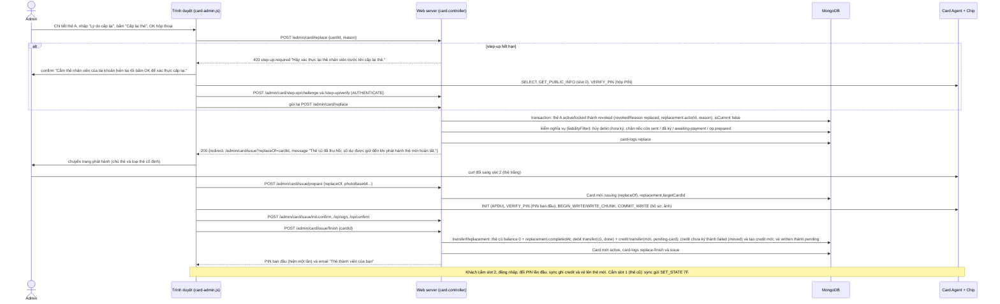
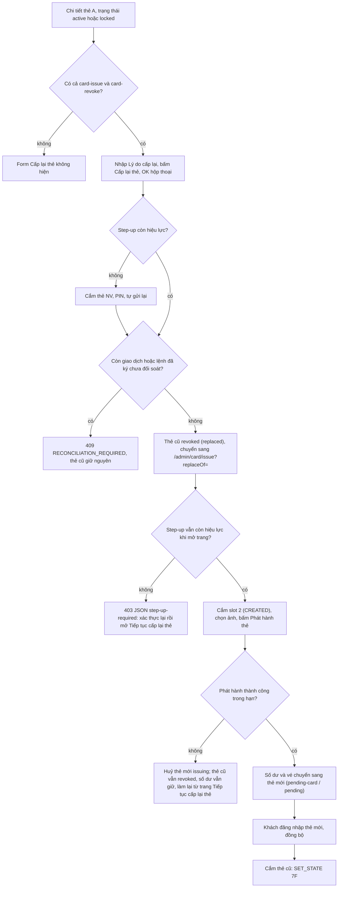

# 14. Cấp lại thẻ (replace)

Khi khách mất/hỏng thẻ nhưng còn tiền và vé, admin dùng **Cấp lại thẻ** thay vì "Thu hồi": thẻ cũ bị thu hồi (lý do `replaced`) **nhưng số dư và vé được giữ**, rồi chuyển sang thẻ mới sau khi phát hành xong.

## Mục đích

- Kiểm tra thẻ cũ thành `revoked` (`revokedReason = replaced`) và số dư **được giữ** đến khi thẻ mới hoàn tất.
- Kiểm tra phát hành thẻ mới gắn với thẻ cũ (`replaceOf`), chủ thẻ cố định; khi `issue/finish` số dư và credit chờ chuyển sang thẻ mới, vé `written` chưa dùng/chưa quá hạn quay về `pending` để ghi lại.
- Kiểm tra thẻ cũ bị đóng trên chip (`SET_STATE 7F`) khi cắm lại.
- Kiểm tra các chốt chặn: step-up 5 phút, thiếu quyền, còn giao dịch chưa đối soát, phát hành mới trực tiếp (không qua Cấp lại) bị chặn.

## Ai thực hiện & quyền

| Thao tác | Quyền | Step-up |
|---|---|---|
| Nút "Cấp lại thẻ" (trang chi tiết thẻ) | **cả hai**: `card-issue` ("Phát hành thẻ") **và** `card-revoke` ("Thu hồi thẻ") | **Có**, 5 phút |
| Trang `/admin/card/issue?replaceOf=<cardId>`, `issue/prepare`, `issue/finish` (khi có `replaceOf`) | `card-issue` + `card-revoke` | **Có, phải còn hiệu lực ở từng bước** |
| Xem chi tiết thẻ | `card-view` | Không |

Chỉ **chính admin đã bấm Cấp lại** mới hoàn tất được (`replacement.actorId`). Thiếu một trong hai quyền: form "Cấp lại thẻ" không hiện.

## Điều kiện trước

- [02](02-dang-nhap-admin-bang-the.md): admin đăng nhập bằng thẻ NV (slot 0), phiên có `cardId`.
- [03](03-phat-hanh-the-khach-hang.md) + [04](04-khach-dang-nhap-bang-the.md): khách A (slot 1) `active`, đã đổi PIN.
- [06](06-nap-tien-mat-tai-quay.md): thẻ A có số dư (ví dụ 100.000 đ đã ghi lên chip); [09](09-ghi-ve-len-the-dong-bo.md): có ít nhất một vé `written` chưa dùng, ngày khởi hành chưa qua. Nên có để thấy số dư và vé chuyển sang.
- **Slot 2 là thẻ trắng (CREATED)** dành cho thẻ mới. Nếu slot 2 đã dùng: reset bằng `curl -X POST -H 'Origin: http://localhost:3002' -H 'Content-Type: application/json' -d '{"slot":2}' http://127.0.0.1:31999/v1/sim/reset`.
- Thẻ A **không còn giao dịch ở trạng thái đã ký/đang chờ**: hãy cắm slot 1 và đăng nhập khách một lần để đồng bộ hết trước ([16](16-dong-bo-doi-soat-bien-nhan.md)).
- Một ảnh chân dung cho thẻ mới.
- **Toàn bộ quy trình từ lúc xác thực step-up đến lúc phát hành xong phải trong 5 phút** (xem ngoại lệ 10).

## Sơ đồ luồng hoạt động

## Các bước test (happy path)

1. Đảm bảo slot 1 cắm thẻ A và đã đồng bộ ổn (đăng nhập khách một lần). Ghi lại **số dư server** (`/admin/card/detail/<cardId A>`, "Số dư server (đ)") và các vé ("Các vé của chủ thẻ").
2. Admin (đăng nhập bằng thẻ slot 0, trong 5 phút đầu step-up còn hiệu lực): menu **"Quản lý thẻ"**, bấm mã thẻ A. Cuộn tới mục "Thao tác thẻ" > form **"Cấp lại thẻ"**.
3. Ô **"Lý do cấp lại"** nhập `mất thẻ` (bắt buộc, tối đa 500 ký tự). Bấm **"Cấp lại thẻ"**. Hộp thoại: "Cấp lại sẽ thu hồi vĩnh viễn thẻ cũ. Số dư được giữ đến khi thẻ mới hoàn tất. Tiếp tục?" > OK.
4. Nếu step-up đã hết hạn: hộp thoại "Cắm thẻ nhân viên của tài khoản hiện tại rồi bấm OK để xác thực cấp lại." Chạy `curl ... -d '{"slot":0}' ... /v1/sim/slot` rồi OK; nhập PIN ở hộp **"Nhập PIN thẻ nhân viên để xác thực thao tác"**. Yêu cầu cấp lại tự gửi lại (không cần cắm lại thẻ).
5. Trình duyệt chuyển tới `/admin/card/issue?replaceOf=<cardId A>`. Tiêu đề "Phát hành thẻ"; khung xanh: "Cấp lại từ <cardId A>. Chủ thẻ và loại thẻ được cố định từ server. Số dư cũ chỉ chuyển khi hoàn tất; thẻ mới cần đổi PIN trước khi đồng bộ tiền / vé." Loại thẻ và khách hàng đã chọn sẵn, bị khóa.
6. **Chuyển sang thẻ trắng:** `curl -X POST -H 'Origin: http://localhost:3002' -H 'Content-Type: application/json' -d '{"slot":2}' http://127.0.0.1:31999/v1/sim/slot`.
7. Chọn **"Ảnh chân dung (cắt giữa 160 × 200)"**, bấm **"Phát hành thẻ"**. Giữ nguyên thẻ ("Đang phát hành, giữ nguyên thẻ trong đầu đọc…"). Xong: "Thẻ đã hoạt động. PIN ban đầu chỉ hiển thị một lần; hãy đổi PIN khi đăng nhập." và hộp hiện PIN (bấm "Đã ghi nhận, đóng"). Ghi lại PIN này. (Chi tiết phát hành: [03](03-phat-hanh-the-khach-hang.md).)
8. Mở lại chi tiết **thẻ cũ** A: trạng thái server "Đã thu hồi", "Lý do khóa / thu hồi" = `replaced`, "Số dư server" = 0 (đã chuyển). Mở chi tiết **thẻ mới**: số dư server 0, "Credit đang chờ" có `<txRef>: <số dư cũ> đ — pending-card`; giao dịch `credit / transfer`.
9. Phía khách (cửa sổ ẩn danh), slot 2 vẫn cắm: `/account/login` > **"Đăng nhập bằng thẻ"**. Hộp PIN **"Nhập PIN hiện tại"** (PIN ban đầu), **"Nhập PIN mới gồm 6 chữ số"** (nhập PIN mạnh, ví dụ `482913`), **"Nhập lại PIN mới"**. Đăng nhập xong vào `/account/card`.
10. Phiên thẻ đồng bộ tự ghi credit và vé: "Số dư hệ thống" = số dư cũ; bấm **"Đọc thẻ"** (hộp PIN "Nhập PIN để đọc thẻ"): "Số dư trên thẻ" = số dư cũ, "Vé trên thẻ" liệt kê lại các vé chưa dùng. (Nếu chưa hiện, tải lại trang hoặc bấm "Đăng nhập bằng thẻ" lại để chạy đồng bộ.)
11. **Thẻ cũ:** `curl ... -d '{"slot":1}' ...`. Admin mở chi tiết thẻ cũ, bấm **"Đồng bộ ngay"** (nếu form trạng thái còn hiện nút) hoặc khách bấm "Đăng nhập bằng thẻ": đồng bộ gửi `SET_STATE 7F`, chip TERMINATED. Với thẻ đã thu hồi form trạng thái ẩn nút thao tác nhưng "Đồng bộ ngay" vẫn dùng được nếu tài khoản có `card-lock`/`card-revoke`; thông báo "Thẻ đã bị thu hồi. Đã đồng bộ trạng thái 7F."

## Kết quả mong đợi

- **Trên giao diện:** như các bước trên; thẻ cũ "Đã thu hồi" (lý do `replaced`); thẻ mới "Đang hoạt động".
- **Trên chip:** thẻ mới (slot 2): ACTIVE, `mustChangePin=1` lúc đầu rồi 0 sau khi đổi PIN; có ví/vé sau đồng bộ. Thẻ cũ (slot 1): `0x7F` TERMINATED sau đồng bộ.
- **Trong dữ liệu:**
  - `cards` (cũ): `status=revoked`, `isCurrent=false`, `revokedReason=replaced`, `replacement{actorId, reason, targetCardId, completedAt}`, `balance=0` sau khi hoàn tất. (mới): `status=active`, `replaceOf=<cardId cũ>`, `isCurrent=true`.
  - `card-transactions`: thẻ cũ `debit/transfer/done` (`balanceAfter=0`); thẻ mới `credit/transfer/pending-card` rồi `done` sau khi ghi; credit chưa ký của thẻ cũ thành `failed` (`failReason=moved`), tạo credit mới có `movedFrom`.
  - `orders.items[].ticketStatus`: vé `written`, chưa dùng, chưa quá hạn (so ngày giờ VN) chuyển về `pending`, sau sync ghi lại thành `written`. Vé đã `used`/đã quá hạn không chuyển.
  - `customers.avatar` cập nhật theo ảnh thẻ mới; `card-issuance-requests` `finished`.
- **Trong Nhật ký thẻ:** `replace` (success, `balanceHeld`), `issue-cancel` (nếu hủy), `replace-finish` (success, `replaceOf`, `amount`, `moved`), `issue`, `card-sync-op`, `card-op-confirm`; lần từ chối ghi `replace` fail với `errorCode`.

## Ngoại lệ & trường hợp lỗi

| # | Tình huống | Cách tái hiện | Kết quả / thông báo mong đợi (exact text) |
|---|---|---|---|
| 1 | Thiếu lý do | Để trống "Lý do cấp lại" | Trình duyệt chặn bằng ô bắt buộc. Gọi thẳng API: 400 INVALID_INPUT "Cấp lại thẻ cần mã thẻ và lý do." |
| 2 | Huỷ hộp thoại xác nhận | Bấm Cancel ở "Cấp lại sẽ thu hồi vĩnh viễn..." | Không gửi gì, thẻ giữ nguyên. |
| 3 | Step-up hết hạn | Chờ hơn 5 phút rồi bấm Cấp lại | confirm "Cắm thẻ nhân viên của tài khoản hiện tại rồi bấm OK để xác thực cấp lại." + hộp PIN. Server: 403 `step-up-required` "Hãy xác thực lại thẻ nhân viên trước khi cấp lại thẻ." |
| 4 | Huỷ xác thực step-up | Bấm Cancel ở confirm step-up | "Đã hủy xác thực." (kèm câu: "Nếu mất phản hồi, tải lại trang để tiếp tục từ thẻ nguồn; không hoàn tiền thủ công.") |
| 5 | Huỷ hộp PIN step-up | Bấm "Huỷ" ở hộp PIN | Mã `PIN_CANCELLED`: giao diện hiển thị "Đã hủy nhập PIN; thao tác chưa được thực hiện." (không còn mã thô; kèm câu "Nếu mất phản hồi..." nếu có). |
| 6 | Sai PIN thẻ NV / khóa PIN | Nhập sai | "Sai mã PIN, còn N lần thử" (N = 4..1); sai 5 lần "PIN đã bị khoá". Hộp đóng, bấm lại "Cấp lại thẻ". |
| 7 | Cắm sai thẻ ở step-up | Slot 1 thay vì slot 0 | "Hãy cắm thẻ nhân viên đang hoạt động của tài khoản hiện tại để xác thực lại." |
| 8 | Còn giao dịch/lệnh chưa đối soát | Thẻ có giao dịch `sent`, đã ký, `awaiting-payment`, hoặc op `prepared` | 409 `RECONCILIATION_REQUIRED` "Thẻ còn giao dịch hoặc lệnh đã ký cần đối soát. Không được cấp lại khi chưa xác nhận kết quả." (thẻ cũ giữ nguyên trạng thái; giao diện thêm câu "Nếu mất phản hồi, tải lại trang...") |
| 9 | Thẻ không `active`/`locked` | Gọi lại cho thẻ đã `revoked` (không phải thẻ nguồn đang chờ) / thẻ đã `failed` | 409 `CARD_STATE` "Yêu cầu phát hành thẻ không hợp lệ hoặc đã kết thúc." (thông báo mặc định). Thẻ nguồn đã hoàn tất cấp lại hoặc lý do khác lý do cũ: 409 `INVALID_REPLACEMENT` cùng thông báo. |
| 10 | Step-up hết hạn giữa chừng khi phát hành thẻ mới | Chờ hơn 5 phút từ lúc xác thực rồi mở trang/phát hành/hoàn tất | Mở `/admin/card/issue?replaceOf=` khi hết hạn: trang trả JSON 403 `{"code":"step-up-required","message":"Hãy xác thực lại thẻ nhân viên trước khi cấp lại thẻ."}`. Ở `issue/prepare`: hiển thị "Hãy xác thực lại thẻ nhân viên trước khi cấp lại thẻ."; ở `issue/finish`: "Chưa xác nhận được phát hành; server đã hủy bản ghi đang phát hành. Hãy kiểm tra thẻ và reset thẻ ảo hoặc cài lại applet trước khi thử lại." Quy trình phát hành không tự step-up lại nên bị hủy. Xác thực lại (ví dụ đăng xuất/đăng nhập bằng thẻ NV, hoặc dùng một thao tác khác có step-up), rồi vào "Tiếp tục cấp lại thẻ". |
| 11 | Mở lại giữa chừng | Quay lại chi tiết thẻ cũ khi chưa hoàn tất | Hiện "Thẻ cũ đã thu hồi. Số dư vẫn được giữ đến khi hoàn tất cấp lại; không hoàn tiền thủ công." và nút **"Tiếp tục cấp lại thẻ"** dẫn tới `/admin/card/issue?replaceOf=<cardId>`. |
| 12 | Cấp mới trực tiếp khi thẻ cũ còn tài sản | Vào `/admin/card/issue`, chọn đúng khách A, phát hành (không qua Cấp lại) | 409 `REPLACEMENT_DEFERRED` "Thẻ cũ còn tài sản hoặc yêu cầu cấp lại; hãy dùng Cấp lại từ thẻ nguồn." |
| 13 | Khách còn thẻ hiện hành | Phát hành mới cho khách đã có thẻ `active` | 409 `CURRENT_CARD` "Người này đã có thẻ đang hoạt động" |
| 14 | `replaceOf` sai/không phải thẻ nguồn | Sửa URL `replaceOf` sang thẻ khác | 409 `INVALID_REPLACEMENT` (thông báo mặc định "Yêu cầu phát hành thẻ không hợp lệ hoặc đã kết thúc."); `replaceOf` không đúng 32 hex: 400 INVALID_INPUT. |
| 15 | Admin khác hoàn tất | Admin khác mở link `replaceOf` | 403 `OP_FORBIDDEN` (chỉ admin đã bấm Cấp lại, `replacement.actorId`, được tiếp tục). |
| 16 | Cắm thẻ không trắng | Slot 1 (thẻ đã phát hành) khi phát hành | "Thẻ phải ở trạng thái CREATED trước khi phát hành." |
| 17 | Quá 5 phút phát hành | Treo ở bước phát hành hơn 5 phút | `ISSUE_EXPIRED`/`ISSUE_CLOSED`: "Yêu cầu phát hành thẻ không hợp lệ hoặc đã kết thúc." Thẻ mới bị hủy, thẻ cũ vẫn `revoked`, số dư vẫn giữ; bấm "Tiếp tục cấp lại thẻ", reset thẻ ảo slot 2 và làm lại. |
| 18 | Ảnh lỗi | Ảnh không chuyển được/quá 10 080 byte | "Ảnh không thể đọc; hãy chọn ảnh khác." / "Ảnh vẫn quá 10 080 byte; hãy chọn ảnh khác." / 400 "Ảnh phải là JPEG hợp lệ và không quá 10 080 byte." |
| 19 | Tải ảnh lên Cloudinary lỗi | Cloudinary từ chối | 502 `PHOTO_UPLOAD` "Không thể lưu ảnh; chưa phát hành thẻ." |
| 20 | Thiếu quyền | Role chỉ có `card-issue` (hoặc chỉ `card-revoke`) | Form "Cấp lại thẻ" không hiện; gọi API: 403 JSON `OP_FORBIDDEN` "Bạn không có quyền sử dụng tính năng này!". Mở `/admin/card/issue` không có `card-issue`: trang "Bạn không có quyền sử dụng tính năng này!". |
| 21 | Mất phản hồi / F5 / bấm đúp | Tải lại trang sau khi bấm Cấp lại | Gọi `replace` lại cùng lý do là idempotent (trả lại cùng redirect); lý do khác: 409 INVALID_REPLACEMENT. Form bị vô hiệu khi đang xử lý. |
| 22 | Agent tắt / Origin sai | Dừng Agent | "Không kết nối được Card Agent" (khi cần cắm thẻ NV hoặc phát hành). |
| 23 | Cắm thẻ cũ sau khi cấp lại | Slot 1 đăng nhập khách | Báo thẻ đã thu hồi/đồng bộ `7F`; thẻ cũ không dùng được ("Thẻ đã bị thu hồi." sau đồng bộ). |

## Checklist

- [ ] Form "Cấp lại thẻ" chỉ hiện khi tài khoản có cả `card-issue` và `card-revoke` và thẻ `active`/`locked`.
- [ ] Bỏ trống lý do: bị chặn.
- [ ] Step-up hết hạn: confirm + hộp PIN thẻ NV, rồi tự gửi lại.
- [ ] Sau khi bấm: thông báo/redirect tới `/admin/card/issue?replaceOf=<cardId>`, chủ thẻ cố định.
- [ ] Thẻ cũ: "Đã thu hồi", lý do `replaced`, số dư giữ đến khi thẻ mới xong.
- [ ] Phát hành vào slot 2 (CREATED) thành công, PIN ban đầu hiện một lần.
- [ ] Sau `finish`: thẻ cũ số dư 0, thẻ mới credit `transfer` `pending-card`.
- [ ] Khách đăng nhập thẻ mới, đổi PIN, đồng bộ: số dư chuyển sang, vé được ghi lại.
- [ ] Thẻ cũ (slot 1) đồng bộ ra `7F`.
- [ ] Cấp mới trực tiếp cho khách còn tài sản: `REPLACEMENT_DEFERRED`.
- [ ] Còn giao dịch chưa đối soát: `RECONCILIATION_REQUIRED`, thẻ cũ giữ nguyên.
- [ ] Nhật ký có `replace`, `replace-finish`, `issue`.

## Liên quan

[03 Phát hành thẻ khách](03-phat-hanh-the-khach-hang.md) | [13 Khóa, thu hồi](13-khoa-mo-khoa-thu-hoi-the.md) | [16 Đối soát](16-dong-bo-doi-soat-bien-nhan.md) | [91](91-bang-ma-loi.md) | [92](92-han-che-va-xu-ly-su-co.md)
