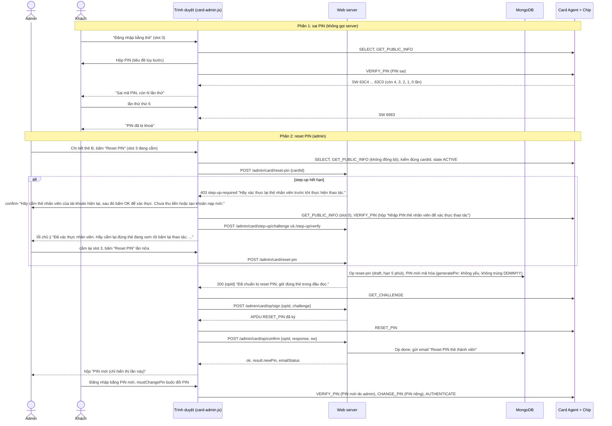
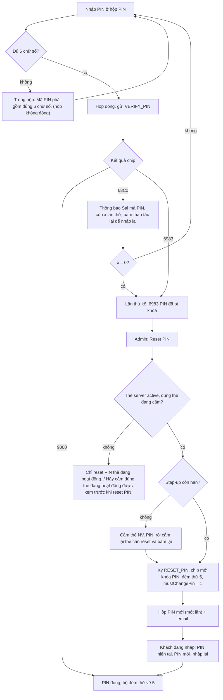
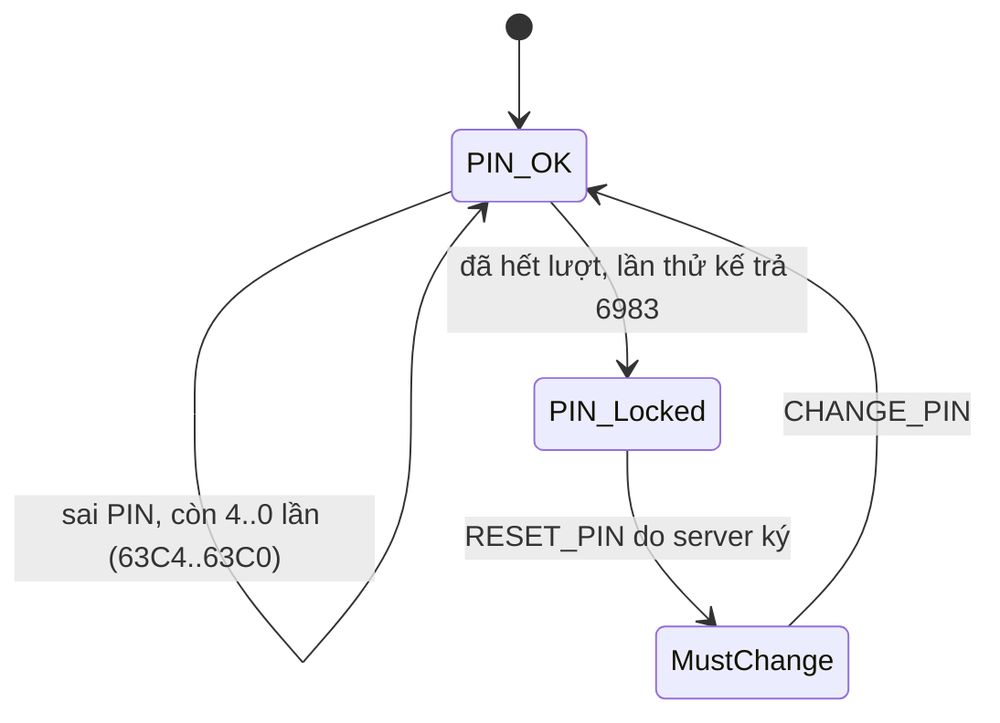

# 15. Sai PIN, khóa PIN và reset PIN

PIN là 6 chữ số, chỉ chip kiểm tra (PIN không bao giờ gửi lên server). Chip cho thử sai tối đa **5 lần**; sai tiếp thì PIN bị **khóa**. Chỉ admin có quyền `card-reset-pin` (kèm step-up thẻ nhân viên) mới đặt lại được: server sinh PIN mới ngẫu nhiên, ký lệnh `RESET_PIN`, hiển thị PIN **một lần** và gửi email cho chủ thẻ.

## Mục đích

- Kiểm tra đếm số lần thử sai và thông báo "Sai mã PIN, còn N lần thử", rồi "PIN đã bị khoá".
- Kiểm tra reset PIN: step-up, phải cắm đúng thẻ, PIN mới chỉ hiện một lần, chip mở khóa PIN và buộc đổi PIN (`mustChangePin = 1`).
- Kiểm tra khách đăng nhập bằng PIN mới và bị buộc đổi PIN; PIN yếu và nhập lại không khớp được hỏi lại ngay trong hộp PIN.

## Ai thực hiện & quyền

| Vai trò | Thao tác | Quyền / yêu cầu |
|---|---|---|
| Khách (tester đóng vai) | Nhập sai PIN ở bất kỳ bước nào cần PIN (đăng nhập, đọc thẻ, thanh toán...) | Không |
| Admin | Nút **"Reset PIN"** (trang chi tiết thẻ) | `card-reset-pin` ("Đặt lại PIN thẻ") **và** step-up thẻ NV trong 5 phút. Nút chỉ hiện khi thẻ đang `active`. Dùng được cho cả thẻ khách lẫn thẻ nhân viên. |
| Admin | Ký lệnh `reset-pin` ở `/admin/card/op/sign` | Server kiểm lại `card-reset-pin` + step-up còn hạn khi ký |

## Điều kiện trước

- [02](02-dang-nhap-admin-bang-the.md): admin đăng nhập bằng thẻ NV (slot 0).
- [03](03-phat-hanh-the-khach-hang.md): khách B có thẻ ở **slot 3** (dùng slot này để không phá khách A). Thẻ mới phát hành có `mustChangePin = 1` nên lần đăng nhập đầu hộp PIN hỏi "Nhập PIN hiện tại" (PIN ban đầu), chuẩn bị sẵn PIN ban đầu (hiện lúc phát hành hoặc email).
- Chủ thẻ B có email đọc được (để thấy email "Reset PIN thẻ thành viên").
- Thẻ B đang `active` trên server (reset PIN không áp dụng cho thẻ khóa/thu hồi).

## Sơ đồ luồng hoạt động

## Các bước test (happy path)

### A. Sai PIN và khóa PIN (khách B, slot 3)

1. `curl -X POST -H 'Origin: http://localhost:3002' -H 'Content-Type: application/json' -d '{"slot":3}' http://127.0.0.1:31999/v1/sim/slot`.
2. Cửa sổ khách (ẩn danh): `http://localhost:3002/account/login`, bấm **"Đăng nhập bằng thẻ"**. Hộp PIN hiện (nếu thẻ còn `mustChangePin`: tiêu đề **"Nhập PIN hiện tại"**; nếu đã đổi PIN: **"Nhập PIN để đăng nhập"**).
3. Nhập 5 ký tự (ví dụ `12345`) rồi bấm **"Xác nhận"**: ngay trong hộp hiện "Mã PIN phải gồm đúng 6 chữ số." và ô được xóa (hộp không đóng).
4. Nhập PIN sai nhưng đủ 6 số (ví dụ `000111`), bấm "Xác nhận". Hộp đóng, dòng trạng thái dưới nút hiện **"Sai mã PIN, còn 4 lần thử"**.
5. Bấm lại "Đăng nhập bằng thẻ" và nhập PIN sai tiếp: lần lượt **"Sai mã PIN, còn 3 lần thử"**, **"...còn 2 lần thử"**, **"...còn 1 lần thử"**, **"Sai mã PIN, còn 0 lần thử"** (đây là lần sai thứ 5).
6. Lần thứ 6 (kể cả nhập **đúng** PIN): **"PIN đã bị khoá"**. Từ đây mọi thao tác cần PIN của thẻ này (đọc thẻ, thanh toán, đăng nhập) đều trả "PIN đã bị khoá".
7. Admin xem chi tiết thẻ B: vẫn "Đang hoạt động" (PIN khóa chỉ nằm trên chip, server không biết).

### B. Reset PIN (admin)

8. Admin (đã đăng nhập bằng thẻ slot 0): `/admin/card/list`, bấm mã thẻ B. Mục "Thao tác thẻ" > form **"Reset PIN"** (chú thích: "PIN mới chỉ hiện một lần sau khi xác nhận. Chủ thẻ cần đổi PIN trước khi sử dụng.").
9. **Slot 3 phải đang cắm** (đúng thẻ đang xem). Bấm **"Reset PIN"**. Dòng trạng thái: "Đang reset PIN; giữ đúng thẻ trong đầu đọc…".
10. Nếu quá 5 phút từ lúc đăng nhập/xác thực lại: trình duyệt hỏi "Hãy cắm thẻ nhân viên của tài khoản hiện tại, sau đó bấm OK để xác thực. Chưa thu tiền hoặc tạo khoản nạp mới." Đổi slot về 0 (`{"slot":0}`), bấm OK, nhập PIN ở hộp **"Nhập PIN thẻ nhân viên để xác thực thao tác"**. Sau đó hiện thông báo: "Đã xác thực nhân viên. Hãy cắm lại đúng thẻ đang xem rồi bấm lại thao tác; giữ nguyên yêu cầu tiền mặt cũ nếu có." (đây là hành vi dự kiến, chưa có reset). Đổi lại slot 3 (`{"slot":3}`) và bấm **"Reset PIN"** lần nữa.
11. Thành công: dòng trạng thái "Đã reset PIN và gửi email. PIN mới chỉ hiện một lần; khách cần đổi PIN." và hộp **"PIN mới (chỉ hiển thị lần này)"** hiện 6 số; chép lại rồi bấm **"Đã lưu PIN an toàn"** (hộp đóng, PIN bị xóa khỏi màn hình).
12. Hộp thư chủ thẻ: email **"Reset PIN thẻ thành viên"**, nội dung "PIN mới: NNNNNN".
13. Khách (slot 3): "Đăng nhập bằng thẻ", hộp **"Nhập PIN hiện tại"** nhập PIN do admin cấp. Hộp **"Nhập PIN mới gồm 6 chữ số"**: thử `111111` hoặc `123456`: trong hộp hiện "PIN quá yếu (không dùng 6 số giống nhau, dãy số liên tiếp hoặc ngày sinh DDMMYY). Vui lòng nhập mã khác." và hộp **không đóng**. Nhập PIN mạnh (ví dụ `482913`). Hộp **"Nhập lại PIN mới"**: nhập khác (`482914`): "PIN nhập lại không khớp. Vui lòng nhập lại." (trong hộp); nhập đúng `482913`. Đăng nhập thành công, chuyển tới `/account/card`.
14. Kiểm tra PIN cũ không còn dùng được và PIN mới dùng được (đọc thẻ: "Nhập PIN để đọc thẻ").

## Kết quả mong đợi

- **Trên giao diện:** các thông báo ở các bước; PIN mới chỉ hiện một lần (đóng hộp là mất); nút "Reset PIN" bị vô hiệu khi đang xử lý hoặc khi kết quả reset còn chưa rõ ("resetUncertain").
- **Trên chip:** sau `RESET_PIN`: bộ đếm thử đặt lại 5, PIN mở khóa, `mustChangePin = 1` (chỉ nhận `GET_PUBLIC_INFO`, `VERIFY_PIN`, `CHANGE_PIN`, `RESET_PIN`, `GET_CHALLENGE`, `GET_CARD_PUBKEY`, `BEGIN_WRITE`, `WRITE_CHUNK`, `COMMIT_WRITE`, `SET_STATE`; lệnh khác `6985`). Sau `CHANGE_PIN`: `mustChangePin = 0`.
- **Trong dữ liệu:** `card-operations` có op `reset-pin` (draft -> prepared -> done; `params.newPin`/`encryptedPin` bị xóa sau khi xong); `cards` không đổi (vẫn `active`). Không có PIN nào được lưu trong `card-logs`.
- **Trong Nhật ký thẻ:** `reset-pin` chỉ ghi khi **bị từ chối** (fail với `errorCode`, ví dụ `STEP_UP_REQUIRED`, `CARD_STATE`, `INVALID_INPUT`); thành công ghi `card-op-sign`/`card-op-confirm` (qua engine) và, khi đăng nhập lại, `customer-login-challenge`, `auth`, `customer-login`. Mọi giá trị 6 số bị che "[Đã ẩn]".

## Ngoại lệ & trường hợp lỗi

| # | Tình huống | Cách tái hiện | Kết quả / thông báo mong đợi (exact text) |
|---|---|---|---|
| 1 | PIN không đủ 6 số / có chữ | Nhập `12345`/`12a456` | Trong hộp: "Mã PIN phải gồm đúng 6 chữ số." (hộp giữ mở, ô xóa) |
| 2 | Sai PIN lần 1..5 | Nhập sai | "Sai mã PIN, còn 4 lần thử" ... "Sai mã PIN, còn 0 lần thử" (hộp đã đóng; bấm lại thao tác để nhập lại) |
| 3 | PIN đã khóa | Lần thử kế tiếp sau "còn 0 lần" (hoặc nhập đúng PIN) | "PIN đã bị khoá" (SW 6983) |
| 4 | Huỷ hộp PIN | Bấm "Huỷ" / Esc | Khách: "Đã hủy nhập PIN." Admin đăng nhập: "Đã huỷ nhập PIN." Admin ở form trạng thái: "Đã hủy xác thực; trạng thái chưa được gửi lại." Form Reset PIN/Cấp lại/Check-in/Ghi hồ sơ: "Đã hủy nhập PIN; thao tác chưa được thực hiện." |
| 5 | PIN mới yếu (khách) | `111111`, `123456`, `654321`, `012345`, hoặc DDMMYY ngày sinh | Trong hộp, hộp **không đóng**: "PIN quá yếu (không dùng 6 số giống nhau, dãy số liên tiếp hoặc ngày sinh DDMMYY). Vui lòng nhập mã khác." |
| 6 | PIN mới yếu (admin đăng nhập thẻ NV lần đầu) | Cùng bước ở [02](02-dang-nhap-admin-bang-the.md) | Trong hộp: "PIN quá yếu (không dùng 6 số giống nhau hoặc dãy số liên tiếp). Vui lòng nhập mã khác." (không kiểm ngày sinh) |
| 7 | Nhập lại không khớp | PIN mới `482913`, nhập lại `482914` | Trong hộp: "PIN nhập lại không khớp. Vui lòng nhập lại." |
| 8 | Reset khi thẻ không `active` | Thẻ `locked`/`revoked`/`issuing` (nút không hiện; gọi API trực tiếp) | 409 `CARD_STATE` "Chỉ reset PIN thẻ đang hoạt động."; không có chủ thẻ: "Không tìm thấy chủ thẻ hiện tại." |
| 9 | Cắm sai thẻ | Slot khác khi bấm "Reset PIN" | "Hãy cắm đúng thẻ đang hoạt động được xem trước khi reset PIN." (nếu thẻ khác) hoặc "Đang cắm thẻ khác. Hãy cắm đúng thẻ đang xem trước khi đồng bộ." |
| 10 | Step-up hết hạn | Chờ hơn 5 phút rồi Reset PIN | Server 403 `step-up-required` "Hãy xác thực lại thẻ nhân viên trước khi thực hiện thao tác."; giao diện: confirm cắm thẻ NV + PIN, rồi "Đã xác thực nhân viên. Hãy cắm lại đúng thẻ đang xem rồi bấm lại thao tác; ..." |
| 11 | Huỷ confirm step-up | Bấm Cancel | "Đã hủy xác thực; giữ nguyên yêu cầu để đối chiếu." |
| 12 | Cắm sai thẻ ở step-up | Slot 3 thay vì thẻ NV | "Hãy cắm thẻ nhân viên đang hoạt động của tài khoản hiện tại để xác thực lại." |
| 13 | Tài khoản/phiên không có thẻ NV | Admin chưa có thẻ NV hoặc đăng nhập bằng mật khẩu khi chưa phát hành thẻ | Câu tiếng Việt `STAFF_CARD_REQUIRED` "Tài khoản của bạn chưa có thẻ nhân viên đang hoạt động. Hãy phát hành thẻ nhân viên cho tài khoản này (Phát hành thẻ → Nhân viên) rồi đăng nhập lại bằng thẻ." (hoặc `CARD_RELOGIN_REQUIRED` "Tài khoản đã được yêu cầu đăng nhập bằng thẻ nhân viên. Vui lòng đăng nhập lại bằng mật khẩu và thẻ." nếu tài khoản đã bật `cardRequired`); xem [91](91-bang-ma-loi.md). |
| 14 | Thiếu quyền | Role không có `card-reset-pin` | Nút không hiện; API: 403 "Bạn không có quyền sử dụng tính năng này!" (`OP_FORBIDDEN`) |
| 15 | Op hết hạn | Chuẩn bị xong nhưng chờ hơn 5 phút mới ký/xác nhận | "Thao tác đã hết hạn hoặc đã thay đổi trạng thái. Hãy tải lại trang và thử lại." (`OP_STATE`, hiển thị trên trang admin) |
| 16 | Mất kết nối sau khi chip đã reset | Tắt Agent/mạng giữa `RESET_PIN` và `op/confirm` | "Chưa nhận được PIN mới. Không tự gửi lại RESET_PIN; hãy kiểm tra trạng thái thẻ." + "Kết quả reset cần kiểm tra; không tự gửi lệnh reset lần nữa." Nút "Reset PIN" bị vô hiệu đến khi tải lại trang; kiểm tra bằng cách thử đăng nhập: nếu chip đã reset, PIN cũ không dùng được và PIN mới không hiện lại (cần reset lần nữa). |
| 17 | Email không gửi được | SMTP lỗi | "Đã reset PIN. Gửi email thất bại; PIN mới chỉ hiện một lần. Khách cần đổi PIN trước khi sử dụng." |
| 18 | Chủ thẻ chưa có email | Thẻ NV/khách thiếu email | "Đã reset PIN. Chủ thẻ chưa có email; PIN mới chỉ hiện một lần." |
| 19 | Đóng tab/hộp trước khi chép PIN | Bấm "Đã lưu PIN an toàn" quá sớm | PIN không hiện lại; reset lần nữa (op mới) để lấy PIN mới. |
| 20 | Hết thời gian / Agent lỗi | Agent tắt | "Không kết nối được Card Agent"; Agent 503 `no-card` khi slot trống. |
| 21 | F5 / bấm đúp | Bấm "Reset PIN" hai lần | Nút bị vô hiệu khi đang xử lý; sau khi thành công nút vẫn có thể bấm lại (op mới, PIN mới). Chưa xác minh trường hợp bấm đúp cực nhanh. |

## Checklist

- [ ] Nhập 5 ký tự: lỗi định dạng trong hộp, hộp không đóng.
- [ ] Sai PIN lần 1 đến 5: "Sai mã PIN, còn 4/3/2/1/0 lần thử".
- [ ] Lần 6 (kể cả PIN đúng): "PIN đã bị khoá".
- [ ] Admin thấy thẻ vẫn "Đang hoạt động" dù PIN đã khóa.
- [ ] Reset PIN cần cắm đúng thẻ; cắm sai: báo "Hãy cắm đúng thẻ đang hoạt động được xem trước khi reset PIN.".
- [ ] Step-up hết hạn: confirm + PIN thẻ NV, rồi cắm lại thẻ cần reset.
- [ ] Hộp "PIN mới (chỉ hiển thị lần này)" hiện 6 số một lần + email "Reset PIN thẻ thành viên".
- [ ] Khách đăng nhập bằng PIN mới bị buộc đổi PIN (hộp "Nhập PIN hiện tại").
- [ ] PIN mới yếu và nhập lại không khớp: báo ngay trong hộp, hộp không đóng.
- [ ] PIN cũ không dùng được sau reset.
- [ ] Reset thẻ `locked`/`revoked`: không có nút; API "Chỉ reset PIN thẻ đang hoạt động.".
- [ ] Nhật ký không chứa PIN (mọi số 6 chữ số hiện "[Đã ẩn]").

## Liên quan

[04 Khách đăng nhập](04-khach-dang-nhap-bang-the.md) | [02 Admin đăng nhập](02-dang-nhap-admin-bang-the.md) | [13 Khóa, thu hồi](13-khoa-mo-khoa-thu-hoi-the.md) | [91 Bảng mã lỗi](91-bang-ma-loi.md) | [92](92-han-che-va-xu-ly-su-co.md)
