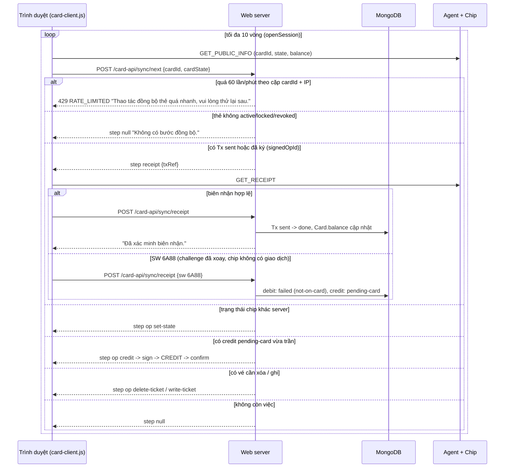
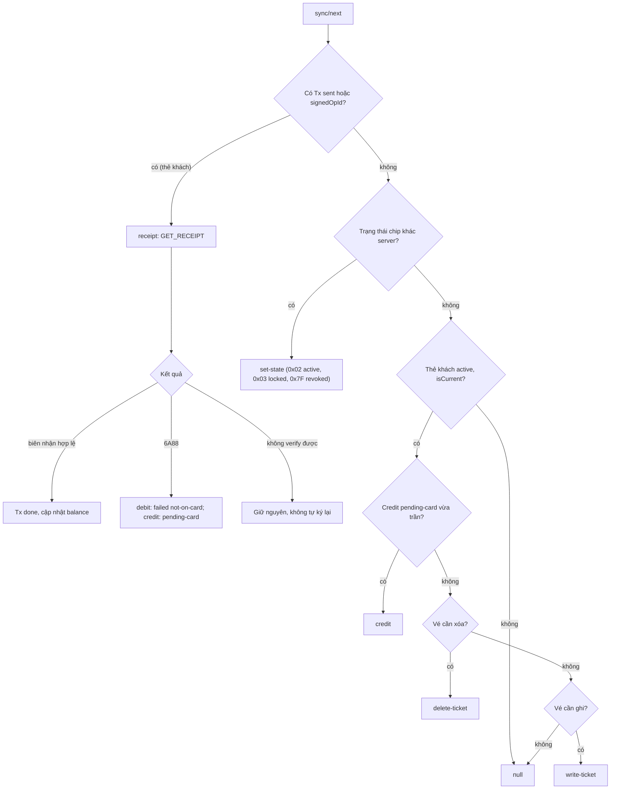

# 16. Đồng bộ, đối soát và khôi phục biên nhận

Mỗi lệnh `CREDIT`/`DEBIT` trên chip trả về một **biên nhận 166 byte do chip ký**. Nếu trình duyệt mất kết nối sau khi chip đã thực thi, giao dịch ở trạng thái `sent`. Lần cắm thẻ sau, vòng đồng bộ (`openSession`) chạy bước `receipt` để lấy lại biên nhận bằng `GET_RECEIPT` và khôi phục. Chức năng này không có màn hình riêng; tester phải cố ý làm gián đoạn.

## Mục đích

- Xác nhận hệ thống không mất tiền, không trừ/nạp hai lần khi mạng hoặc trình duyệt gián đoạn.
- Xác nhận thứ tự các bước đồng bộ: `receipt` > `set-state` > `credit` > `delete-ticket` > `write-ticket`.
- Xác nhận cơ chế chặn tốc độ (429), giữ credit vượt trần ví 50.000.000 và ghi log đối soát.

## Ai thực hiện & quyền

| Vai trò | Hành động | Quyền |
|---|---|---|
| Khách | Đăng nhập bằng thẻ, mở `/account/card` (tự đồng bộ) | Phiên khách |
| Admin | Nút **"Đồng bộ ngay"** ở chi tiết thẻ (`data-card-sync`) để chạy đồng bộ cho thẻ đang cắm | `card-view` (tối thiểu để xem); ký lệnh op cần phiên admin hợp lệ |
| Tester | Gây gián đoạn (tắt tab, chặn request bằng DevTools, tắt Agent) | Không |

Thao tác đồng bộ không cần step-up.

## Điều kiện trước

- [06](06-nap-tien-mat-tai-quay.md) (nạp tiền mặt tạo `Tx` credit) và [08](08-dat-tour-thanh-toan-vi-the.md) (thanh toán ví tạo `Tx` debit).
- Khách A ở **slot 1**, đã đăng nhập thành công ([04](04-khach-dang-nhap-bang-the.md)); có số dư.
- Admin ở slot 0 (nếu nạp tiền mặt). Chuyển slot: `curl -X POST -H 'Origin: http://localhost:3002' -H 'Content-Type: application/json' -d '{"slot":N}' http://127.0.0.1:31999/v1/sim/slot`.
- Lưu ý: nếu **restart Agent** thì chip ảo mất sạch (bộ nhớ), khi đó DB còn bản ghi nhưng chip thì không (xem [92](92-han-che-va-xu-ly-su-co.md)). Để gây gián đoạn hãy **chặn request / đóng tab**, không restart Agent.

## Sơ đồ luồng hoạt động

## Các bước test (happy path)

### A. Khôi phục sau gián đoạn khi thanh toán ví (DEBIT)

1. Slot 1 (khách A), đăng nhập, thêm tour vào giỏ, vào thanh toán, chọn ví thẻ ([08](08-dat-tour-thanh-toan-vi-the.md)).
2. Mở DevTools > Network. Khi hộp PIN xuất hiện, nhập PIN; ngay trước bước `op/confirm` của thanh toán, bật **Block request URL** cho `*card-api/op/confirm*` (hoặc chuyển Network sang Offline) để chip đã trừ tiền nhưng server chưa nhận xác nhận.
3. Giao diện hiện thông báo: "Chưa xác nhận thanh toán. Vui lòng cắm lại thẻ để hệ thống đối soát, không thanh toán lại."
4. Gỡ chặn, tải lại trang, đăng nhập lại bằng thẻ (slot 1). Vòng đồng bộ chạy bước `receipt`: thông báo "Đã xác minh biên nhận."
5. Kiểm tra: `Tx` debit `done`, `balanceAfter` đúng; đơn hàng chuyển sang đã thanh toán.

### B. Credit (nạp tiền mặt) tới thẻ

6. Admin tạo khoản nạp tiền mặt ([06](06-nap-tien-mat-tai-quay.md)); Tx credit `pending-card`. Khách đăng nhập (slot 1): vòng đồng bộ chạy bước `op credit`: ký, chip `CREDIT`, `op/confirm`; Tx `done`, số dư tăng.

### C. Chặn tốc độ (429)

7. Trên `/account/card` mở Console, gọi liên tục `POST /card-api/sync/next` hơn 60 lần/phút với cùng `cardId`: từ lần thứ 61 server trả HTTP 429 `RATE_LIMITED` "Thao tác đồng bộ thẻ quá nhanh, vui lòng thử lại sau." Chỉ **lần bị chặn đầu tiên** trong mỗi cửa sổ 60 giây ghi log `card-sync-op` (result `fail`, `errorCode` `RATE_LIMITED`). (Khó tái hiện bằng giao diện thường; chưa xác minh tay.)

### D. Credit vượt trần 50.000.000 (giữ lại)

8. Nạp tiền khiến tổng vượt 50.000.000 (ví dụ số dư 49.000.000 và khoản chờ 2.000.000): credit không được ký, giữ `pending-card` và đánh dấu `capHeldAt`; log `card-sync-credit-held` (result `fail`, lý do "vượt hạn mức 50.000.000 trên thẻ, cần đối soát thủ công"). Chỉ ghi **một lần** cho mỗi giao dịch.

## Kết quả mong đợi

- **Trên giao diện:** các thông báo ở bước 3-4; thông báo xác nhận op: "Đã tiếp nhận xác nhận.", "Thẻ báo lỗi; cần kiểm tra biên nhận.", "Biên nhận không hợp lệ.", "Thao tác đã kết thúc.", "Thao tác đã được xác nhận."
- **Trên chip:** `GET_BALANCE` khớp `Card.balance` sau khi đồng bộ xong; `GET_RECEIPT` trả biên nhận 166 byte của giao dịch gần nhất (ký bằng khóa thẻ).
- **Trong dữ liệu:** `card-transactions`: `sent` -> `done` (khôi phục) hoặc `failed` với `not-on-card` (debit), hoặc quay về `pending-card` (credit). `card-operations`: op hết hạn sau 5 phút. Có thể có bản ghi `reconciliation` với lý do `wallet-cap`, `card-unavailable`, `gateway-conflict`.
- **Trong Nhật ký thẻ:** `card-sync-op`, `card-op-sign`, `card-op-confirm`, `card-receipt-recovery` (biên nhận hợp lệ đến trễ sau khi đã giải phóng), `card-sync-credit-held`, `counter-anomaly`.

## Ngoại lệ & trường hợp lỗi

| # | Tình huống | Cách tái hiện | Kết quả / thông báo mong đợi (exact text) |
|---|---|---|---|
| 1 | Thẻ chưa nhận khoản nạp (credit) | Receipt không tìm thấy, challenge đã xoay (6A88) | "Thẻ chưa nhận khoản nạp; sẽ ghi lại ở lần đồng bộ tiếp theo." Tx về `pending-card` |
| 2 | Thẻ chưa bị trừ (debit) | Như trên cho debit | "Thẻ chưa bị trừ tiền; giao dịch thanh toán đã được huỷ." Tx `failed`, `not-on-card` |
| 3 | Chưa có biên nhận hợp lệ | Biên nhận không verify | "Chưa có biên nhận hợp lệ; không tự ký lại giao dịch." |
| 4 | Biên nhận hợp lệ đến trễ | Sau khi Tx đã giải phóng | Không đổi trạng thái; ghi log `card-receipt-recovery` để đối soát |
| 5 | Op hết hạn | Chờ hơn 5 phút giữa sign và confirm | `OP_STATE` "Thao tác đã hết hạn hoặc thay đổi. Vui lòng thử lại." |
| 6 | Op không tồn tại / của người khác | Gọi API với opId sai | `OP_NOT_FOUND` (404) / `OP_FORBIDDEN` (403) |
| 7 | Cắm sai thẻ (trang admin) | Slot không phải thẻ đang xem | "Đang cắm thẻ khác. Hãy cắm đúng thẻ đang xem trước khi đồng bộ." |
| 8 | Agent không chạy | Tắt Agent | "Không kết nối được Card Agent" |
| 9 | Không cắm thẻ | Agent 503 `no-card` | Thông báo không có thẻ (xem [91](91-bang-ma-loi.md)) |
| 10 | Vượt 60 lần đồng bộ/phút | Xem bước C | 429 `RATE_LIMITED` "Thao tác đồng bộ thẻ quá nhanh, vui lòng thử lại sau." |
| 11 | Thẻ khóa/thu hồi | Admin khóa thẻ rồi cắm | Bước `set-state` ghi 0x03/0x7F lên chip; không còn credit/vé (chỉ thẻ khách `active` mới ghi credit) |
| 12 | Thẻ đã cấp lại (`isCurrent` false) | Cắm thẻ cũ sau khi cấp lại | Không có bước đồng bộ ngoài `receipt`/`set-state` |
| 13 | Hủy hộp PIN | Bấm "Huỷ" | "Đã hủy nhập PIN." / "Đã huỷ nhập PIN." tùy trang |
| 14 | F5 giữa chừng | Tải lại khi đang đồng bộ | Lần vào sau tự chạy lại; Tx `sent` được khôi phục bằng `receipt`, không tạo giao dịch mới |

## Checklist

- [ ] Gián đoạn sau DEBIT: thông báo "Chưa xác nhận thanh toán..." rồi "Đã xác minh biên nhận." ở lần cắm sau.
- [ ] Tx `sent` -> `done`, số dư đúng, không trừ hai lần.
- [ ] 6A88 với debit: `failed`/`not-on-card`; với credit: về `pending-card`.
- [ ] Credit vượt trần được giữ, log `card-sync-credit-held` chỉ một lần.
- [ ] 429 sau 60 lần/phút, chỉ một log đầu tiên.
- [ ] Thứ tự bước: receipt, set-state, credit, delete-ticket, write-ticket.
- [ ] Không có PIN/secret trong log.

## Liên quan

[06](06-nap-tien-mat-tai-quay.md) | [08](08-dat-tour-thanh-toan-vi-the.md) | [17](17-danh-sach-chi-tiet-the.md) | [18](18-nhat-ky-the.md) | [91](91-bang-ma-loi.md) | [92](92-han-che-va-xu-ly-su-co.md)
