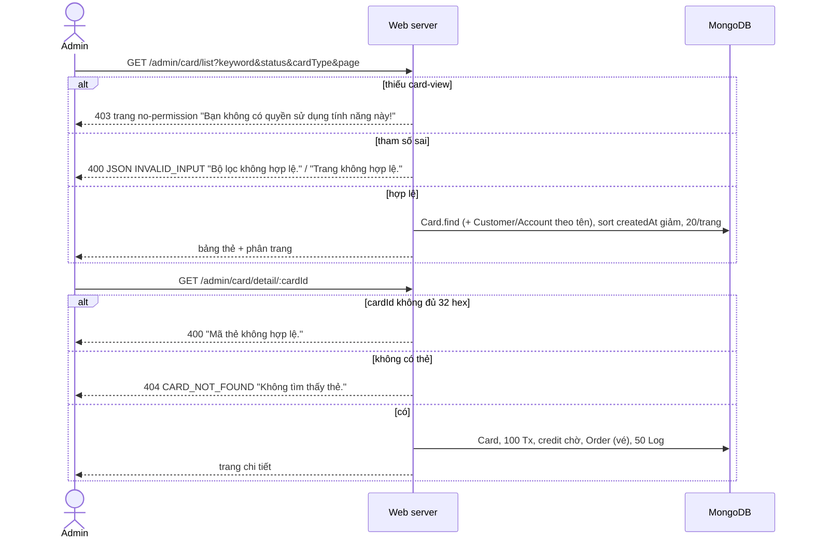
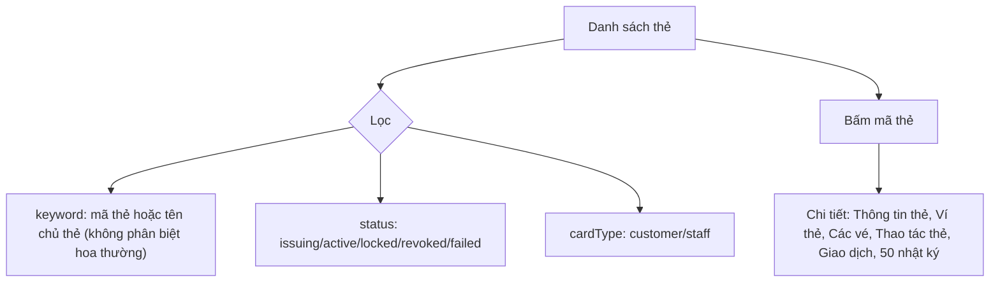

# 17. Danh sách và chi tiết thẻ (admin)

Trang `/admin/card/list` ("Quản lý thẻ") liệt kê mọi thẻ đã phát hành, có lọc và phân trang; trang `/admin/card/detail/<cardId>` ("Chi tiết thẻ") gom thông tin thẻ, ví, vé, thao tác, giao dịch và nhật ký của một thẻ.

## Mục đích

Kiểm tra admin tra cứu đúng thẻ, số dư server, credit chờ, vé, 100 giao dịch gần nhất, 50 nhật ký gần nhất, và các form thao tác chỉ hiện đúng với quyền/loại/trạng thái thẻ.

## Ai thực hiện & quyền

- Admin có `card-view` ("Xem thẻ"). Không có: trang "no-permission" với "Bạn không có quyền sử dụng tính năng này!" (HTTP 403).
- Menu: **Quản lý thẻ** (sidebar, hiện khi có `card-view`). Nút "Phát hành thẻ" chỉ hiện khi có `card-issue`.
- Mỗi form ở chi tiết chỉ hiện khi có quyền tương ứng (`card-issue`/`card-edit`/`card-lock`/`card-revoke`/`card-reset-pin`/`card-topup`). Không cần step-up để xem.

## Điều kiện trước

- [02](02-dang-nhap-admin-bang-the.md) đăng nhập admin (slot 0); [03](03-phat-hanh-the-khach-hang.md) đã có ít nhất thẻ khách (slot 1) và thẻ NV. Nên có thêm thẻ `locked`/`revoked` từ [13](13-khoa-mo-khoa-thu-hoi-the.md) và `failed` nếu có.
- Nên có giao dịch/vé từ [06](06-nap-tien-mat-tai-quay.md), [08](08-dat-tour-thanh-toan-vi-the.md), [09](09-ghi-ve-len-the-dong-bo.md).

## Sơ đồ luồng hoạt động

## Các bước test (happy path)

1. Admin vào **Quản lý thẻ** (`http://localhost:3002/admin/card/list`; tiền tố admin theo cấu hình). Bảng có cột "Mã thẻ", "Chủ thẻ", "Loại thẻ", "Trạng thái" (và số dư); 20 dòng/trang, mới nhất trước.
2. Bộ lọc: ô **"Tên chủ thẻ hoặc mã thẻ"** (nhập một phần tên hoặc mã), **"Trạng thái"** (Đang phát hành, Đang hoạt động, Đã khóa, Đã thu hồi, Phát hành thất bại), **"Loại thẻ"** (khách / nhân viên). Thử từng bộ lọc và kết hợp; dòng trống: "Không có thẻ phù hợp.".
3. Phân trang: giữ nguyên tham số lọc khi chuyển trang.
4. Bấm vào thẻ khách A. Kiểm tra các khối: **Thông tin thẻ** (Mã thẻ, Loại thẻ "Khách hàng"/"Nhân viên", Trạng thái server, Chủ thẻ, Email, Số điện thoại, "Lý do khóa / thu hồi" nếu có), **Ví thẻ** ("Số dư server (đ)", ghi chú "Số dư trên thẻ (chip) được đối chiếu khi cắm thẻ và đồng bộ.", "Credit đang chờ" hoặc "Không có credit đang chờ."), **Các vé của chủ thẻ** (hoặc "Chưa có vé."), **Thao tác thẻ**, **"Giao dịch (100 mục gần nhất, mới nhất trước)"** (Thời gian, Mã giao dịch, Loại / nguồn, số tiền, Trạng thái), **"50 nhật ký gần nhất"** (Thời gian, Thao tác, Người thực hiện, Kết quả, Chi tiết).
5. Đối chiếu số dư server với số dư trên chip (đăng nhập khách, `/account/card`).
6. Với thẻ `active` khách: có đủ form "Cấp lại thẻ" (lý do), "Sửa hồ sơ / ảnh trên thẻ", "Trạng thái thẻ" (Khóa/Mở khóa/Thu hồi theo trạng thái, kèm "Đồng bộ ngay"), "Reset PIN", "Nạp tiền mặt". Thẻ NV không có "Nạp tiền mặt". Thẻ `locked`: chỉ nút mở khóa/thu hồi; Reset PIN và nạp tiền chỉ hiện khi `active`.

## Kết quả mong đợi

- **Trên giao diện:** các khối và nhãn như trên; nhãn trạng thái đúng màu (active xanh lá, locked cam, revoked đỏ, issuing xanh dương, còn lại xám).
- **Trên chip:** không thay đổi (trang chỉ đọc server).
- **Trong dữ liệu:** không ghi gì (chỉ truy vấn). Giao dịch lấy 100 mục mới nhất; credit chờ gồm `awaiting-payment`, `pending-card`, `sent` và `failed` có `signedOpId`.
- **Trong Nhật ký thẻ:** xem trang chi tiết **không** ghi log. Nhật ký chi tiết giới hạn 50 mục của thẻ đó (không cần `card-log-view`; trang toàn cục cần quyền này).

## Ngoại lệ & trường hợp lỗi

| # | Tình huống | Cách tái hiện | Kết quả / thông báo mong đợi (exact text) |
|---|---|---|---|
| 1 | Thiếu `card-view` | Role không có quyền, vào `/admin/card/list` | 403, trang "no-permission": "Bạn không có quyền sử dụng tính năng này!" |
| 2 | `status`/`cardType` sai | `?status=abc` hoặc `?cardType=x` | 400 JSON `INVALID_INPUT` "Bộ lọc không hợp lệ." (không render trang) |
| 3 | Tham số quá dài | `keyword` > 120 ký tự | "Bộ lọc không hợp lệ." |
| 4 | Trang sai | `?page=0` / `?page=abc` / 7 chữ số | "Trang không hợp lệ." |
| 5 | Trang vượt cuối | `?page=999` | Bảng rỗng "Không có thẻ phù hợp." |
| 6 | cardId sai định dạng | `/admin/card/detail/abc` | 400 "Mã thẻ không hợp lệ." |
| 7 | Không có thẻ | cardId 32 hex không tồn tại | 404 `CARD_NOT_FOUND` "Không tìm thấy thẻ." |
| 8 | Chủ thẻ đã bị xóa | Xóa mềm khách rồi mở thẻ | Chủ thẻ: "Không còn thông tin chủ thẻ", Email/SĐT: "Chưa có" |
| 9 | Thiếu quyền một form | Role chỉ `card-view` | Chỉ xem, không có form thao tác |
| 10 | Mất phiên | Hết phiên admin | Chuyển về đăng nhập admin |
| 11 | Ký tự đặc biệt trong keyword | `keyword=.*` | Được escape, tìm theo nghĩa đen (không lỗi regex) |

## Checklist

- [ ] Lọc theo từng điều kiện và kết hợp cho kết quả đúng; giữ tham số khi sang trang.
- [ ] Lọc/trang sai trả đúng JSON 400.
- [ ] Chi tiết hiện đủ 6 khối; số dư server khớp chip sau đồng bộ.
- [ ] Form thao tác hiện đúng theo quyền, loại thẻ, trạng thái.
- [ ] Thẻ không tồn tại: "Không tìm thấy thẻ.".
- [ ] Thiếu quyền: "Bạn không có quyền sử dụng tính năng này!".

## Liên quan

[13](13-khoa-mo-khoa-thu-hoi-the.md) | [18](18-nhat-ky-the.md) | [20](20-quan-ly-khach-hang.md) | [91](91-bang-ma-loi.md)
