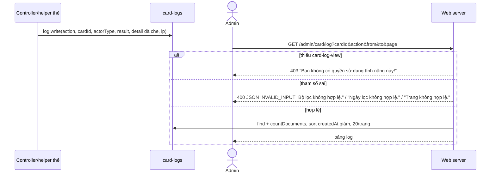
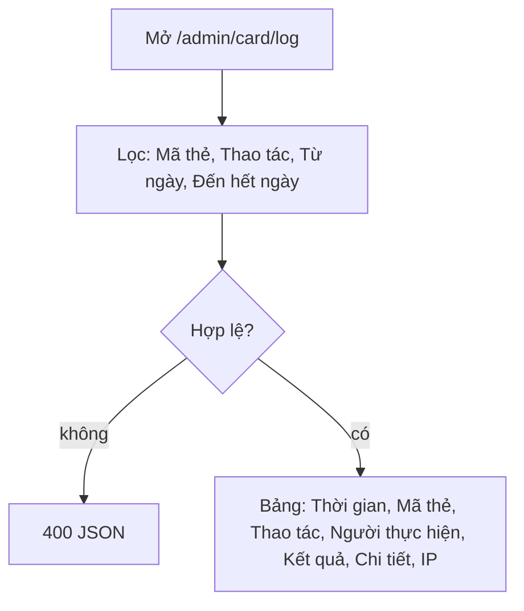

# 18. Nhật ký thẻ

Trang `/admin/card/log` ("Nhật ký thẻ") liệt kê toàn bộ log của hệ thống thẻ (collection `card-logs`), 20 dòng/trang, mới nhất trước. Dữ liệu nhạy cảm được che.

## Mục đích

Kiểm tra mọi thao tác thẻ đều để lại dấu vết, tra cứu theo thẻ/thao tác/ngày, và không có PIN, OTP, khóa, chữ ký thô nào bị lộ.

## Ai thực hiện & quyền

Admin có `card-log-view` ("Xem nhật ký thẻ"). Menu: **Nhật ký thẻ** (sidebar, `card-log-view`). Thiếu quyền: 403 "Bạn không có quyền sử dụng tính năng này!". Không cần step-up.

## Điều kiện trước

- Đã có hoạt động thẻ để tạo log: [03](03-phat-hanh-the-khach-hang.md), [04](04-khach-dang-nhap-bang-the.md), [06](06-nap-tien-mat-tai-quay.md), [13](13-khoa-mo-khoa-thu-hoi-the.md), [15](15-sai-pin-khoa-pin-reset-pin.md), [16](16-dong-bo-doi-soat-bien-nhan.md).
- Biết `cardId` (32 ký tự hex HOA) từ trang chi tiết.

## Sơ đồ luồng hoạt động

## Các bước test (happy path)

1. Admin vào **Nhật ký thẻ**. Có tiêu đề "Tổng N mục", "Trang x/y".
2. Bộ lọc: **"Mã thẻ"** (đúng 32 hex; tự viết hoa), **"Thao tác"**, **"Từ ngày"**, **"Đến hết ngày"** (định dạng `YYYY-MM-DD`, tính theo giờ Việt Nam; "đến hết ngày" gồm cả ngày đó). Bấm **"Lọc nhật ký"**; **"Xóa bộ lọc"** để đặt lại.
3. Ô "Thao tác" là **khớp chính xác** (không tìm một phần). Placeholder "Ví dụ: card.lock" chỉ là gợi ý và **không phải** tên action thật. Thử các action thực tế: `issue`, `auth`, `customer-login`, `customer-login-challenge`, `card-op-sign`, `card-op-confirm`, `card-sync-op`, `card-sync-credit-held`, `card-receipt-recovery`, `counter-anomaly`, `checkin-lookup`, `checkin-use`, `reset-pin`.
4. Kiểm tra cột "Kết quả": nhãn `success`/`ok` màu xanh, còn lại xám (`fail`). Cột "Chi tiết" là JSON; PIN, OTP, chuỗi 6 chữ số, v.v. hiện "[Đã ẩn]".
5. Cột "Người thực hiện" = `actorType` + `actorId` (ví dụ `system`, `customer <id>`, `staff <id>`).
6. Dòng trống: "Không có nhật ký phù hợp.".

## Kết quả mong đợi

- **Trên giao diện:** các cột như trên; thời gian định dạng `vi-VN`, múi giờ Asia/Ho_Chi_Minh.
- **Trên chip:** không liên quan.
- **Trong dữ liệu:** chỉ đọc. `counter-anomaly` ghi khi bộ đếm của chip bất thường lúc xác thực.
- **Trong Nhật ký thẻ:** trang này không tự ghi log khi xem.

## Ngoại lệ & trường hợp lỗi

| # | Tình huống | Cách tái hiện | Kết quả / thông báo mong đợi (exact text) |
|---|---|---|---|
| 1 | Thiếu `card-log-view` | Role không có quyền | 403 "Bạn không có quyền sử dụng tính năng này!" (vẫn xem được 50 log gần nhất ở chi tiết thẻ nếu có `card-view`) |
| 2 | Mã thẻ sai định dạng | `cardId=abc` | 400 JSON `INVALID_INPUT` "Bộ lọc không hợp lệ." |
| 3 | Ngày sai định dạng / không tồn tại | `from=2026-02-30` hoặc `from=01/02/2026` | "Ngày lọc không hợp lệ." |
| 4 | Từ ngày sau Đến ngày | `from=2026-06-10&to=2026-06-01` | "Bộ lọc không hợp lệ." |
| 5 | Thao tác > 80 ký tự | Nhập chuỗi dài | "Bộ lọc không hợp lệ." |
| 6 | Trang sai | `page=0` | "Trang không hợp lệ." |
| 7 | Lọc action gõ một phần | `action=card` | Không có kết quả "Không có nhật ký phù hợp." (khớp chính xác) |
| 8 | Dữ liệu nhạy cảm | Đổi PIN, reset PIN, đăng nhập sai PIN | Không có PIN trong "Chi tiết"; số 6 chữ số hiện "[Đã ẩn]" |

## Checklist

- [ ] Lọc từng điều kiện và kết hợp cho kết quả đúng; "Xóa bộ lọc" hoạt động.
- [ ] Ngày sai/khoảng ngược trả 400 đúng thông báo.
- [ ] Action lọc khớp chính xác (không dùng placeholder "card.lock").
- [ ] Không còn PIN/OTP rõ trong cột Chi tiết ("[Đã ẩn]").
- [ ] Có log cho issue, auth/login, op sign/confirm, sync, check-in, lock.

## Liên quan

[17](17-danh-sach-chi-tiet-the.md) | [16](16-dong-bo-doi-soat-bien-nhan.md) | [91](91-bang-ma-loi.md)
