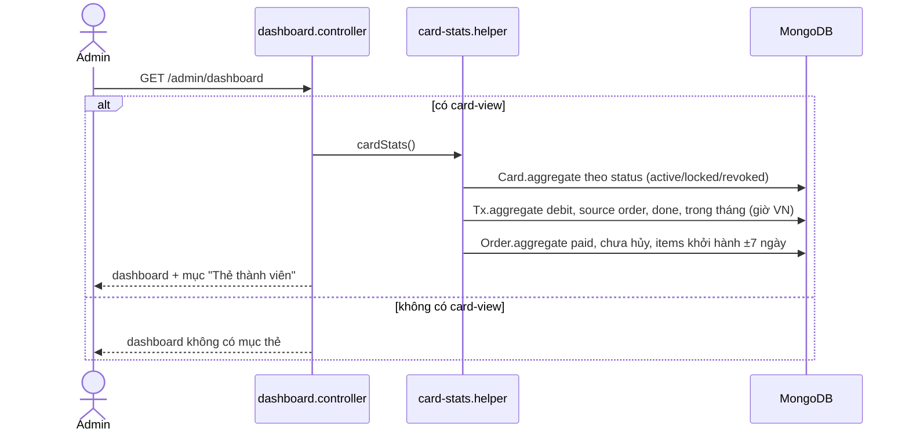
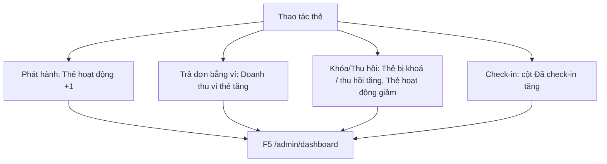

# 19. Thống kê thẻ trên dashboard

> Hướng dẫn hiện hành từ checkpoint G2 sang G3 nằm trong [nghiệm thu Dashboard G3](../MANUAL_TEST_GUIDE.md#g3--nghiệm-thu-dashboard-và-khách-hàng). Nội dung bên dưới mô tả baseline Smart Card trước G3.

Trang tổng quan admin `/admin/dashboard` ("Tổng quan") có thêm mục **"Thẻ thành viên"** với số liệu thẻ, doanh thu ví thẻ tháng này và bảng tỉ lệ check-in. Mục này chỉ tính và hiển thị cho tài khoản có `card-view`.

## Mục đích

Kiểm tra số liệu thống kê thẻ phản ánh đúng thao tác phát hành, thanh toán ví, khóa/thu hồi và check-in; kiểm tra ẩn mục này khi thiếu quyền.

## Ai thực hiện & quyền

Admin có `card-view` (`req.permissions` chứa `card-view`). Không có quyền: mục "Thẻ thành viên" không xuất hiện (phần tổng quan còn lại vẫn hiện). Không cần step-up.

## Điều kiện trước

- [02](02-dang-nhap-admin-bang-the.md) admin đăng nhập; dữ liệu từ [03](03-phat-hanh-the-khach-hang.md), [08](08-dat-tour-thanh-toan-vi-the.md), [10](10-check-in-tour.md), [13](13-khoa-mo-khoa-thu-hoi-the.md).
- Để bảng check-in có dòng: có đơn đã thanh toán (`paid`), không bị hủy, có tour khởi hành trong khoảng từ 7 ngày trước đến 7 ngày sau hiện tại.

## Sơ đồ luồng hoạt động

## Các bước test (happy path)

1. Admin (slot 0) vào **Tổng quan**: `http://localhost:3002/admin/dashboard`. Ghi lại các ô trong mục "Thẻ thành viên".
2. Ô **"Thẻ hoạt động"** (số thẻ `active`; dòng nhỏ "Đã khoá: N · Đã thu hồi: M"). Ô **"Doanh thu ví thẻ (tháng này)"** (tổng debit `source=order`, `status=done`, trong tháng hiện tại theo giờ VN, kèm "đ"). Ô **"Thẻ bị khoá / thu hồi"** (locked + revoked).
3. Bảng **"Tỉ lệ check-in (khởi hành trong ±7 ngày)"** với cột: "Tour", "Ngày khởi hành", "Tổng vé", "Vé trên thẻ (đã ghi hoặc đã dùng)", "Đã check-in". Mỗi dòng là một cặp (tour, ngày khởi hành theo giờ VN). Rỗng: "Không có tour khởi hành trong khoảng này."
4. Thực hiện: phát hành thẻ ([03](03-phat-hanh-the-khach-hang.md)): "Thẻ hoạt động" +1. Trả đơn bằng ví ([08](08-dat-tour-thanh-toan-vi-the.md)): doanh thu tăng đúng số tiền đơn. Ghi vé ([09](09-ghi-ve-len-the-dong-bo.md)): cột "Vé trên thẻ" tăng. Check-in ([10](10-check-in-tour.md)): "Đã check-in" tăng. Khóa thẻ ([13](13-khoa-mo-khoa-thu-hoi-the.md)): "Thẻ hoạt động" -1, "Thẻ bị khoá / thu hồi" +1.
5. F5 sau mỗi thao tác để kiểm tra thay đổi. Đăng nhập admin không có `card-view`: không thấy mục "Thẻ thành viên".

## Kết quả mong đợi

- **Trên giao diện:** số liệu định dạng `vi-VN` (dấu chấm ngăn cách nghìn); thay đổi sau khi tải lại.
- **Trên chip:** không liên quan.
- **Trong dữ liệu:** chỉ đọc. Thẻ `issuing`/`failed` không tính vào ô nào. Đơn hủy hoặc chưa thanh toán không vào bảng check-in. Hủy đơn ví thẻ ([11](11-huy-don-xoa-ve.md)) không tạo debit âm: khoản hoàn là một `credit` (`source refund`) riêng, nên các số liệu dựa trên debit `done` không tự giảm; tuy nhiên đơn `cancel` bị loại khỏi truy vấn doanh thu của dashboard.
- **Trong Nhật ký thẻ:** không ghi.

## Ngoại lệ & trường hợp lỗi

| # | Tình huống | Cách tái hiện | Kết quả / thông báo mong đợi (exact text) |
|---|---|---|---|
| 1 | Thiếu `card-view` | Role không có quyền | Không có mục "Thẻ thành viên" (không báo lỗi) |
| 2 | Chưa có tour ±7 ngày | Dữ liệu demo không có | "Không có tour khởi hành trong khoảng này." |
| 3 | Qua tháng mới | Giao dịch tháng trước | Không tính vào "Doanh thu ví thẻ (tháng này)" |
| 4 | Thanh toán ví chưa `done` (`sent`) | Gián đoạn ở [16](16-dong-bo-doi-soat-bien-nhan.md) | Chưa tính doanh thu cho đến khi khôi phục `done` |
| 5 | Đơn đã hủy | Hủy đơn ([11](11-huy-don-xoa-ve.md)) | Biến mất khỏi bảng check-in |
| 6 | Mất phiên | Hết phiên | Chuyển về đăng nhập admin |

## Checklist

- [ ] Ghi số liệu trước/sau từng thao tác và đối chiếu.
- [ ] "Thẻ hoạt động", "Thẻ bị khoá / thu hồi" đúng theo trạng thái thẻ.
- [ ] Doanh thu ví thẻ chỉ gồm debit order `done` trong tháng.
- [ ] Bảng check-in đúng 5 cột và đúng khoảng ±7 ngày.
- [ ] Thiếu `card-view` thì ẩn mục.

## Liên quan

[10](10-check-in-tour.md) | [13](13-khoa-mo-khoa-thu-hoi-the.md) | [17](17-danh-sach-chi-tiet-the.md)
