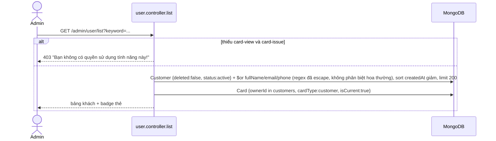
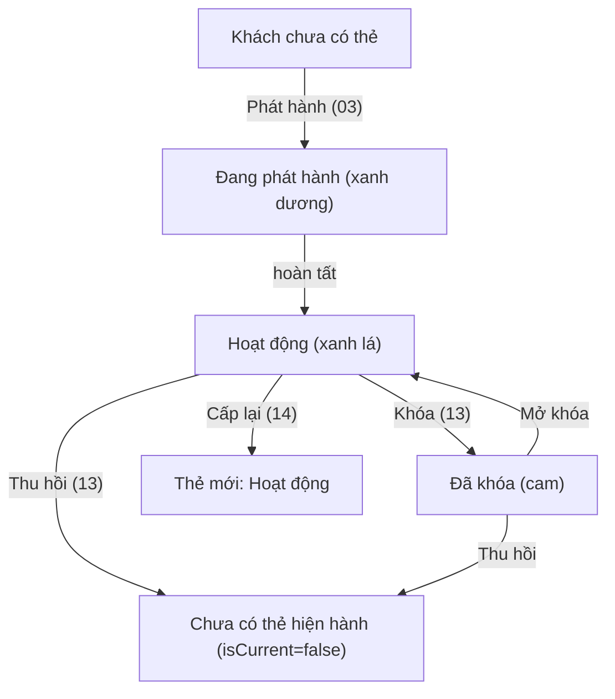

# 20. Quản lý khách hàng (liên quan thẻ)

Trang `/admin/user/list` ("Quản lý khách hàng") cho nhân viên quầy tra cứu khách và xem **thẻ hiện hành** của từng khách. Đây là điểm xuất phát để phát hành thẻ ([03](03-phat-hanh-the-khach-hang.md)).

## Mục đích

Kiểm tra danh sách khách chỉ gồm khách hợp lệ, tìm kiếm theo tên/email/số điện thoại, cột "Trạng thái thẻ hiện hành" phản ánh đúng vòng đời thẻ, và quyền truy cập.

## Ai thực hiện & quyền

- Admin có `card-view` **hoặc** `card-issue`. Không có cả hai: 403, trang no-permission "Bạn không có quyền sử dụng tính năng này!".
- Menu: **Quản lý khách hàng** trong sidebar. Không cần step-up để xem (xác thực thẻ NV theo phiên).
- Danh sách chỉ gồm khách `status: active`, chưa xóa (`deleted: false`), sắp theo ngày tạo mới nhất, **tối đa 200**.

## Điều kiện trước

- [02](02-dang-nhap-admin-bang-the.md) admin đăng nhập (slot 0). Có ít nhất vài khách (đăng ký ở site khách).
- Khách A (slot 1) và khách B (slot 3) để so sánh trạng thái thẻ trước/sau [03](03-phat-hanh-the-khach-hang.md), [13](13-khoa-mo-khoa-thu-hoi-the.md).

## Sơ đồ luồng hoạt động

## Các bước test (happy path)

1. Admin vào **Quản lý khách hàng**: `http://localhost:3002/admin/user/list`. Bảng gồm cột "Họ tên" (trống: "Chưa cung cấp"), "Ảnh đại diện", "Email", "Số điện thoại" (trống: "Chưa cung cấp"), "Trạng thái thẻ hiện hành". Cuối trang: "Hiển thị tối đa 200 khách hàng. Dùng tìm kiếm để thu hẹp kết quả."
2. Ô **"Tìm theo tên, email hoặc số điện thoại"** (placeholder "Tên, email hoặc số điện thoại", tối đa 120 ký tự), bấm **"Tìm kiếm"**: lọc theo một phần của tên, email hoặc SĐT, không phân biệt hoa thường. Không có kết quả: "Không có khách hàng phù hợp."
3. Khách chưa có thẻ: badge xám "Chưa có thẻ hiện hành".
4. Phát hành thẻ cho khách A ([03](03-phat-hanh-the-khach-hang.md)); tải lại: badge xanh "Hoạt động" (khi đang phát hành: xanh dương "Đang phát hành").
5. Khóa thẻ ([13](13-khoa-mo-khoa-thu-hoi-the.md)): badge cam "Đã khóa". Mở khóa: về "Hoạt động".
6. Thu hồi thẻ: thẻ có `isCurrent=false` nên cột về "Chưa có thẻ hiện hành" (thẻ đã thu hồi không còn là thẻ hiện hành).
7. Đăng nhập admin chỉ có `card-view` hoặc chỉ `card-issue`: vẫn vào được.

## Kết quả mong đợi

- **Trên giao diện:** như các bước; nhãn thẻ chỉ có 3 trạng thái (Đang phát hành, Hoạt động, Đã khóa), còn lại là "Chưa có thẻ hiện hành".
- **Trên chip:** không liên quan.
- **Trong dữ liệu:** chỉ đọc.
- **Trong Nhật ký thẻ:** không ghi log khi xem.

## Ngoại lệ & trường hợp lỗi

| # | Tình huống | Cách tái hiện | Kết quả / thông báo mong đợi (exact text) |
|---|---|---|---|
| 1 | Thiếu quyền | Role không có `card-view` lẫn `card-issue` | 403 "Bạn không có quyền sử dụng tính năng này!" |
| 2 | Không có kết quả | `keyword=zzzz` | "Không có khách hàng phù hợp." |
| 3 | Keyword có ký tự regex | `.*` hoặc `(` | Escape, tìm nghĩa đen, không lỗi |
| 4 | Keyword dài > 120 | Nhập chuỗi dài | Cắt còn 120 ký tự (không báo lỗi) |
| 5 | Khách đã bị khóa/xóa | Khách `status` khác `active` hoặc `deleted` | Không xuất hiện trong danh sách |
| 6 | Hơn 200 khách | Dữ liệu lớn | Chỉ 200 khách mới nhất; dùng tìm kiếm |
| 7 | Mất phiên/thẻ NV không còn hiệu lực | Thu hồi thẻ NV đang dùng | Chuyển về đăng nhập admin, hoặc với XHR/JSON: câu tiếng Việt `STAFF_CARD_CHANGED`/`STAFF_CARD_REQUIRED` (xem [91](91-bang-ma-loi.md)) |

## Checklist

- [ ] Danh sách đủ cột, tối đa 200, chỉ khách active.
- [ ] Tìm theo tên, email, SĐT đều đúng.
- [ ] Badge thẻ đổi đúng sau phát hành, khóa, mở khóa, thu hồi.
- [ ] Thiếu cả hai quyền bị chặn.

## Liên quan

[03](03-phat-hanh-the-khach-hang.md) | [13](13-khoa-mo-khoa-thu-hoi-the.md) | [17](17-danh-sach-chi-tiet-the.md)
