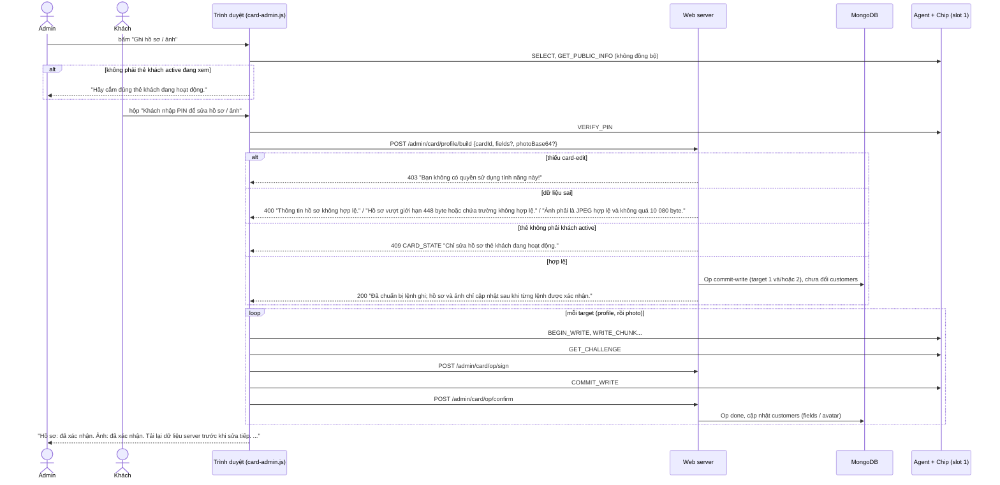
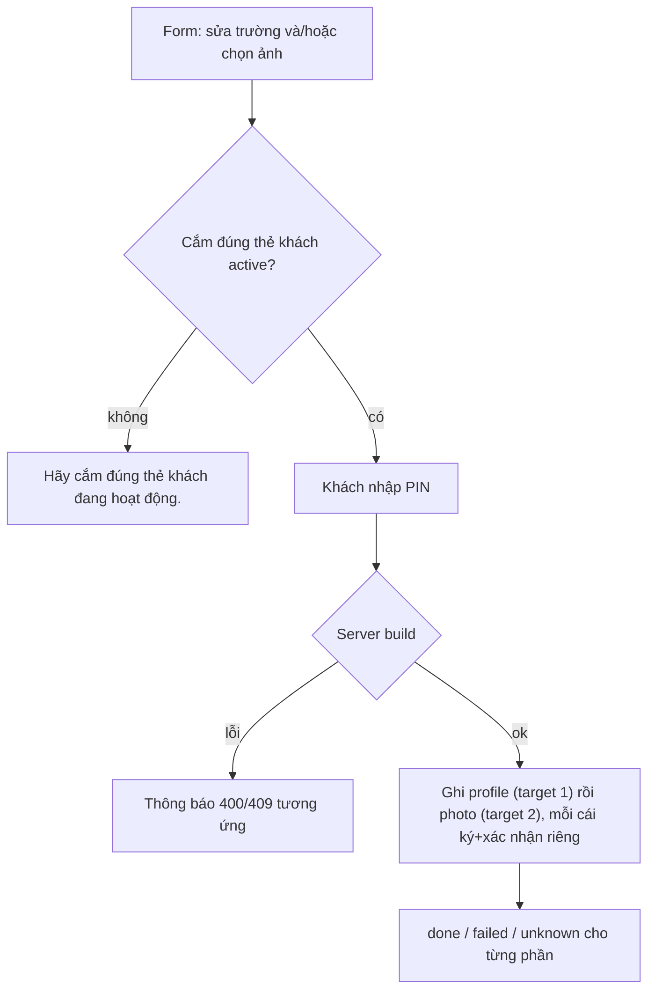

# 21. Sửa hồ sơ và ảnh trên thẻ

Hồ sơ (vùng dữ liệu target 1) và ảnh JPEG (target 2) nằm trên chip. Admin có `card-edit` sửa cho khách tại quầy (khách nhập PIN); khách cũng tự sửa **chỉ** số điện thoại và liên hệ khẩn cấp. Mỗi lần ghi dùng lệnh ký của server (`commit-write`) và chỉ cập nhật DB sau khi chip xác nhận.

## Mục đích

Kiểm tra ghi hồ sơ/ảnh lên chip đúng, DB (`customers`) chỉ cập nhật sau khi từng lệnh được xác nhận, và các giới hạn kích thước/định dạng.

## Ai thực hiện & quyền

| Vai trò | Thao tác | Quyền / yêu cầu |
|---|---|---|
| Admin | Form **"Sửa hồ sơ / ảnh trên thẻ"** ở chi tiết thẻ (chỉ thẻ khách `active`) | `card-edit` ("Sửa thẻ"); không cần step-up (chưa thấy `requireStepUp` trong `profileBuildPost`) |
| Khách tại quầy | Nhập PIN của đúng thẻ | PIN thẻ |
| Khách tự sửa | `/account/card` (chỉ `phone`, `emergencyName`, `emergencyPhone`) | Phiên khách; PIN, hộp "Nhập PIN để sửa hồ sơ" |

## Điều kiện trước

- [03](03-phat-hanh-the-khach-hang.md): khách A ở **slot 1**, thẻ `active`, khách biết PIN. Admin đăng nhập (slot 0) để mở chi tiết thẻ, nhưng khi ghi phải **cắm slot 1** (đúng thẻ đang xem).
- Một ảnh JPEG nhỏ để thử (ảnh phải mã hóa lại sao cho không quá 10 080 byte; trình duyệt tự nén qua `preparePhoto`).

## Sơ đồ luồng hoạt động

## Các bước test (happy path)

### A. Admin sửa hồ sơ và ảnh

1. Slot 1: `curl -X POST -H 'Origin: http://localhost:3002' -H 'Content-Type: application/json' -d '{"slot":1}' http://127.0.0.1:31999/v1/sim/slot`.
2. Admin: `/admin/card/list` > mở thẻ khách A > mục **"Sửa hồ sơ / ảnh trên thẻ"**. Các trường: "Họ tên" (bắt buộc, tối đa 60), "Ngày sinh", "Giới tính (male / female / other)", "Số điện thoại" (15), "Số giấy tờ" (20), "Liên hệ khẩn cấp" (60), "Số liên hệ khẩn cấp" (15), "Nhóm máu" (3), "Dị ứng" (120), và "Ảnh mới (không bắt buộc)" có xem trước.
3. Sửa ít nhất một trường (ví dụ "Dị ứng" = `Hải sản`) và/hoặc chọn ảnh. Chỉ trường **thay đổi so với giá trị ban đầu** mới được gửi.
4. Bấm **"Ghi hồ sơ / ảnh"**. Dòng trạng thái: "Đang ghi hồ sơ / ảnh; giữ nguyên thẻ khách…". Hộp PIN **"Khách nhập PIN để sửa hồ sơ / ảnh"**: khách nhập PIN.
5. Kết quả: "Hồ sơ: đã xác nhận. Ảnh: đã xác nhận. Tải lại dữ liệu server trước khi sửa tiếp. Kết quả chưa rõ cần đối chiếu và ghi lại từ hồ sơ chuẩn; không tự áp thay đổi." Nút **"Tải lại hồ sơ đã xác nhận"** hiện; nút ghi bị vô hiệu (không gửi lại form).
6. Phần không yêu cầu hiển thị "không yêu cầu"; có thể là "thẻ báo lỗi" hoặc "chưa rõ kết quả".

### B. Khách tự sửa (phone, liên hệ khẩn cấp)

7. Khách đăng nhập (slot 1), `/account/card`, sửa chỉ số điện thoại/liên hệ khẩn cấp; hộp PIN "Nhập PIN để sửa hồ sơ"; thành công ghi target 1. Lỗi ghi: "Chưa xác nhận ghi thẻ. Hồ sơ trên hệ thống chưa được cập nhật."

### C. Kiểm tra

8. Khách bấm "Đọc thẻ" (hộp "Nhập PIN để đọc thẻ"): thấy hồ sơ/ảnh mới. Admin tải lại chi tiết thẻ: Chủ thẻ/Email/Số điện thoại phản ánh dữ liệu mới.

## Kết quả mong đợi

- **Trên giao diện:** các thông báo ở bước 4-5; form khóa sau khi ghi xong.
- **Trên chip:** vùng hồ sơ (target 1, tối đa 448 byte) và ảnh (target 2, tối đa 10 080 byte) được ghi qua `BEGIN_WRITE`/`WRITE_CHUNK`/`COMMIT_WRITE`.
- **Trong dữ liệu:** `card-operations` `commit-write` (draft -> prepared -> done); `customers` cập nhật `fields`/`avatar` **chỉ khi op done**. Ảnh được tải lên Cloudinary (`secure_url` HTTPS) lúc build; lỗi: `PHOTO_UPLOAD` 502.
- **Trong Nhật ký thẻ:** `profile-build` (success, detail có `profileOpId`/`photoOpId`/`targets`), `card-op-sign`, `card-op-confirm`; thất bại: `profile-build` `fail` với `errorCode`. Khách: `customer-profile-build`.

## Ngoại lệ & trường hợp lỗi

| # | Tình huống | Cách tái hiện | Kết quả / thông báo mong đợi (exact text) |
|---|---|---|---|
| 1 | Cắm sai thẻ / slot trống | Slot khác hoặc thẻ NV | "Hãy cắm đúng thẻ khách đang hoạt động." |
| 2 | Agent không chạy | Tắt Agent | "Không kết nối được Card Agent" |
| 3 | Thẻ khóa / thu hồi / thẻ NV | Gọi API trực tiếp | 409 `CARD_STATE` "Chỉ sửa hồ sơ thẻ khách đang hoạt động." |
| 4 | Thiếu `card-edit` | Role không có quyền | Form không hiện; API 403 "Bạn không có quyền sử dụng tính năng này!" |
| 5 | Dữ liệu sai schema | Ngày sinh không đủ 8 số, giới tính khác male/female/other | 400 "Thông tin hồ sơ không hợp lệ." |
| 6 | Hồ sơ quá lớn | Nhập các trường rất dài (tổng > 448 byte UTF-8, tiếng Việt có dấu tốn nhiều byte) | 400 `INVALID_PROFILE` "Hồ sơ vượt giới hạn 448 byte hoặc chứa trường không hợp lệ." |
| 7 | Ảnh không hợp lệ/quá lớn | Chọn tệp không phải JPEG hoặc > 10 080 byte sau nén | 400 `INVALID_PHOTO` "Ảnh phải là JPEG hợp lệ và không quá 10 080 byte." |
| 8 | Tải ảnh lên Cloudinary lỗi | Thiếu cấu hình Cloudinary / mạng | 502 `PHOTO_UPLOAD` "Yêu cầu phát hành thẻ không hợp lệ hoặc đã kết thúc." (câu mặc định của server; không còn mã thô) |
| 9 | Chủ thẻ không còn hợp lệ | Khách bị xóa/khóa | 409 `OWNER_STATE` "Yêu cầu phát hành thẻ không hợp lệ hoặc đã kết thúc." (câu mặc định của server; không còn mã thô) |
| 10 | Sai PIN | PIN sai ở hộp PIN | "Sai mã PIN, còn N lần thử" (không hỏi lại trong hộp) |
| 11 | Hủy hộp PIN | Bấm "Huỷ" | "Đã hủy nhập PIN; thao tác chưa được thực hiện." (`PIN_CANCELLED`) hiện ở dòng trạng thái |
| 12 | Lỗi op/sign hoặc op/confirm | Op hết hạn 5 phút, chip trả SW lỗi | Admin UI hiển thị câu tiếng Việt, ví dụ `OP_STATE` -> "Thao tác đã hết hạn hoặc đã thay đổi trạng thái. Hãy tải lại trang và thử lại."; xem [91](91-bang-ma-loi.md) |
| 13 | Chỉ một phần thành công | Hồ sơ xong, ảnh lỗi | "Hồ sơ: đã xác nhận. Ảnh: chưa rõ kết quả. ..."; không gửi lại form, bấm "Tải lại hồ sơ đã xác nhận" |
| 14 | F5 / bấm đúp | Bấm "Ghi hồ sơ / ảnh" hai lần | Nút bị vô hiệu khi đang chạy (`busy`); sau khi xong nút bị khóa |
| 15 | Khách sửa trường ngoài phone/liên hệ khẩn cấp | Gọi API client với `fullName` | Không được hỗ trợ ở giao diện khách; (chưa xác minh phản hồi API) |

## Checklist

- [ ] Ghi hồ sơ: trên chip và `customers` cùng đổi sau khi op done.
- [ ] Ghi ảnh: ảnh mới hiện ở "Đọc thẻ", `avatar` cập nhật.
- [ ] Cắm sai thẻ bị chặn trước khi hỏi PIN.
- [ ] Ảnh/hồ sơ vượt giới hạn: đúng thông báo, DB không đổi.
- [ ] Chỉ một phần thành công: thông báo từng phần, nút tải lại.
- [ ] Khách tự sửa chỉ được phone và liên hệ khẩn cấp.

## Liên quan

[05](05-trang-the-cua-toi.md) | [17](17-danh-sach-chi-tiet-the.md) | [14](14-cap-lai-the.md) | [91](91-bang-ma-loi.md) | [92](92-han-che-va-xu-ly-su-co.md)
