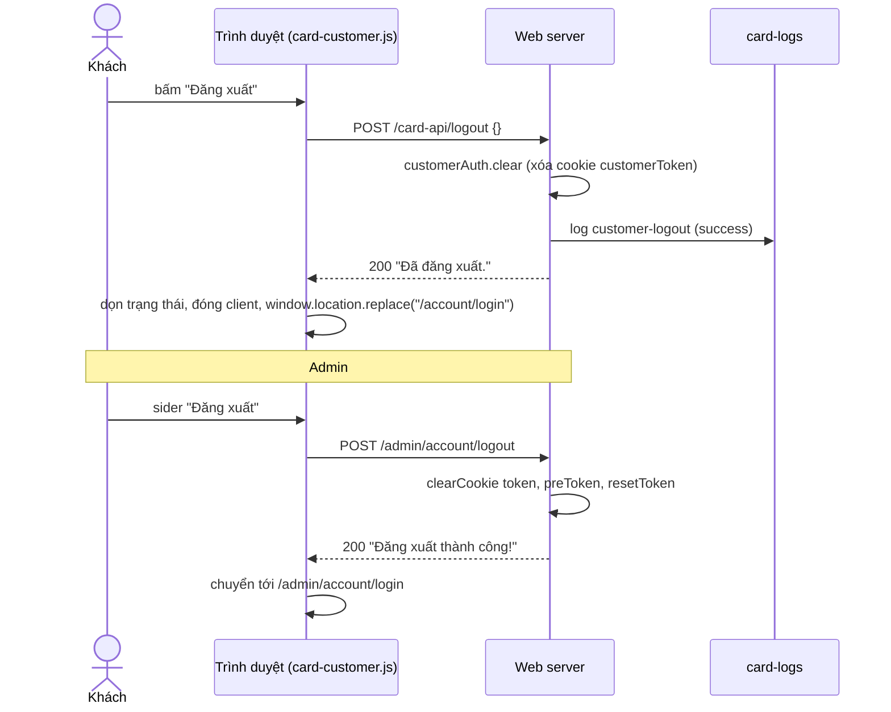
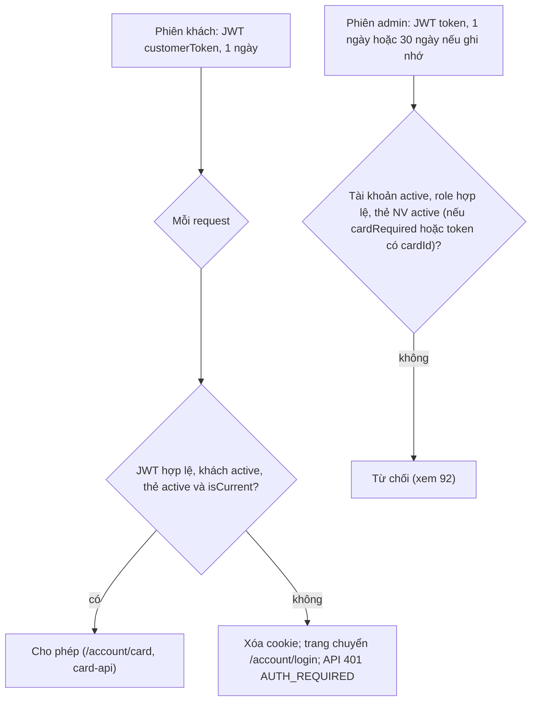

# 22. Đăng xuất và phiên thẻ

Cả khách lẫn admin dùng JWT lưu trong cookie `httpOnly`. Đăng xuất chỉ xóa cookie (token không có danh sách thu hồi phía server), nhưng token khách và token admin còn bị vô hiệu khi thẻ tương ứng không còn `active`/hiện hành.

## Mục đích

Kiểm tra đăng xuất đúng cho cả hai phía, hiệu lực và thời hạn phiên, và hành vi đồng bộ khi chưa đăng nhập.

## Ai thực hiện & quyền

- Khách: nút **"Đăng xuất"** (`data-card-logout`, ở header site khách khi có phiên thẻ). Không cần quyền.
- Admin: **"Đăng xuất"** ở cuối sidebar (`.inner-logout`). Không cần quyền, không cần step-up.

## Điều kiện trước

- Khách A đăng nhập thẻ ([04](04-khach-dang-nhap-bang-the.md)), slot 1; admin đăng nhập ([02](02-dang-nhap-admin-bang-the.md)), slot 0.
- Hai cửa sổ trình duyệt riêng (khách ở cửa sổ ẩn danh, host `localhost:3002`).

## Sơ đồ luồng hoạt động

## Các bước test (happy path)

### A. Khách

1. Slot 1, đăng nhập khách bằng thẻ, vào `/account/card`.
2. Bấm **"Đăng xuất"**: trang chuyển tới `http://localhost:3002/account/login`; header lại hiện "Đăng nhập bằng thẻ".
3. Vào lại `/account/card`: bị chuyển về `/account/login`. (API cần phiên: 401 `AUTH_REQUIRED`.)
4. Sau khi đăng xuất, cắm thẻ và mở trang chi tiết admin/đồng bộ: các bước `receipt`/`set-state` vẫn có thể chạy, nhưng bước `credit`/`delete-ticket`/`write-ticket` cần xác thực: `sync/next` trả `code: success`, `step: null`, `requiresAuth: true`, thông báo "Đăng nhập để đồng bộ dữ liệu thẻ."

### B. Admin

5. Admin bấm **"Đăng xuất"** ở sidebar: chuyển tới `/admin/account/login`; thông báo "Đăng xuất thành công!" (từ API).
6. Đăng nhập lại: cần mật khẩu rồi thẻ NV + PIN ([02](02-dang-nhap-admin-bang-the.md)). Step-up bị xóa cùng token (cần xác thực lại sau đăng nhập mới tạo).
7. Sau khi một thẻ NV được phát hành cho admin, mọi phiên cũ bằng mật khẩu bị yêu cầu đăng nhập lại bằng thẻ (xem [01](01-phat-hanh-the-nhan-vien.md), [92](92-han-che-va-xu-ly-su-co.md)).

### C. Hiệu lực phiên

8. Khách: thu hồi/khóa thẻ khách ([13](13-khoa-mo-khoa-thu-hoi-the.md)) khi khách còn đăng nhập: request kế tiếp bị chuyển về `/account/login` (cookie bị xóa) vì thẻ không còn `active`.
9. Thời hạn: token khách 1 ngày; token admin 1 ngày (30 ngày khi tích ghi nhớ mật khẩu); `preToken` (giữa bước mật khẩu và thẻ) 5 phút; step-up 5 phút; challenge đăng nhập có hạn ngắn (xem [91](91-bang-ma-loi.md)).

## Kết quả mong đợi

- **Trên giao diện:** như các bước; không còn nội dung `/account/card` sau đăng xuất.
- **Trên chip:** không đổi (đăng xuất không gửi APDU). PIN vẫn được xác minh lại ở mỗi thao tác nhạy cảm.
- **Trong dữ liệu:** không đổi bản ghi nào ngoài log.
- **Trong Nhật ký thẻ:** `customer-logout` (success, có `cardId`, `actorType: customer`). Đăng xuất admin không ghi log thẻ (chưa thấy trong mã).

## Ngoại lệ & trường hợp lỗi

| # | Tình huống | Cách tái hiện | Kết quả / thông báo mong đợi (exact text) |
|---|---|---|---|
| 1 | Đăng xuất khi hết phiên | Xóa cookie rồi bấm "Đăng xuất" | Request logout đi qua middleware khách; xử lý lỗi/chuyển trang (chưa xác minh chính xác phản hồi) |
| 2 | Quay lại bằng nút Back | Back sau đăng xuất | `Cache-Control: no-store`; trang bị tải lại và chuyển `/account/login` |
| 3 | Dùng lại cookie cũ | Sao chép cookie trước đăng xuất rồi dán lại | Token không bị thu hồi phía server: vẫn dùng được đến khi hết hạn hoặc thẻ mất hiệu lực (hạn chế; xem [92](92-han-che-va-xu-ly-su-co.md)) |
| 4 | Thẻ bị khóa/thu hồi/cấp lại | Admin thao tác khi khách đang đăng nhập | Phiên khách vô hiệu; về `/account/login` |
| 5 | Đồng bộ không đăng nhập | Bước credit/vé khi không có phiên hợp lệ | `requiresAuth: true`, "Đăng nhập để đồng bộ dữ liệu thẻ." |
| 6 | Token admin hết hạn | Sau 1 ngày (hoặc 30 ngày) | Chuyển về đăng nhập admin |
| 7 | `preToken` hết hạn (5 phút) | Chờ giữa bước mật khẩu và thẻ | Phải nhập lại mật khẩu |
| 8 | Step-up hết hạn (5 phút) | Chờ rồi thao tác nhạy cảm | 403 `step-up-required` "Hãy xác thực lại thẻ nhân viên trước khi thực hiện thao tác." |
| 9 | Mất mạng khi bấm "Đăng xuất" | Chặn request | Giao diện không chuyển trang (admin) hoặc báo lỗi thông thường (khách); cookie chưa bị xóa |
| 10 | Admin thiếu thẻ khi `cardRequired` | Token không có `cardId` | Trang admin: bị đăng xuất, chuyển về `/admin/account/login?notice=card-required` với "Tài khoản đã được yêu cầu đăng nhập bằng thẻ nhân viên. Vui lòng đăng nhập lại bằng mật khẩu và thẻ."; XHR/JSON: 403 `CARD_RELOGIN_REQUIRED` cùng câu đó (xem [91](91-bang-ma-loi.md)) |

## Checklist

- [ ] Khách đăng xuất: về `/account/login`, `/account/card` bị chặn.
- [ ] Admin đăng xuất: về `/admin/account/login`, đăng nhập lại cần thẻ + PIN.
- [ ] Log `customer-logout` có mặt.
- [ ] Đồng bộ khi chưa đăng nhập: `requiresAuth` + "Đăng nhập để đồng bộ dữ liệu thẻ."
- [ ] Khóa/thu hồi thẻ làm vô hiệu phiên khách ở request kế tiếp.
- [ ] Hiểu hạn chế: cookie cũ không bị thu hồi phía server.

## Liên quan

[02](02-dang-nhap-admin-bang-the.md) | [04](04-khach-dang-nhap-bang-the.md) | [13](13-khoa-mo-khoa-thu-hoi-the.md) | [92](92-han-che-va-xu-ly-su-co.md)
