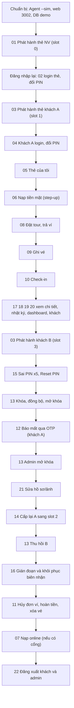

# 90. Kịch bản end-to-end (localhost:3002)

Một kịch bản liên tục đi qua mọi chức năng, theo đúng thứ tự phụ thuộc. Mỗi bước trỏ tới file chi tiết (nhãn, thông báo chính xác, ngoại lệ). Chạy bằng Card Agent `--sim`, web tại `http://localhost:3002` (luôn dùng `localhost`, không dùng `127.0.0.1`).

## Quy ước

- **Slot:** 0 = thẻ nhân viên (NV), 1 = khách A, 2 = thẻ cấp lại, 3 = khách B.
- **Đổi slot:** `curl -X POST -H 'Origin: http://localhost:3002' -H 'Content-Type: application/json' -d '{"slot":N}' http://127.0.0.1:31999/v1/sim/slot` (thay N).
- **Cửa sổ:** `ADMIN` = cửa sổ thường (`/admin`), `KHÁCH` = cửa sổ ẩn danh (site khách). Đừng dùng chung một hồ sơ trình duyệt (xem [92](92-han-che-va-xu-ly-su-co.md)).
- Ghi lại PIN ban đầu từng thẻ và PIN mới bạn đặt. Không restart Agent giữa chừng (chip ảo mất, xem [92](92-han-che-va-xu-ly-su-co.md)).
- Cột "Tick": đánh dấu `[x]` khi kết quả đúng.

## Sơ đồ tổng

## Các bước

| # | Chức năng | Cửa sổ / tài khoản | Slot | Thao tác | Kết quả mong đợi | File | Tick |
|---|---|---|---|---|---|---|---|
| 0 | Chuẩn bị | Terminal | - | Mở MongoDB (27019), Agent `--sim`, web 3002 | `http://localhost:3002` lên; `curl` đổi slot trả `{"slot":N}` | [00](00-tong-quan.md) | [ ] |
| 1 | Phát hành thẻ NV | ADMIN, đăng nhập mật khẩu (tài khoản admin demo) | 0 | `/admin/card/issue`, chọn chủ thẻ NV, hoàn tất phát hành; ghi PIN ban đầu | Thẻ NV `active`; PIN hiện một lần; `cardRequired = true` | [01](01-phat-hanh-the-nhan-vien.md) | [ ] |
| 2 | Hệ quả: phiên cũ bị từ chối | ADMIN | 0 | Tải lại trang `/admin/card/list` | Tự động bị đăng xuất và chuyển về `/admin/account/login?notice=card-required` với thông báo "Tài khoản đã được yêu cầu đăng nhập bằng thẻ nhân viên. Vui lòng đăng nhập lại bằng mật khẩu và thẻ."; đăng nhập lại bằng mật khẩu và thẻ | [92](92-han-che-va-xu-ly-su-co.md) | [ ] |
| 3 | Đăng nhập admin bằng thẻ | ADMIN | 0 | Mật khẩu, rồi "Đăng nhập bằng thẻ"; PIN ban đầu; đổi PIN: thử `111111` (yếu), nhập lại không khớp, rồi PIN hợp lệ | Báo yếu/không khớp ngay trong hộp; vào được `/admin/dashboard` | [02](02-dang-nhap-admin-bang-the.md) | [ ] |
| 4 | Phát hành thẻ khách A | ADMIN (NV) | 1 (khách A) | `/admin/card/issue` > chọn khách A (email đọc được) > phát hành; ghi PIN | Thẻ A `active`; email PIN; "Thẻ hoạt động" +1 | [03](03-phat-hanh-the-khach-hang.md) | [ ] |
| 5 | Khách A đăng nhập | KHÁCH | 1 | `/account/login` > "Đăng nhập bằng thẻ"; PIN ban đầu; đổi PIN (thử yếu/không khớp trong hộp) | Vào `/account/card`; thẻ hiện số dư 0 | [04](04-khach-dang-nhap-bang-the.md) | [ ] |
| 6 | Thẻ của tôi | KHÁCH | 1 | "Đọc thẻ" (hộp PIN); đổi PIN; sửa số điện thoại/liên hệ khẩn cấp | Dữ liệu từ chip khớp server; không báo lệch số dư | [05](05-trang-the-cua-toi.md), [21](21-sua-ho-so-anh-tren-the.md) | [ ] |
| 7 | Nạp tiền mặt 100.000 đ | ADMIN | 0 (step-up) rồi 1 | Chi tiết thẻ A > "Nạp tiền mặt" 100000; nếu step-up hết hạn: cắm slot 0, PIN; rồi cắm lại slot 1 và bấm lại | Số dư server và chip = 100.000; Tx credit `done` | [06](06-nap-tien-mat-tai-quay.md) | [ ] |
| 8 | Khách kiểm tra số dư | KHÁCH | 1 | Tải lại `/account/card`, "Đọc thẻ" | 100.000 đ trên chip và server | [05](05-trang-the-cua-toi.md) | [ ] |
| 9 | Đặt tour, trả bằng ví | KHÁCH | 1 | Đặt tour (đã sửa ngày khởi hành về hôm nay ở admin trước khi đặt), thanh toán ví thẻ; PIN "Nhập PIN để thanh toán" | Đơn đã thanh toán; debit `done`; số dư giảm đúng | [08](08-dat-tour-thanh-toan-vi-the.md) | [ ] |
| 10 | Ghi vé lên thẻ | KHÁCH | 1 | Đăng nhập lại / mở `/account/card` để đồng bộ | Vé `written` trên thẻ; "Đọc thẻ" thấy vé | [09](09-ghi-ve-len-the-dong-bo.md) | [ ] |
| 11 | Check-in | ADMIN | 1 | `/admin/card/checkin`; tra cứu; hộp "Khách nhập PIN thẻ để check-in" | Vé `used`; quét lại "Vé đã sử dụng" | [10](10-check-in-tour.md) | [ ] |
| 12 | Danh sách và chi tiết thẻ | ADMIN | - | `/admin/card/list` lọc, mở chi tiết A | Có Tx credit/debit, vé, 50 nhật ký | [17](17-danh-sach-chi-tiet-the.md) | [ ] |
| 13 | Quản lý khách hàng | ADMIN | - | `/admin/user/list` tìm khách A | Badge "Hoạt động" | [20](20-quan-ly-khach-hang.md) | [ ] |
| 14 | Dashboard | ADMIN | - | `/admin/dashboard` | "Thẻ hoạt động", doanh thu ví tháng này, bảng check-in có tour vừa dùng | [19](19-thong-ke-dashboard.md) | [ ] |
| 15 | Nhật ký thẻ | ADMIN | - | `/admin/card/log` lọc theo mã thẻ A; action `issue`, `customer-login`, `checkin-use` | Có log, PIN hiện "[Đã ẩn]" | [18](18-nhat-ky-the.md) | [ ] |
| 16 | Phát hành thẻ khách B | ADMIN | 3 (khách B) | Như bước 4 cho khách B | Thẻ B `active` | [03](03-phat-hanh-the-khach-hang.md) | [ ] |
| 17 | Sai PIN 5 lần, khóa PIN | KHÁCH (B) | 3 | "Đăng nhập bằng thẻ", nhập sai 5 lần, lần 6 | "Sai mã PIN, còn 4 lần thử" ... "còn 0 lần thử"; rồi "PIN đã bị khoá" | [15](15-sai-pin-khoa-pin-reset-pin.md) | [ ] |
| 18 | Admin reset PIN thẻ B | ADMIN | 3 (+0 nếu step-up) | Chi tiết thẻ B > "Reset PIN"; step-up nếu cần, cắm lại slot 3 | Hộp "PIN mới (chỉ hiển thị lần này)"; email "Reset PIN thẻ thành viên" | [15](15-sai-pin-khoa-pin-reset-pin.md) | [ ] |
| 19 | B đăng nhập bằng PIN mới | KHÁCH (B) | 3 | PIN do admin cấp, rồi đổi PIN | Vào được; PIN cũ không còn dùng | [15](15-sai-pin-khoa-pin-reset-pin.md) | [ ] |
| 20 | Admin khóa thẻ B | ADMIN | 3 | Chi tiết B > "Lý do" > Khóa; "Đồng bộ ngay" | Server "Đã khóa"; chip state 0x03; khách B không đăng nhập được | [13](13-khoa-mo-khoa-thu-hoi-the.md) | [ ] |
| 21 | Mở khóa thẻ B | ADMIN | 3 | Mở khóa; đồng bộ | Về "Đang hoạt động", chip 0x02 | [13](13-khoa-mo-khoa-thu-hoi-the.md) | [ ] |
| 22 | Khách A báo mất qua OTP | KHÁCH (A) | 1 | `/account/card-lock` (báo mất) nhập email, OTP | Thẻ A "Đã khóa" | [12](12-khach-bao-mat-the-otp.md) | [ ] |
| 23 | Admin mở khóa A | ADMIN | 1 | Chi tiết A > Mở khóa; đồng bộ | A `active` | [13](13-khoa-mo-khoa-thu-hoi-the.md) | [ ] |
| 24 | Sửa hồ sơ và ảnh | ADMIN + khách A nhập PIN | 1 | Chi tiết A > "Sửa hồ sơ / ảnh trên thẻ" > "Ghi hồ sơ / ảnh" | "Hồ sơ: đã xác nhận. Ảnh: đã xác nhận. ..." | [21](21-sua-ho-so-anh-tren-the.md) | [ ] |
| 25 | Cấp lại thẻ A sang slot 2 | ADMIN | 1 rồi 2 (thẻ trắng) | Chi tiết A > "Cấp lại thẻ" (lý do); step-up; phát hành thẻ mới trên slot 2 | Thẻ A cũ "Đã thu hồi" (`replaced`); thẻ mới `active`, số dư và vé chuyển | [14](14-cap-lai-the.md) | [ ] |
| 26 | Thu hồi thẻ B | ADMIN | 3 | Chi tiết B > Thu hồi (lý do, step-up; hoàn tiền nếu còn dư); đồng bộ | B "Đã thu hồi"; chip 0x7F; "Thẻ bị khoá / thu hồi" tăng; B biến mất ở "hiện hành" | [13](13-khoa-mo-khoa-thu-hoi-the.md), [20](20-quan-ly-khach-hang.md) | [ ] |
| 27 | Gián đoạn thanh toán, khôi phục | KHÁCH (A, thẻ mới) | 2 | Trả đơn mới bằng ví; chặn `op/confirm` sau khi chip trừ tiền; đăng nhập lại | "Chưa xác nhận thanh toán..." rồi "Đã xác minh biên nhận."; Tx `done` | [16](16-dong-bo-doi-soat-bien-nhan.md) | [ ] |
| 28 | Hủy đơn ví thẻ, hoàn tiền, xóa vé | ADMIN rồi KHÁCH (A) | 2 | Ghi lại số dư, `totalSpent`, tồn kho. ADMIN: `/admin/order/edit/<id>` của đơn ví ở bước 27 (chưa check-in), "Trạng thái" = Hủy, "Cập nhật", đồng ý hộp xác nhận. KHÁCH: cắm slot 2, đăng nhập thẻ/đồng bộ | "Đã huỷ đơn và hoàn ... đ vào ví thẻ. Tiền sẽ được ghi lên thẻ ở lần cắm thẻ tiếp theo."; Tx `credit` `refund` `pending-card`; `totalSpent` giảm; vé `pending-delete`; sau sync: số dư chip tăng đúng số tiền hoàn, Tx `done`, vé `deleted`, lịch sử ghi "Hoàn tiền"; log `card-refund` | [11](11-huy-don-xoa-ve.md) | [ ] |
| 28b | Hủy bị chặn vì vé đã check-in | ADMIN | - | Mở đơn ví ở bước 9 (vé đã check-in ở bước 11), "Trạng thái" = Hủy, "Cập nhật" | "Đơn có vé đã check-in, không thể huỷ và hoàn tiền tự động. Vui lòng xử lý thủ công." Không có gì thay đổi | [11](11-huy-don-xoa-ve.md) | [ ] |
| 29 | Nạp online (nếu có cổng) | KHÁCH | 2 | Nạp VNPay/ZaloPay | Cần cấu hình cổng/DOMAIN_WEBSITE công khai; nếu không, bỏ qua | [07](07-nap-online-vnpay-zalopay.md) | [ ] |
| 30 | Kiểm tra lại dashboard và nhật ký | ADMIN | - | Mở lại `/admin/dashboard` và `/admin/card/log` | Số liệu và log phản ánh các bước 17-28 (`reset-pin`, `card-op-*`, `card-receipt-recovery` nếu có) | [18](18-nhat-ky-the.md), [19](19-thong-ke-dashboard.md) | [ ] |
| 31 | Đăng xuất khách | KHÁCH | - | "Đăng xuất" | Về `/account/login`; `customer-logout` | [22](22-dang-xuat-phien-the.md) | [ ] |
| 32 | Đăng xuất admin | ADMIN | - | Sidebar "Đăng xuất" | Về `/admin/account/login` | [22](22-dang-xuat-phien-the.md) | [ ] |

## Đối chiếu với `smartcard/README.md`

README gốc có bảng nghiệm thu 16 dòng. Dòng "hủy đơn có vé written chuyển pending-delete" nay làm được qua giao diện với đơn ví thẻ (bước 28, kèm hoàn tiền tự động; xem [11](11-huy-don-xoa-ve.md)); dòng nạp online cần cổng ([07](07-nap-online-vnpay-zalopay.md)). README gốc ghi cổng 3000, môi trường này là **3002**.

## Liên quan

[README](README.md) | [91](91-bang-ma-loi.md) | [92](92-han-che-va-xu-ly-su-co.md)
